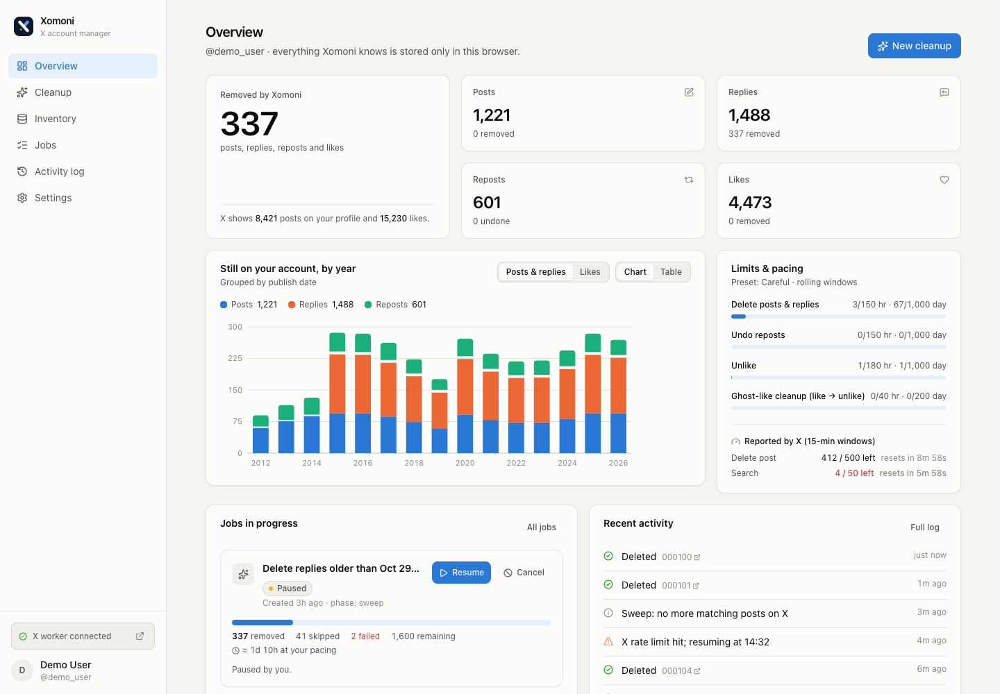

<div dir="rtl">

**آخرین نسخه: [0.5.3](https://github.com/pirdehi/xomoni/releases/tag/v0.5.3)، ۲۰۲۶-۱۱-۲۳.** Xomoni در مجموع ۴۴ قابلیت دارد (فهرستشان بالاتر آمده) که ۷ تا از آن‌ها بعد از 0.5.3 اضافه شده‌اند. سایت xomoni.com هر تغییر را به محض merge شدن دارد و افزونه آن را با نسخه‌ی بعدی می‌گیرد.
<div align="center">


# Xomoni

**مدیریت ردپای دیجیتال (Digital footprint manager).** ردپای دیجیتال خودتان را مدیریت کنید، از X شروع کنید: پست‌ها، ریپلای‌ها، ریپوست‌ها و لایک‌های قدیمی خودتان را از یک داشبورد روی کامپیوتر خودتان مرور و حذف کنید. بدون کلید API و هماهنگ با محدودیت‌های X.

[English](README.md) · [نقشه‌ی راه](docs/ROADMAP.md) · [معماری](docs/ARCHITECTURE.md) · [تحقیق کامل](docs/RESEARCH.md) · [گزارش مشکل](https://github.com/pirdehi/xomoni/issues)



</div>

---

## چرا Xomoni؟

پاک کردن پست‌های چندساله در X ساده نیست:

- **API رسمی برای این کار گران و کند است.** پرداخت به ازای مصرف است، و حذف پست با آن به ۵۰ درخواست در هر ۱۵ دقیقه محدود است.
- **اسکریپت‌هایی که مستقیم به API داخلی X درخواست می‌فرستند مدام از کار می‌افتند.** X برای درخواست‌های بیشتر و بیشتری یک هدر امضاشده‌ی یک‌بارمصرف ضدربات (`x-client-transaction-id`) را اجباری کرده است.
- **اسکریپت‌های کنسول باعث پرچم خوردن حساب می‌شوند.** محدودیت‌های X را نادیده می‌گیرند و حتی بعد از هشدار X هم ادامه می‌دهند.

Xomoni راه دیگری می‌رود. یک افزونه‌ی Chrome است که **داخل تب X خود شما** که در آن وارد حساب شده‌اید کار می‌کند و روی همان دکمه‌هایی کلیک می‌کند که شما می‌زنید. هر درخواست را خود وب‌اپ X با همه‌ی هدرهایش می‌فرستد. Xomoni فقط پاسخ X را **می‌خواند**: برای تأیید هر عمل، و برای دیدن سهمیه‌ای که X در پاسخ اعلام می‌کند.

## قابلیت‌ها

<!-- BEGIN GENERATED: features (npm run readme) -->

### در افزونه

- **پاک‌سازی گروهی بر اساس تاریخ:** حذف پست، ریپلای، ریپوست یا لایک‌های قدیمی‌تر از یک تاریخ، یا بین دو تاریخ.
- **قوانین نگه‌داری:** پست‌هایی با حداقل N لایک، پست‌هایی با کلمات کلیدی مشخص، لینک‌هایی که خودتان وارد می‌کنید، و ریپلای‌های داخل رشته‌های خودتان حذف نمی‌شوند.
- **پیش‌نمایش پیش از اجرا:** فهرست دقیق موارد، زمان تخمینی با سرعت انتخابی شما، دانلود پشتیبان JSON، و تأیید با تایپ `DELETE`. پیش از اولین کار هر حساب X، Xomoni ریسک‌ها را نشان می‌دهد و از شما می‌خواهد `I UNDERSTAND` را تایپ کنید.
- **عبور از سقف حدود ۳,۲۰۰ پست پروفایل:** با جستجوی X (`from:you until:date`) و وارد کردن آرشیو رسمی X.
- **حداکثر یک‌پنجم محدودیت‌های X:** Xomoni هرگز بیش از یک‌پنجم هیچ سقفی را که X اعلام کرده مصرف نمی‌کند، با حساب تازه کندتر شروع می‌کند، بین نوبت‌های کار استراحت می‌کند، فقط در ساعات فعال کار می‌کند و با اولین هشدار X دست نگه می‌دارد. تنظیم دستی می‌تواند کندتر باشد، هرگز سریع‌تر.
- **فقط روی چیزی که تأیید شود:** Xomoni پیش از حذف بررسی می‌کند که پست مال خود شماست و هنوز با قانون جور است، و فقط وقتی آن را حذف‌شده می‌شمارد که پاسخ X تأییدش کند. یک بررسی بعد از اولین حذف هر کار و بررسی‌های نمونه‌ای بعدی نشان می‌دهند اگر X بی‌صدا حذف‌ها را نادیده بگیرد.
- **کمک برای ورود و تأیید دومرحله‌ای (2FA):** هر وقت X به شما نیاز داشته باشد (ورود، کد 2FA، کپچا، کد ایمیل، باز کردن قفل حساب یا حساب اشتباه)، کار متوقف می‌شود و اعلان دسکتاپ می‌گیرید. شما مرحله را در پنجره‌ی X کامل می‌کنید و کار خودکار ادامه پیدا می‌کند. Xomoni هرگز رمز عبور شما را نمی‌خواهد و ذخیره نمی‌کند.
- **کارهای قابل ادامه:** می‌توانید کار را متوقف کنید، مرورگر را ببندید و بعداً بدون از دست رفتن پیشرفت ادامه دهید.
- **ادامه‌ی کار وقتی سرتان جای دیگری گرم است:** *Keep going while away* صفحه‌نمایش را روشن نگه می‌دارد و پنجره‌ی X را اگر پوشیده شده باشد جلو می‌آورد، و *Run hidden* تب X را با داشبورد به اشتراک می‌گذارد تا کار با پنجره‌ی X کوچک‌شده هم ادامه پیدا کند. از تب اشتراکی هیچ چیز ضبط یا فرستاده نمی‌شود.
- **آرشیو X، درخواست و وارد کردنش:** *Get my archive* آرشیو شما را روی صفحه‌ی خود X درخواست می‌کند و وقتی X آماده‌اش کرد دانلودش می‌کند. فایل ZIP همان‌طور که هست وارد می‌شود، از پوشه‌ی Downloads › Xomoni یا با رها کردنش روی Library، و فقط `account.js`، `tweets.js` و `like.js` خوانده می‌شوند.
- **نسخه‌ی شما در Library:** نشان می‌دهد Xomoni چه مقدار از حساب شما را دارد و از کجا آمده، و می‌شود در آن جستجو کرد. *Complete my copy* پست‌ها، ریپلای‌ها، لایک‌ها و کل تاریخچه را در یک job از X می‌خواند.
- **گاوصندوق: فایل‌های خود X، روی رایانه‌ی شما** *(نسخه‌ی بعد)*: صفحه‌ی *Vault* آرشیو X و خروجی آمارش را، رها شده یا انتخاب شده، می‌گیرد، پیش از هر نوشتنی می‌گوید چه چیزی را شناخت، و دفتری از هر واردات و خط زمانی حساب شما نگه می‌دارد. یادآوری، حداکثر روزی یک بار، می‌گوید کِی یک فایل نسخه‌ی تازه می‌خواهد. هیچ چیز از رایانه‌ی شما بیرون نمی‌رود و هیچ کاری روی X انجام نمی‌شود.
- **خروجی گاوصندوق، خواندنی بدون Xomoni** *(نسخه‌ی بعد)*: یک ZIP از گاوصندوق شما که نگهش می‌دارید: CSV برای صفحه‌گسترده (بدون سلولی که صفحه‌گسترده اجرایش کند)، JSON برای ابزارهای دیگر، صفحه‌ای که هر مرورگری باز می‌کند، یک README و یک schema. واژه‌های دیگران فقط وقتی خودتان تیک بزنید. روی رایانه‌ی شما ساخته می‌شود، هرگز جایی فرستاده نمی‌شود و در همه‌ی پلن‌ها رایگان است.
- **آرشیو یک بازه‌ی زمانی:** تاریخ‌ها را انتخاب کنید، Xomoni آن بازه را از X می‌خواند (فقط خواندن، با همان سرعت محتاطانه) و پست‌ها، ریپلای‌ها و ریپوست‌های آن بازه را به‌صورت یک صفحه‌ی قابل باز شدن در هر مرورگر یا JSON به شما می‌دهد. فایل فقط روی کامپیوتر خودتان ذخیره می‌شود. آرشیو رسمی X همچنان نسخه‌ی کامل، همراه با عکس و ویدیو، است.
- **دنبال کردن جستجوی X (Watch):** تا پنج عبارت یا #هشتگ را در جستجوی X دنبال کنید. Xomoni هر کدام را تقریباً دقیقه‌ای یک بار، در چارچوب سقف خواندن، بررسی می‌کند و ۱۰ پست تازه را با لینک به X نشان می‌دهد. فقط می‌خواند: هیچ چیزی لایک، ریپلای یا پست نمی‌شود.
- **دیدن آنچه درباره‌ی شما گفته می‌شود:** دو جستجوی آماده‌ی Watch برای حساب خودتان، «اشاره به شما» و «ریپلای به شما»، که تا روشنشان نکنید خاموش‌اند. پستی از حسابی که در ۳۰ روز گذشته ساخته شده با سن حساب علامت می‌خورد، از پاسخ جستجوی خود X، و دکمه‌ی Xomoni در نوار ابزار تعداد آن‌هایی را که ندیده‌اید نشان می‌دهد. فقط می‌خواند و چیزی از رایانه‌تان بیرون نمی‌رود.
- **داشبورد:** صفحه‌ی *Home* می‌گوید چه کاری در جریان است و X چه می‌خواهد، همراه با همان یک دکمه‌ای که کار را جلو می‌برد؛ صفحه‌ی *Activity* پیشرفت هر کار، زمان باقی‌مانده و لاگی خوانا را نشان می‌دهد که می‌شود از آن خروجی CSV یا JSON گرفت؛ به‌علاوه‌ی آمار حذف و نمودار سالانه. حالت روشن و تاریک دارد.
- **آمار روزانه:** برای هر حساب X در هر روز یک ردیف، فقط در همین مرورگر: دنبال‌کننده‌ها، دنبال‌شده‌ها، پست‌ها و لایک‌ها، آنچه منتشر یا حذف کرده‌اید، و تخمینی از واکنش‌ها به پست‌هایتان. فقط صفحه‌هایی حساب می‌شوند که X خودش نشان داده؛ هیچ درخواست تازه‌ای به X فرستاده نمی‌شود.
- **دیده‌شدن** *(پیش‌نمایش)*: اینکه X می‌گوید هر پست شما چند بار دیده شد، از عددهای خود X، در برابر حد معمول شما: میانه‌ی پست‌های هم‌نوع شما در ۸ هفته‌ی پیش از آن. پستی که هنوز در حال رشد است مقایسه نمی‌شود و هیچ چیزی حدس زده نمی‌شود. مقایسه‌ی پست‌های با و بی لینک، با عکس یا ویدیو، و با Premium، هر کدام با یکی از پنج واژه‌ی ثابت، اندازه، بازه‌ی ۹۵٪ و آنچه می‌تواند گمراه کند، و دیده‌شدن معمول شما بر حسب روز و ساعت. برچسب‌های X ماه به ماه از گزارش *Under the hood* آن، و پست‌هایی که شاید یکی گرفته باشند، همیشه با نشان حدس. ۳۰ روز آخر رایگان است؛ بازه‌های بلندتر و مقایسه‌ها بخشی از Plus است که به‌صورت پیش‌نمایش باز است. Xomoni هرگز برای سنجیدن دیده‌شدن در X جستجو نمی‌کند و چیزی از رایانه‌تان بیرون نمی‌رود.
- **خروج از Xomoni:** یک پنجره نام حساب را می‌آورد و می‌گوید چه می‌شود: کار در حال اجرا متوقف می‌شود، پنجره‌ی X بسته می‌شود و دیگر چیزی ثبت نمی‌شود. می‌توانید داده‌های آن حساب را هم، با دانلود یک نسخه پیش از آن، از این مرورگر پاک کنید و روی صفحه‌ی خود X از X هم خارج شوید.
- **انتقال داده‌ها به یک Xomoni تازه:** *Export everything* یک فایل در Downloads ذخیره می‌کند که حساب‌ها، نسخه‌ی شما، کارها، لاگ و تنظیمات را دارد؛ *Import from a file* در Xomoni تازه اول کل فایل را بررسی می‌کند و بعد آن را به داده‌های موجود اضافه می‌کند. فایل هرگز از کامپیوتر شما بیرون نمی‌رود.
- **به‌روزرسانی با یک کلیک** *(پیش‌نمایش)*: اگر Xomoni را از zip نصب کرده باشید، نسخه‌ی تازه را از GitHub دانلود می‌کند، امضا و تک‌تک فایل‌هایش را بررسی می‌کند و آن را در پوشه‌ی خودش می‌نویسد، هیچ‌وقت وسط یک کار. داده‌هایتان سر جایش می‌ماند. وقتی نگه‌دارنده‌ی پروژه کلید امضا را راه بیندازد فعال می‌شود؛ تا آن وقت، به‌روزرسانی دستی است.

### افزونه همراه با xomoni.com

- **حریم خصوصی:** بدون ردیابی؛ پست‌ها، لایک‌ها و نسخه‌ی شما فقط در IndexedDB مرورگرتان می‌ماند. اگر وارد xomoni.com شوید، فقط وضعیت کارها (عنوان، وضعیت و شمارنده‌ها) آنجا فرستاده می‌شود، و شمارنده‌های روزانه هم فقط اگر خودتان روشنشان کنید. متن پست، لایک یا شناسه‌ی پست هرگز به سروری نمی‌رسد.
- **یک ورود برای هر دو:** در xomoni.com وارد شوید تا Xomoni در همان مرورگر خودش وارد شود، بدون تایپ هیچ کدی؛ از هر طرف خارج شوید، طرف دیگر هم خارج می‌شود. داشتن حساب همچنان اختیاری است.
- **کارهای شما، زنده در xomoni.com:** پیشرفت هر کار را از هر دستگاهی روی داشبورد xomoni.com دنبال کنید. فقط وضعیت کار فرستاده می‌شود، و اگر روشنشان کنید، عددهای روزانه‌تان.
- **توقف و لغو از xomoni.com:** کارت هر کار در xomoni.com می‌تواند کار همان مرورگر را فوراً متوقف یا لغو کند و صفحه‌های Xomoni را باز کند. *Resume* اول در خود Xomoni از شما می‌پرسد: سایت هیچ‌وقت کاری را روی X شروع یا از سر نمی‌گیرد.
- **برنامه‌ریزی پاک‌سازی در xomoni.com:** همان سه سؤال Xomoni، همراه با تعداد مواردی که برنامه شامل می‌شود و تعداد روزهایی که طول می‌کشد. *Review and start in Xomoni* صفحه‌ی Cleanup را در Xomoni با همین برنامه باز می‌کند، و تا آنجا تأیید نکنید هیچ چیز شروع نمی‌شود.
- **Library، Watch و سلامت حساب در xomoni.com:** پست‌ها، ریپلای‌ها، ریپوست‌ها و لایک‌هایتان همراه با جستجو، هر جستجوی Watch، و سلامت و سرعت هر حساب X؛ همه از Xomoni در همان مرورگر خوانده می‌شوند و فقط تا وقتی صفحه باز است نگه داشته می‌شوند.
- **تنظیمات از xomoni.com:** ساعات فعال Xomoni، تعداد شکست پشت‌سرهم پیش از توقف، اعلان‌ها و جستجوهای Watch را عوض کنید، یا سرعت را به Careful برگردانید. Xomoni قوانین خودش را اعمال می‌کند، پس هیچ چیز سریع‌تر از Careful نمی‌شود.
- **کامنت‌ها در xomoni.com:** ریپلای‌هایتان را بر اساس تاریخ، لایک، کسی که به او جواب داده‌اید و کلمات پیدا کنید، ببینید بیشتر به چه کسی جواب می‌دهید، و موارد انتخابی را برای بررسی به صفحه‌ی Cleanup در Xomoni بفرستید. بخش *Replies to you* تعداد ریپلای‌هایی را که هر روز گرفته‌اید نشان می‌دهد؛ Xomoni آن‌ها را فقط روی کامپیوتر شما و تا ۹۰ روز نگه می‌دارد.
- **نمایش آمار در xomoni.com:** کلیدی که تا خودتان روشنش نکنید خاموش است و شمارنده‌های هر روز را (فقط عدد، بدون متن یا شناسه) برای ۴۰۰ روز اخیر می‌فرستد. با خاموش کردنش همه‌ی روزهایی که فرستاده شده پاک می‌شوند.
- **خبر نسخه‌های تازه:** مرورگری که به xomoni.com وصل است خبر می‌دهد که نسخه‌ی تازه‌ای از Xomoni آمده و آیا مشکل امنیتی‌ای را رفع می‌کند.
- **نصب از Chrome Web Store و Edge Add-ons** *(پیش‌نمایش)*: وقتی Xomoni در فروشگاه‌ها منتشر شود، صفحه‌ی xomoni.com/install برای مرورگر شما یک دکمه نشان می‌دهد، نسخه‌ی zip قدم‌های رفتن به نسخه‌ی فروشگاه را نشان می‌دهد، و xomoni.com افزونه را با شناسه‌ی ثابت فروشگاه‌ها پیدا می‌کند.
- **فهرستی که خودش تیک می‌خورد:** Xomoni بعد از نصب صفحه‌ی xomoni.com/welcome را باز می‌کند و سه قدم از روی آنچه صفحه می‌بیند تیک می‌خورند: نصب Xomoni، ورود به xomoni.com، و ورود Xomoni با حساب شما. اگر از صفحه‌ای ثبت‌نام کنید که از شما خواسته بود، به همان صفحه برمی‌گردید.

### در xomoni.com

- **گاوصندوق شما روی xomoni.com:** کنار Library، آنچه گاوصندوق شما در Xomoni دارد: هر فایل X با میزان تازگی و آنچه در آن است، که فقط به‌صورت شمارش و تاریخ در مرورگر شما خوانده می‌شود، و *Open the vault in Xomoni*. هیچ چیز از آن به سرورهای ما نمی‌رسد.
- **دیده‌شدن روی xomoni.com** *(پیش‌نمایش)*: *Reach* در داشبورد همان چیزی را نشان می‌دهد که صفحه‌ی Reach در Xomoni نشان می‌دهد و در مرورگر شما خوانده می‌شود: مقایسه‌ها با همان پنج واژه، پست‌های شما صدتا صدتا با بازدید و سهمشان از حد معمول، بر حسب بازه و ترتیب، برچسب‌های X ماه به ماه، و پست‌های مظنون، هر کدام در کادری که می‌گوید حدس است. پست‌های نمایش‌داده را می‌توان به‌صورت CSV ساخته‌شده در مرورگر ذخیره کرد. هیچ چیز از آن به سرورهای ما نمی‌رسد و هیچ چیز در آن به پاک‌سازی نمی‌انجامد. بخشی از Plus که به‌صورت پیش‌نمایش باز است.
- **تأیید دومرحله‌ای:** در بخش حساب با یک اپ احراز هویت روشنش کنید؛ از آن به بعد هر ورود به xomoni.com پیش از باز شدن هر صفحه‌ی خصوصی، کد ۶ رقمی اپ را می‌خواهد. سرور وب‌سایت و پایگاه داده هر دو آن را بررسی می‌کنند، پس رمز عبور یا نشستِ کپی‌شده به‌تنهایی چیزی را نمی‌خواند و تغییر نمی‌دهد. تغییر ایمیل یا رمز، یا بازنشانی رمز با ایمیل هم کد می‌خواهد، و هر اپی که اضافه یا حذف شود به ایمیل شما خبر داده می‌شود.
- **داشبورد در xomoni.com:** بخش‌های Overview، Audience، Content، Engagement، Reports، Library، Comments، Cleanup، Watch، Activity، Account health، Browsers و Settings، هر کدام با نشانی خودش و با انتخاب حساب و بازه‌ی زمانی. روی کامپیوتر نوار کناری دارد و روی گوشی نوار پایین.
- **Overview، Audience، Content و Engagement:** دنبال‌کننده‌ها، آنچه منتشر کرده‌اید و واکنش‌هایی که گرفته، هر کدام در مقایسه با دوره‌ی قبل، در نمودارهایی که با ماوس و صفحه‌کلید جواب می‌دهند و نمای جدولی دارند. واکنش‌ها به‌عنوان تخمین علامت خورده‌اند.
- **گزارش‌ها و ایمیل هفتگی:** گزارش هفتگی، ماهانه و مرور سال، آنچه Xomoni حذف کرده، و گزارش دلخواه خودتان، به‌صورت CSV یا PDF. اگر بخواهید، هر دوشنبه ایمیلی آمار هفته‌ی گذشته را با هفته‌ی قبلش مقایسه می‌کند؛ با یک لینک هم قطع می‌شود.
- **ایمیل وقتی X به حسابتان هشدار می‌دهد:** اگر در تنظیمات بخواهید، وقتی X به یکی از حساب‌های X شما هشدار بدهد و Xomoni آنجا متوقف شود، یک ایمیل می‌گیرید: فقط ‎@handle و اینکه Xomoni کی می‌تواند ادامه بدهد، نه چیزی که X نشان داده یا شما نوشته‌اید. حداکثر هر شش ساعت یکی؛ با یک لینک هم قطع می‌شود.
- **راهنمای نصبی که همراهتان می‌آید:** صفحه‌ی xomoni.com/install قدم‌ها را برای مرورگر و سیستم‌عامل شما، یکی‌یکی و با تصویرهای کوتاه، نشان می‌دهد، به محض نصب Xomoni تیک می‌خورد و به مشکلات رایج نصب جواب می‌دهد.
- **فرستادن به کامپیوتر:** Xomoni روی کامپیوتر کار می‌کند، پس xomoni.com روی گوشی پیشنهاد می‌کند لینک نصب را به اشتراک بگذارید، کپی کنید یا برای خودتان ایمیل کنید. چیزی به لینک اضافه یا به سرورهای Xomoni فرستاده نمی‌شود.
- **xomoni.com روی گوشی:** منویی با *How it works*، *Safety*، *Privacy*، *Install* و *GitHub* که با صفحه‌کلید هم کار می‌کند، و یک پانویس کامل در همه‌ی صفحه‌ها.
- **پله‌ها و صورت‌حساب** *(پیش‌نمایش)*: صفحه‌ی xomoni.com/pricing پله‌های Free، Plus و Pro و «۳۰ روز Plus» یک‌باره را نشان می‌دهد، و آنچه در هر پله رایگان می‌ماند: همه‌ی محدودیت‌های ایمنی و داده‌های شما. پرداخت را Polar، فروشنده‌ی رسمی، می‌گیرد؛ صفحه‌ی /account/billing پله‌ی شما را نشان می‌دهد، پورتال Polar را باز می‌کند و پله را دوباره می‌پرسد. تا فروش باز نشده، همه‌ی بخش‌های Plus پیش‌نمایش‌اند و چیزی خریدنی نیست.
- **شرایط فروش و سیاست بازپرداخت** *(پیش‌نمایش)*: شرایط پله‌های پولی که در راه‌اند، با فروش از طریق Polar به‌عنوان فروشنده‌ی رسمی، و سیاست بازپرداخت ۱۴ روزه، و نام Polar در صفحه‌ی حریم خصوصی. این‌ها پیش‌نویس‌اند و منتظر تأیید نگه‌دارنده‌ی پروژه: xomoni.com فقط پس از تأیید نشانشان می‌دهد، و هیچ وعده‌ای درباره‌ی نتیجه روی X نمی‌دهند.

*(نسخه‌ی بعد)*: روی `main` است و با نسخه‌ی بعدی به Xomoni می‌رسد؛ بخش مربوط به xomoni.com از همین حالا روی سایت است. *(پیش‌نمایش)*: ساخته شده، ولی منتظر چیزی بیرون از کد است؛ مثلاً منتشر شدن Xomoni در فروشگاه‌ها.

<!-- END GENERATED: features -->

## ورود و 2FA چطور کار می‌کند

۱. X از شما چیزی می‌خواهد: ورود دوباره، کد 2FA، کپچا، تأیید ایمیل یا شماره، یا باز کردن قفل حساب.

۲. Xomoni بلافاصله دست از کار می‌کشد. وضعیت کار «Needs you» می‌شود، اعلان دسکتاپ می‌آید و بالای داشبورد یک بنر نمایش داده می‌شود.

۳. با کلیک روی اعلان یا دکمه‌ی **Open X window**، پنجره‌ی X باز می‌شود. خودتان مرحله را کامل می‌کنید. Chrome می‌تواند رمز ذخیره‌شده را پر کند.

۴. Xomoni می‌بیند که حساب درست برگشته و مکث کوتاهی می‌کند. بعد از بررسی امنیتی X چند دقیقه صبر می‌کند و با سرعت کمتر ادامه می‌دهد.

۵. اگر تا یک ساعت کاری انجام نشود، کار با وضعیت Paused متوقف می‌شود و بعداً می‌توانید Resume بزنید.

## کار در چارچوب محدودیت‌های X

| سازوکار | واکنش Xomoni |
|---|---|
| تنظیم سرعت | تأخیرهای متغیر بین عمل‌ها، استراحت بین دسته‌ها، و ۱۰ تا ۳۰ دقیقه استراحت بعد از هر ۲۵ تا ۵۰ دقیقه کار. **از هر سقفی که X اعلام کرده، حداکثر یک‌پنجم** ([ADR-0012](docs/adr/0012-one-fifth-of-every-x-limit.md)). X اجازه‌ی ۵۰ حذف در ۱۵ دقیقه را منتشر کرده؛ Xomoni حداکثر ۱۰ (۸۰ تا ۱۲۰ ثانیه فاصله، حداکثر ۴۰ در ساعت). آن‌لایک هم حداکثر ۲۰۰ در روز، یک‌پنجم ۱,۰۰۰ اعلام‌شده‌ی X. تنظیم دستی می‌تواند کندتر باشد، هرگز سریع‌تر. حساب تازه از این هم کندتر شروع می‌کند (گرم‌کردن: روز اول یک‌چهارم همین سرعت، از روز چهارم فعالیت کل یک‌پنجم). |
| هدرهای rate-limit خود X | خواندن `x-rate-limit-limit / remaining / reset` و صبر تا reset به محض مصرف یک‌پنجم سهمیه |
| خطای 429 / کد 88 | صبر تا تازه شدن سهمیه، و کند شدن خودکار |
| کد 185 / 344 (سقف روزانه) | صبر حدود ۲۴ ساعت |
| کد 226 («رفتار خودکار») | **توقف کار.** بعد از چند ساعت استفاده‌ی عادی از X، خودتان ادامه می‌دهید |
| خروج از حساب، 2FA، کپچا، قفل حساب (326) | **منتظر شما می‌ماند** و اعلان می‌فرستد |
| ۵ شکست پشت‌سرهم | توقف موقت؛ احتمالاً X صفحه‌اش را عوض کرده |
| ساعات فعال | به‌طور پیش‌فرض روشن، ۸ صبح تا ۱۱ شب به وقت محلی، تا کار هیچ‌وقت تمام شب ادامه پیدا نکند. ساعت‌ها را می‌توانید عوض یا خاموش کنید. |

جزئیات کامل، شامل منابع و مقایسه‌ی روش‌ها، در [docs/RESEARCH.md](docs/RESEARCH.md) است.

## پیش از شروع: ریسک‌ها

افزونه پیش از اولین کار هر حساب X متنی را نشان می‌دهد و از شما می‌خواهد `I UNDERSTAND` را تایپ کنید: قوانین X اتوماسیون غیر API را منع می‌کند و ممکن است حساب محدود یا تعلیق شود؛ Xomoni این ریسک را کم می‌کند ولی صفر نمی‌کند؛ Xomoni یک پروژه‌ی تحقیقاتی بدون تضمین است و استفاده از آن با ریسک خود شماست؛ حذف‌ها دائمی‌اند؛ اول آرشیو X خود را بگیرید؛ و Xomoni هرگز رمز یا کوکی شما را نمی‌خواهد، داده‌ی X را به سروری نمی‌فرستد و از یک پنجم هیچ محدودیت اعلام‌شده‌ی X جلوتر نمی‌رود. متن کامل (انگلیسی) در [README](README.md#before-you-start-the-risks) و [xomoni.com/risks](https://xomoni.com/risks) است.

## نصب

Xomoni برای Chrome Web Store و Edge Add-ons آماده می‌شود و هنوز در آن‌ها نیست. وقتی منتشر شود، [xomoni.com/install](https://xomoni.com/install) برای مرورگر شما یک دکمه نشان می‌دهد: *Add to Chrome* یا *Get it for Edge*. نه Developer mode لازم است و نه به‌روزرسانی دستی ([ADR-0034](docs/adr/0034-distribution-through-the-browsers-stores.md)).

تا آن وقت، یا اگر این راه را ترجیح می‌دهید، از zip نصب کنید. [راهنمای نصب در xomoni.com](https://xomoni.com/install) قدم‌به‌قدم همراهتان است (وقتی Xomoni در فروشگاه‌ها باشد، زیر *Advanced: install from a zip*):

۱. فایل [`xomoni-extension.zip`](https://github.com/pirdehi/xomoni/releases/latest/download/xomoni-extension.zip) را از [آخرین نسخه](https://github.com/pirdehi/xomoni/releases/latest) دانلود کنید (checksumهای SHA-256 هر نسخه کنارش هست) و در پوشه‌ای که نگه می‌دارید unzip کنید.

۲. `chrome://extensions` را باز کنید، **Developer mode** را روشن کنید، **Load unpacked** را بزنید و همان پوشه را انتخاب کنید.

۳. روی آیکون Xomoni در نوار ابزار کلیک کنید تا داشبورد باز شود.

### رفتن از نسخه‌ی zip به نسخه‌ی فروشگاه

Xomoni فروشگاه برای مرورگر افزونه‌ی دیگری است و داده‌هایش خالی شروع می‌شود. وقتی منتشر شود، نسخه‌ی zip همین قدم‌ها را در صفحه‌ی Home نشان می‌دهد، و [xomoni.com/install#move-to-store](https://xomoni.com/install#move-to-store) هم آن‌ها را دارد:

۱. در Xomoni دکمه‌ی **Export everything** را بزنید (در *Settings › Move your data* هم هست). یک فایل در Downloads ذخیره می‌شود.

۲. وقتی هیچ کاری در حال اجرا نیست، نسخه‌ی zip را در `chrome://extensions` حذف کنید. مرورگر داده‌هایش را پاک می‌کند، ولی فایل شما آن‌ها را نگه می‌دارد.

۳. Xomoni را از فروشگاه نصب کنید.

۴. در Xomoni تازه، **Import your data** را بزنید و همان فایل را انتخاب کنید.

هیچ چیز خودبه‌خود منتقل نمی‌شود: داده‌های شما فقط در همان فایل جابه‌جا می‌شوند و آن فایل هرگز از کامپیوتر شما بیرون نمی‌رود ([ADR-0032](docs/adr/0032-move-data-between-xomoni-versions.md)).

### یا از سورس بسازید

**پیش‌نیاز:** Node.js نسخه‌ی 20.19 یا بالاتر، و Chrome، Edge یا Brave نسخه‌ی ۱۱۶ یا بالاتر.

</div>

```bash
git clone https://github.com/pirdehi/xomoni.git
cd xomoni
npm install
npm run build -w @xomoni/extension
```

<div dir="rtl">

۱. `chrome://extensions` را باز کنید و **Developer mode** را روشن کنید.

۲. **Load unpacked** را بزنید و پوشه‌ی `apps/extension/dist` را انتخاب کنید.

۳. روی آیکون Xomoni در نوار ابزار کلیک کنید تا داشبورد باز شود.

روی macOS، در *System Settings → Notifications* اجازه‌ی اعلان را برای مرورگر بدهید تا هشدارهای ورود و 2FA را ببینید.

## استفاده

۱. **اتصال:** در داشبورد **Open X worker** را بزنید. یک پنجره‌ی معمولی x.com باز می‌شود. مثل همیشه وارد شوید، همراه با 2FA. حساب شما خودکار شناسایی می‌شود.

۲. **آرشیو (پیشنهادی):** در صفحه‌ی **Library** دکمه‌ی *Get my archive* را بزنید. Xomoni آرشیو را روی صفحه‌ی خود X درخواست می‌کند و وقتی X آن را ساخت (یک روز یا بیشتر)، خودش دانلودش می‌کند. اگر X رمز خواست، آن را روی صفحه‌ی خود X وارد کنید؛ Xomoni هرگز آن را نمی‌بیند. Chrome فایل ZIP را در **Downloads › Xomoni** ذخیره می‌کند. یک بار همان پوشه را انتخاب کنید تا ZIP خودش وارد شود. Xomoni این پوشه را خودش می‌سازد، چون Chrome اجازه نمی‌دهد افزونه‌ها خود پوشه‌ی Downloads را بخوانند. ZIPی را که از قبل دارید می‌توانید همان‌طور که هست، بدون unzip، روی Library رها کنید.

۳. **کامل کردن نسخه:** صفحه‌ی **Library** نشان می‌دهد Xomoni چه مقدار از حساب شما را دارد. *Complete my copy* پست‌ها، ریپلای‌ها، لایک‌ها و کل تاریخچه را در یک job از X می‌خواند. *Download a copy* هر بازه‌ی تاریخی را به‌صورت صفحه یا JSON ذخیره می‌کند.

۴. **پاک‌سازی:** در صفحه‌ی **Cleanup** نوع، تاریخ و قوانین نگه‌داری را انتخاب کنید. پیش‌نمایش را ببینید، پشتیبان بگیرید و با تایپ `DELETE` شروع کنید.

۵. **نظارت:** صفحه‌ی **Home** می‌گوید چه کاری در جریان است و X چه می‌خواهد. صفحه‌ی **Activity** پیشرفت هر job، زمان باقی‌مانده و لاگ زنده را نشان می‌دهد.

**توصیه‌ها**

- با حالت **Careful** و یک بازه‌ی کوچک شروع کنید، مثلاً «قدیمی‌تر از ۲ سال». لاگ را ببینید و بعد بازه را بزرگ‌تر کنید.
- در حین کار، تب داشبورد و پنجره‌ی X باید باز و minimize‌نشده بمانند.
- برای بهترین نتیجه، زبان نمایش X را روی English بگذارید.
- گزینه‌ی **Ghost likes** (لایک دوباره و بعد برداشتن آن) ممکن است برای نویسنده‌ی پست اعلان بفرستد. این گزینه پیش‌فرض خاموش است.

## توسعه

| دستور | کاربرد |
|---|---|
| `npm run build -w @xomoni/extension` | ساخت افزونه در `apps/extension/dist/` |
| `npm run watch -w @xomoni/extension` | ساخت پیوسته هنگام تغییر کد |
| `npm run preview:ui -w @xomoni/extension` | نمایش داشبورد با داده‌ی نمایشی، بدون اتصال به X |
| `npm run dev -w @xomoni/web` | اجرای محلی سایت xomoni.com |
| `npm run readme` | نوشتن فهرست قابلیت‌ها و وضعیت هر دو README از روی `docs/features.json` |
| `npm run verify` | همه‌ی بررسی‌های CI: قالب‌بندی، lint و مستندات کد، تایپ‌ها، قواعد معماری، مستندات، هماهنگی READMEها با فهرست قابلیت‌ها، تست‌ها |

مخزن یک monorepo است: `apps/extension` (افزونه)، `apps/web` (سایت)، `packages/db` (قرارداد پایگاه داده)، `supabase` (پیکربندی و migrationها). معماری و قواعد آن در [docs/ARCHITECTURE.md](docs/ARCHITECTURE.md) آمده است. پیش از هر `git push`، دستور `npm run verify` خودکار اجرا می‌شود.

اگر X ظاهر سایتش را عوض کند، معمولاً فقط [apps/extension/src/content/dom.ts](apps/extension/src/content/dom.ts) نیاز به اصلاح دارد.

## وضعیت پروژه

<!-- BEGIN GENERATED: status (npm run readme) -->

**آخرین نسخه: [0.6.0](https://github.com/pirdehi/xomoni/releases/tag/v0.6.0)، ۲۰۲۶-۱۱-۲۴.** Xomoni در مجموع ۴۶ قابلیت دارد (فهرستشان بالاتر آمده) که ۶ تا از آن‌ها بعد از 0.6.0 اضافه شده‌اند. سایت xomoni.com هر تغییر را به محض merge شدن دارد و افزونه آن را با نسخه‌ی بعدی می‌گیرد.

<!-- END GENERATED: status -->

کل جریان روی یک نسخه‌ی شبیه‌سازی‌شده‌ی محلی از x.com به‌طور کامل تست شده است. این شامل حذف، برداشتن لایک، توقف‌های ایمنی، قوانین نگه‌داری، و کمک برای ورود و 2FA است. چون X وب‌اپ خود را زیاد تغییر می‌دهد، اگر چیزی کار نکرد لطفاً [یک issue باز کنید](https://github.com/pirdehi/xomoni/issues) و خط مربوط به آن را از لاگ بفرستید.

## سلب مسئولیت

Xomoni یک پروژه‌ی تحقیقاتی مستقل و متن‌باز است و هیچ ارتباطی با شرکت X Corp ندارد. خودکارسازی کارها در وب‌سایت X ممکن است خلاف [قوانین اتوماسیون X](https://help.x.com/en/rules-and-policies/x-automation) باشد و به محدود شدن حساب منجر شود. Xomoni برای کم کردن این ریسک طراحی شده، ولی نمی‌تواند آن را حذف کند و هیچ تضمینی نمی‌دهد. حذف‌ها برگشت‌پذیر نیستند، پس اول آرشیو بگیرید. استفاده از Xomoni با ریسک خود کاربر است و پیامدهای آن برای حساب X او بر عهده‌ی خود اوست.

## سازنده

**امید پیردهی** (Omid Pirdehi) · [github.com/pirdehi](https://github.com/pirdehi)

## مجوز

[MIT](LICENSE) © 2026 Omid Pirdehi

</div>
