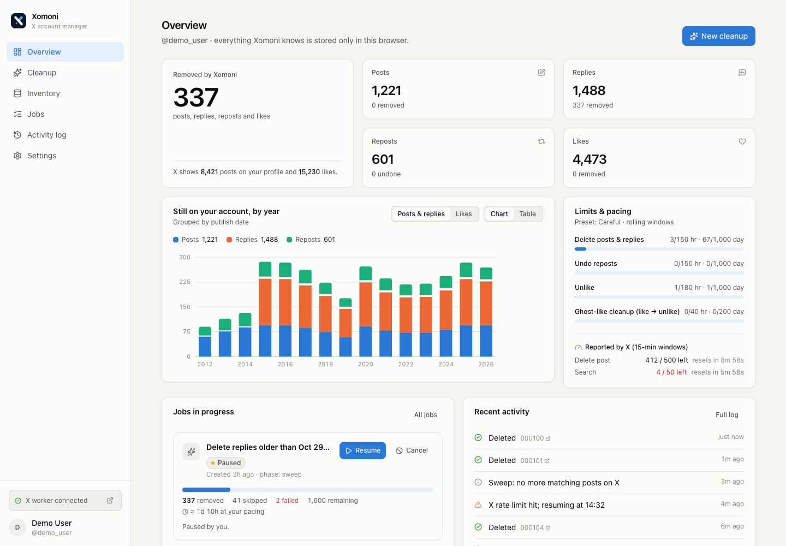
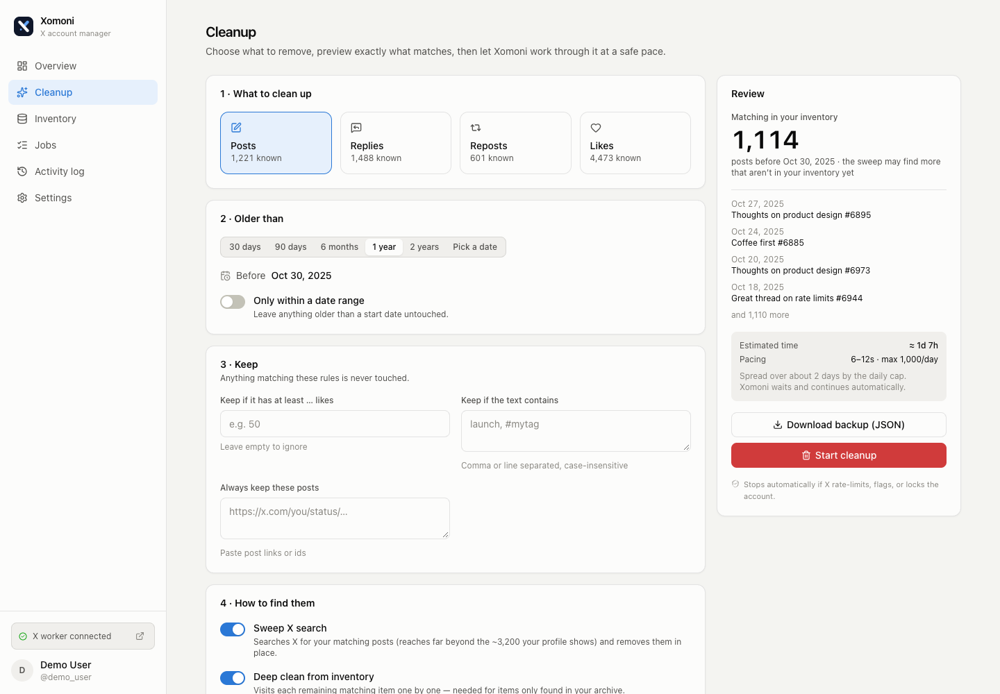
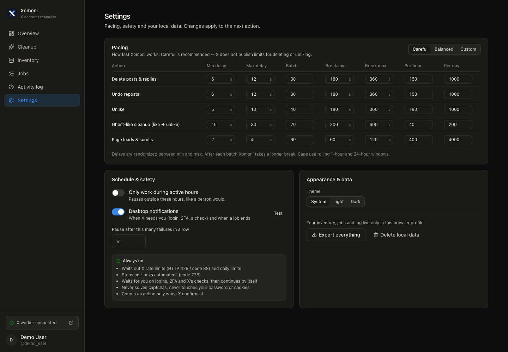
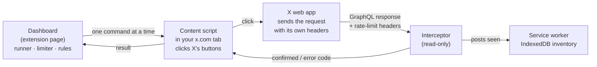

<div align="center">


# Xomoni

**Digital footprint manager.** Manage your digital footprint, starting with X: review and remove your own old posts, replies, reposts and likes from a dashboard on your computer. No API keys. Paced to stay within X's limits.

[](https://github.com/pirdehi/xomoni/actions/workflows/ci.yml)
[](LICENSE)


[فارسی](README.fa.md) · [Roadmap](docs/ROADMAP.md) · [Architecture](docs/ARCHITECTURE.md) · [Research notes](docs/RESEARCH.md) · [Report a bug](https://github.com/pirdehi/xomoni/issues)



</div>

---

## Why Xomoni

Deleting years of posts on X is harder than it should be:

- **The official API is expensive and slow for this.** It is pay-per-use, and deleting a post through it is limited to 50 requests per 15 minutes.
- **Scripts that call X's internal API break all the time.** X now requires a signed, single-use anti-bot header (`x-client-transaction-id`) on more and more requests. Tools that build their own requests keep failing.
- **Copy-paste console scripts get accounts flagged.** They ignore X's limits and keep going after X has asked them to stop.

Xomoni takes a different approach. It is a Chrome extension that works **inside your own logged-in X tab** and clicks the same buttons you would. X's own web app sends every request, with all its headers. Xomoni only *reads* X's responses, to confirm each action and to watch the rate-limit headers X returns.

## Features

<!-- BEGIN GENERATED: features (npm run readme) -->

### In the extension

- **Bulk cleanup by date:** delete posts, replies, reposts or likes older than a given date, or between two dates.
- **Keep rules:** spare posts with at least N likes, posts containing given keywords, specific links you paste, and replies in your own threads.
- **Preview before acting:** see exactly what matches, an estimated duration at your pacing, a JSON backup download, and a typed `DELETE` confirmation. Before an X account's first job, Xomoni shows the risks and asks you to type `I UNDERSTAND`.
- **Reaches past the ~3,200 profile limit:** sweeps X search (`from:you until:date`) in pages and imports your official X archive.
- **Within one fifth of X's limits:** Xomoni never uses more than one fifth of any limit X announces, starts slower on a new account, rests between work sessions, keeps to active hours, and stops at X's first warning. Custom pacing can be slower, never faster.
- **Acts only on what it can verify:** before deleting, Xomoni checks that the post is yours and still matches the rule, and counts it as removed only when X's response confirms it. A check after a job's first delete, and spot checks later, catch X quietly ignoring deletes.
- **Login and 2FA hand-off:** when X needs you (login, 2FA, captcha, email code, account unlock, wrong account), the job pauses, sends you a desktop notification, waits while you complete it in the X window, then continues by itself. Xomoni never asks for or stores your password.
- **Resumable jobs:** pause, close the browser, and resume later without losing progress.
- **Keeps going while you do other things:** *Keep going while away* keeps the display on and brings a covered X window forward, and *Run hidden* shares the X tab with the dashboard so a job continues with the X window minimized. Nothing of the shared tab is recorded or sent.
- **Your X archive, requested and imported:** *Get my archive* asks X for your archive on X's own page and downloads it once X has made it. The ZIP is imported as it is, from Downloads › Xomoni or dropped on the Library, and only `account.js`, `tweets.js` and `like.js` are read.
- **Your copy, in the Library:** shows how much of your account Xomoni has and where it came from, with a search. *Complete my copy* reads your posts, replies, likes and full history from X in one job.
- **The vault: X's own files, kept on your computer** *(next release)*: the *Vault* page takes X's archive and its analytics export, dropped or chosen, says what it recognized before anything is written, and keeps a ledger of every import and your account's timeline. A reminder, at most once a day, says when a file is due for a fresh copy. Nothing leaves your computer, and nothing is done on X.
- **Export my vault, readable without Xomoni** *(next release)*: one ZIP of your vault you keep: CSV for spreadsheets (no cell a spreadsheet would run), JSON for other tools, a page any browser opens, a README and a schema. Other people's words only when you tick them. Made on your computer, never sent anywhere, and free on every plan.
- **Archive a date range:** pick the dates, let Xomoni read them from X (read-only, at the same careful pace), and download your posts, replies and reposts from that range as a page you can open in any browser, or as JSON. It is saved on your computer only. Your official X archive stays the complete copy, with media.
- **Watch X search:** follow up to five phrases or #hashtags in X's search. Xomoni checks each about once a minute, within its read limits, and shows the 10 newest posts, each linked to X. It only reads: nothing is liked, replied to or posted.
- **Watch what is said about you:** two ready Watch searches for your own account, Mentions of you and Replies to you, off until you turn them on. A post from an account made in the last 30 days is marked with its age, from X's own search answer, and Xomoni's toolbar button counts the ones you haven't seen. Read only, and nothing leaves your computer.
- **Dashboard:** *Home* says what runs and what X needs, with the one button that helps; *Activity* shows each job's progress, time remaining and a log you can read, and export as CSV or JSON; plus removal counts and a year-by-year chart. Light and dark themes.
- **Daily numbers:** one row per X account per day, kept in this browser: followers, following, posts and likes, what you published and removed, and an estimate of what your posts received. Only pages X already showed count; nothing new is asked of X.
- **Reach** *(preview)*: how many times X says each of your posts was seen, from X's own numbers, against your usual: the median of your posts of the same kind in the 8 weeks before. A post still growing isn't compared, and nothing is guessed. Comparisons of posts with and without a link, with photos or videos, and with Premium, each in one of five fixed words with its size, a 95% interval and what can mislead it, and your usual reach by day and time. X's labels month by month from its *Under the hood* report, and the posts that may have got one, always marked as a guess. The last 30 days are free; longer periods and the comparisons are part of Plus, open as a preview. Xomoni never searches X to measure reach, and nothing leaves your computer.
- **Sign out of Xomoni:** one dialog names the account and says what happens: the running job pauses, the X window closes and nothing more is recorded. You can also remove the account's data from this browser, with a copy to download first, and sign out of X on X's own page.
- **Move your data to a new Xomoni:** *Export everything* saves one file in Downloads with your accounts, your copy, jobs, the log and settings; *Import from a file* in the new Xomoni checks the whole file first, then adds it to what is there. The file never leaves your computer.
- **Update in one click** *(preview)*: a Xomoni installed from the zip downloads the new version from GitHub, checks its signature and every file, and writes it into its own folder, never while a job runs. Your data stays. It starts once the maintainer has set up the signing key; until then, update by hand.

### The extension with xomoni.com

- **Private by design:** no telemetry, and your posts, likes and copy stay in IndexedDB in your browser profile. If you sign in to xomoni.com, only job status goes there (titles, states and counts), and daily counts only if you turn them on. Post text, likes and post ids never reach a server.
- **One sign-in:** sign in on xomoni.com and Xomoni in the same browser signs in by itself, with no code to type; sign out on either side and the other follows. An account stays optional.
- **Your jobs, live on xomoni.com:** follow each job's progress from any device on xomoni.com's dashboard. Only job status is sent, and your daily numbers if you turn them on.
- **Pause and cancel from xomoni.com:** job cards on xomoni.com pause or cancel a job of the same browser at once, and open Xomoni's pages. *Resume* asks you in Xomoni first: the website never starts or resumes work on X.
- **Plan a cleanup on xomoni.com:** the same three questions as Xomoni, with how many items the plan matches and how many days it takes. *Review and start in Xomoni* opens Xomoni's Cleanup page with the plan filled in, and nothing starts until you confirm there.
- **Library, Watch and account health on xomoni.com:** your posts, replies, reposts and likes with a search, each Watch search, and each X account's health and pace, read from Xomoni in the same browser and kept only while the page is open.
- **Settings from xomoni.com:** change Xomoni's active hours, the failures in a row before a pause, notifications and Watch searches, or set pacing back to Careful. Xomoni applies its own rules, so nothing goes faster than Careful.
- **Comments on xomoni.com:** find your replies by date, likes, who you replied to and words, see who you reply to most, and send the ones you pick to Xomoni's Cleanup to review. *Replies to you* counts the replies you get each day; Xomoni keeps them on your computer only, for 90 days.
- **Show my numbers on xomoni.com:** a switch, off until you turn it on, that sends each day's counts (whole numbers only, no text or ids) for the last 400 days. Turning it off deletes every day already sent.
- **Hear about new versions:** a browser connected to xomoni.com says when a newer Xomoni is out, and whether it fixes a security problem.
- **Install from the Chrome Web Store and Edge Add-ons** *(preview)*: once a store lists Xomoni, xomoni.com/install shows one button for your browser, a zip install shows the steps to move to the store's Xomoni, and xomoni.com finds Xomoni by the stores' fixed ids.
- **A checklist that ticks itself:** Xomoni opens xomoni.com/welcome when it is installed, and three steps tick from what the page sees: Xomoni installed, signed in to xomoni.com, and Xomoni signed in with you. Signing up from a page that asked you to brings you back to it.

### On xomoni.com

- **Your vault, on xomoni.com:** beside the Library, what your vault in Xomoni holds: each of X's files with how fresh it is and what it holds, read in your browser as counts and dates only, and *Open the vault in Xomoni*. Nothing of it reaches our servers.
- **Two-step verification:** turn it on in Account with an authenticator app, and every sign-in on xomoni.com asks for its 6-digit code before any private page opens. The website's server and the database both check it, so a password or a copied session alone reads and changes nothing. Changing your email or password, or resetting it by email, asks for a code too, and every app added or removed is emailed to you.
- **The dashboard on xomoni.com:** Overview, Audience, Content, Engagement, Reports, Library, Comments, Cleanup, Watch, Activity, Account health, Browsers and Settings, each at its own address, with an account and period picker. A sidebar on a computer, a bottom bar on a phone.
- **Overview, Audience, Content and Engagement:** your followers, what you published and what it received, each against the period before, in charts that answer on hover and by keyboard, with a table view. What was received is marked as an estimate.
- **Reports and a weekly email:** weekly, monthly and the year in review, what Xomoni removed, and a report of your own, as CSV or PDF. If you ask for it, an email every Monday compares last week's numbers with the week before; one link stops it.
- **An email when X warns your account:** if you ask for it in Settings, one email when X warns one of your X accounts and Xomoni stops there: the @handle and when Xomoni may go on, nothing X showed or you posted. At most one every six hours; one link stops it.
- **An install guide that follows you:** xomoni.com/install gives the steps for your browser and computer, one at a time, with short illustrations, ticks as soon as Xomoni is installed, and answers what goes wrong.
- **Send to my computer:** Xomoni runs on a computer, so on a phone xomoni.com offers to share or copy the install link, or email it to yourself. Nothing is added to the link or sent to Xomoni's servers.
- **xomoni.com on a phone:** a menu with *How it works*, *Safety*, *Privacy*, *Install* and *GitHub*, which works with the keyboard too, and a full footer on every page.

*(next release)*: on `main`, and in Xomoni's next release; xomoni.com has its part already. *(preview)*: built, and waiting on something outside the code, such as the stores listing Xomoni.

<!-- END GENERATED: features -->

| Cleanup wizard | Settings (dark) |
|---|---|
|  |  |

## How it works



1. **Inventory.** Xomoni learns what is on your account from your X archive and from the timelines it loads.
2. **Sweep.** For each rule it opens an X search (or your profile or likes page), then deletes or unlikes matching posts in place.
3. **Deep clean.** Whatever still matches (usually archive-only items) is visited one by one. Each post's page is checked against the rule again before acting.
4. **Confirm.** A post counts as removed only when X's response confirms it.

If Xomoni cannot verify an item, it leaves the item alone.

## Working within X's limits

**Xomoni uses at most one fifth of every limit X announces** ([ADR-0012](docs/adr/0012-one-fifth-of-every-x-limit.md)): one fifth of the limits X publishes, and one fifth of the live limits X reports while you use it.

| Mechanism | What Xomoni does |
|---|---|
| Pacing | Varied delays between actions, longer breaks between batches, a 10–30 minute rest after every 25–50 minutes of work, and rolling caps. X publishes 50 deletes per 15 minutes, so Xomoni does at most 10 (80–120 s apart, at most 40 an hour); unlikes are also capped at 200 a day, one fifth of X's 1,000. Custom settings can be slower, never faster. A new account starts lower still (warm-up: a quarter of that pace on day one, full one fifth from the fourth active day). |
| X's rate-limit headers | Reads `x-rate-limit-limit / remaining / reset` from X's own responses and waits for the reset once one fifth of the window is used. |
| HTTP 429 / code 88 | Waits until the window resets, then slows down (adaptive back-off). |
| Code 185 / 344 (daily limit) | Waits about 24 hours. |
| Code 226 ("looks automated") | **Stops the job.** You resume it after using X normally for a while. |
| Logout, 2FA, captcha, lock (326) | **Waits for you**, with a desktop notification. After an X check it eases back in at a slower pace. |
| 5 failures in a row | Pauses. X may have changed its page. |
| Active hours | On by default, 8:00–23:00 local time, so work never runs all night. You can change the hours or turn them off. |

The full research behind these choices (in Persian) is in [docs/RESEARCH.md](docs/RESEARCH.md). It covers X's limits, anti-automation signals, a comparison of approaches, and sources.

## Before you start: the risks

The extension shows this text once for each X account and asks you to type `I UNDERSTAND` before the first job. It is also at [xomoni.com/risks](https://xomoni.com/risks).

<!-- consent:start -->
Xomoni deletes posts, replies, reposts and likes on your X account by clicking X’s own buttons in a normal browser tab. Read this once for each X account, before its first job.

**X’s rules forbid this kind of automation.** X prohibits non-API automation, such as scripting the X website. X can limit, lock or suspend an account that breaks its rules. [Read X’s automation rules](https://help.x.com/en/rules-and-policies/x-automation).

**The risk can’t be removed.** Xomoni keeps the risk low: it never uses more than one fifth of any limit X announces, starts slower than that, and stops at X’s first warning. It can’t make the risk zero. Only X decides what happens to your account.

**A research project, at your own risk.** Xomoni is open-source research into ways to clean up your own X account through X’s website. It comes with no guarantee that X won’t limit, lock or suspend your account. You use it at your own risk, and the consequences for your X account are yours.

**Deletions are permanent.** A deleted post, an undone repost or a removed like can’t be brought back, by Xomoni or by X.

**Download your archive first.** Before you delete anything, get your X archive: press Get my archive in the Library, and Xomoni asks X for it on X’s own page. It is your only copy, and Xomoni can read it to find your oldest posts.

**What Xomoni never does.**

- Ask for, store or read your X password or cookies.
- Send your posts, likes or anything else from X to any server.
- Forge requests, solve captchas, use proxies or hide that it is automation.
- Use more than one fifth of any limit X announces.
- Start, resume or approve deletions from the website.

If you go ahead, you do so for this X account, knowing these risks and accepting them as your own.
<!-- consent:end -->

## Install

Xomoni is being prepared for the Chrome Web Store and Edge Add-ons, and isn't listed yet. Once it is, [xomoni.com/install](https://xomoni.com/install) shows one button for your browser, *Add to Chrome* or *Get it for Edge*: no developer mode, and it updates itself ([ADR-0034](docs/adr/0034-distribution-through-the-browsers-stores.md)).

Until then, or if you prefer it, install from the zip. The [install guide on xomoni.com](https://xomoni.com/install) walks through it (under *Advanced: install from a zip* once the stores list Xomoni):

1. Download [`xomoni-extension.zip`](https://github.com/pirdehi/xomoni/releases/latest/download/xomoni-extension.zip) from the [latest release](https://github.com/pirdehi/xomoni/releases/latest) (each release lists its SHA-256 checksums) and unzip it into a folder you keep.
2. Open `chrome://extensions`, turn on **Developer mode**, click **Load unpacked** and select that folder.
3. Click the Xomoni icon in the toolbar to open the dashboard.

### Moving from the zip to the store

The store's Xomoni is another extension to your browser, with its own, empty data. Once it is listed, a zip install shows these steps on its Home page, and [xomoni.com/install#move-to-store](https://xomoni.com/install#move-to-store) has them too:

1. In Xomoni, choose **Export everything** (also in *Settings › Move your data*). It saves one file in Downloads.
2. While no job runs, remove the zip copy on `chrome://extensions`. The browser deletes its data, and your file keeps it.
3. Install Xomoni from the store.
4. In the new Xomoni, choose **Import your data** and pick the file.

Nothing moves by itself: your data travels only in that file, which never leaves your computer ([ADR-0032](docs/adr/0032-move-data-between-xomoni-versions.md)).

### Or build it from source

**Requirements:** Node.js 20.19+ and Chrome, Edge or Brave version 116 or later.

```bash
git clone https://github.com/pirdehi/xomoni.git
cd xomoni
npm install
npm run build -w @xomoni/extension
```

1. Open `chrome://extensions` and turn on **Developer mode**.
2. Click **Load unpacked** and select the `apps/extension/dist` folder.
3. Click the Xomoni icon in the toolbar to open the dashboard.

On macOS, allow notifications for your browser in *System Settings → Notifications* so you see the login and 2FA alerts.

## Usage

1. **Connect.** In the dashboard, click **Open X worker**. A normal x.com window opens. Log in there as usual, including 2FA, and Xomoni detects your account.
2. **Get your archive (recommended).** In **Library**, press *Get my archive*. Xomoni asks X for it on X's own page and downloads it when X has made it (a day or more); if X asks for your password, type it there, since Xomoni never sees it. Chrome saves the ZIP in **Downloads › Xomoni**; choose that folder once (Xomoni makes it, and Chrome doesn't let extensions read Downloads itself) and the ZIP is imported by itself. A ZIP you already have can be dropped on the Library as it is, with no unzipping. Only `account.js`, `tweets.js` and `like.js` are read, and Xomoni checks that the archive belongs to the connected account.
3. **Complete your copy.** **Library** shows how much of your account Xomoni has. *Complete my copy* reads your posts, replies, likes and full history from X in one job; *Download a copy* saves any dates as a page or as JSON.
4. **Clean up.** In **Cleanup**:
   1. Pick a type, a date and keep rules.
   2. Review the matches and download a backup.
   3. Type `DELETE` to start.
5. **Watch.** **Home** says what runs and what X needs, and **Activity** shows each job's progress, time remaining and a live log. Pause or resume any time.

**Tips**

- Start with the **Careful** preset and a small range, for example older than 2 years. Check the log, then widen the range.
- Keep the dashboard tab and the X window open and not minimized while a job runs.
- Set X's display language to English for the most reliable results.
- If a job stops with error 226, wait a few hours, use X normally, then resume with Careful pacing.
- **Ghost likes:** X stops showing some very old likes as liked. Removing them means liking and then unliking, which can notify the author. This option is off by default.

## Development

This repository is an npm workspaces monorepo:

```
apps/extension/   the Chrome extension (MV3): engine, X page scripts, dashboard UI
apps/web/         xomoni.com (Next.js): landing page, sign-in, live job status
packages/db/      typed contract of the Supabase database, generated from the migrations
supabase/         database migrations, auth config and email templates (config as code)
docs/             architecture, decision records, safety playbook, research, store listing
tooling/          repository checks: documentation gate, README generator, verify runner, git hooks
```

How the parts fit together, the layer rules and the documentation rules are in [docs/ARCHITECTURE.md](docs/ARCHITECTURE.md). Every app, package and module has its own README.

| Command | What it does |
|---|---|
| `npm run build -w @xomoni/extension` | Builds the extension into `apps/extension/dist/` |
| `npm run watch -w @xomoni/extension` | Rebuilds on change. Reload the extension in `chrome://extensions` after each build. |
| `npm run preview:ui -w @xomoni/extension` | Opens the dashboard with demo data in a normal browser tab, without connecting to X |
| `npm run dev -w @xomoni/web` | Runs xomoni.com locally (see [apps/web/README.md](apps/web/README.md)) |
| `npm run readme` | Writes the feature list and status of both READMEs from `docs/features.json` ([CONTRIBUTING.md](CONTRIBUTING.md#the-feature-registry)) |
| `npm run verify` | Everything CI checks: formatting, lint and code docs, types, architecture rules, documentation, the READMEs against the feature registry, unit tests |

`npm run verify` also runs automatically before every `git push`.

**Stack:** TypeScript, React 19 and Fluent UI for both interfaces; Dexie (IndexedDB), Vite and esbuild for the extension; Next.js 16, Supabase and Vercel for the website; Vitest, ESLint, Prettier and dependency-cruiser for quality.

## Project status

<!-- BEGIN GENERATED: status (npm run readme) -->

**Latest release: [0.6.0](https://github.com/pirdehi/xomoni/releases/tag/v0.6.0), 2026-11-24.** Xomoni has 43 [features](#features), 3 of them added since 0.6.0. xomoni.com gets a change as soon as it is merged; the extension, with the next release.

<!-- END GENERATED: status -->

The full flow has been tested end to end against a local replica of x.com: deleting, unliking, safety stops, keep rules, and the login and 2FA hand-off. X changes its web app often, so selectors may need updating. If something stops working, [open an issue](https://github.com/pirdehi/xomoni/issues) with the activity log line.

## Contributing

Issues and pull requests are welcome. Read [CONTRIBUTING.md](CONTRIBUTING.md) first; `npm run verify` must pass. Keep the core rules intact (the full list is in [docs/PLAYBOOK.md](docs/PLAYBOOK.md)):

- Never forge X's headers.
- Never solve captchas.
- Never read passwords or session cookies.
- Never act on an item you can't verify.

## Disclaimer

Xomoni is an independent open-source research project. It is not affiliated with, endorsed by, or sponsored by X Corp. Automating actions on X's website may be against [X's automation rules](https://help.x.com/en/rules-and-policies/x-automation) and can lead to account restrictions. Xomoni is designed to reduce that risk, but it can't remove it, and it comes with no guarantee. Deletions can't be undone, so download your archive first. You use Xomoni at your own risk, and the consequences for your X account are your responsibility.

## Author

**Omid Pirdehi** · [github.com/pirdehi](https://github.com/pirdehi)

## License

[MIT](LICENSE) © 2026 Omid Pirdehi
