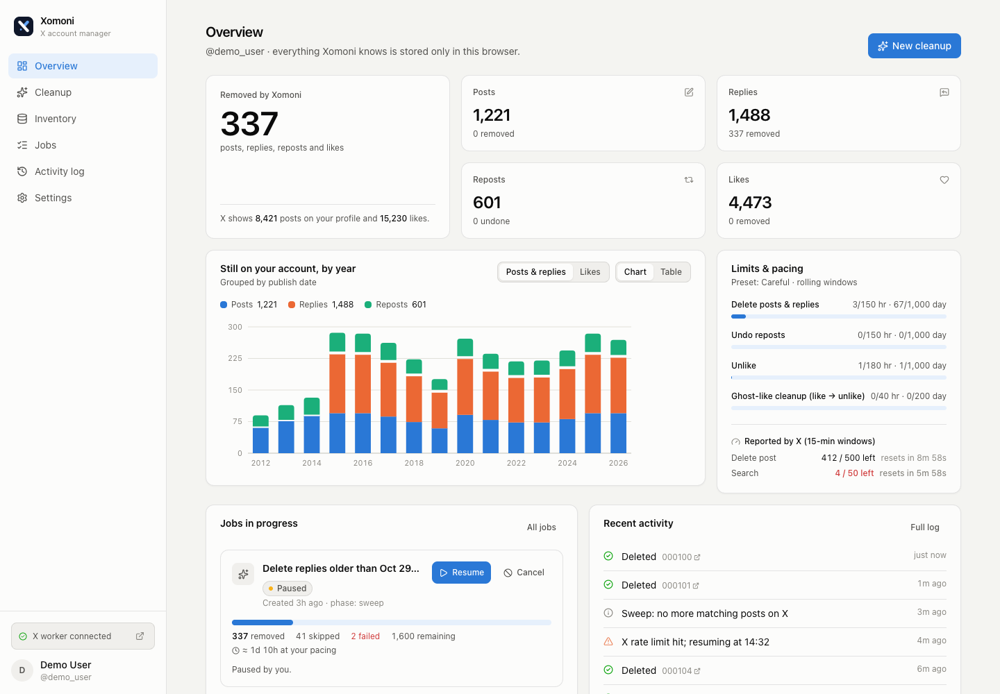
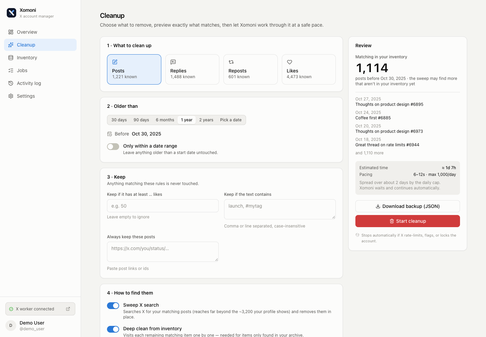
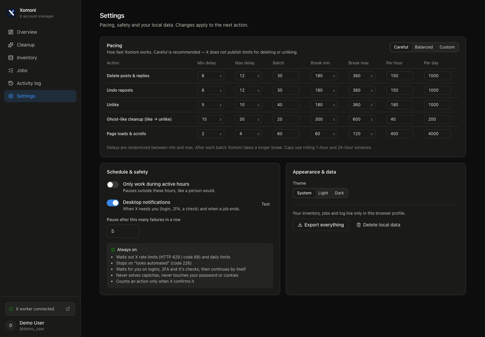
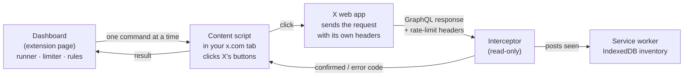

<div align="center">


# Xomoni

**Clean up your own X (Twitter) account — old posts, replies, reposts and likes — from a local dashboard. No API keys. Paced to stay within X's limits.**

[](https://github.com/pirdehi/xomoni/actions/workflows/ci.yml)
[](LICENSE)


[فارسی](README.fa.md) · [Research notes](docs/RESEARCH.md) · [Report a bug](https://github.com/pirdehi/xomoni/issues)



</div>

---

## Why Xomoni

Deleting years of posts on X is harder than it should be:

- **The official API is expensive and slow for this.** It is pay-per-use, and deleting a post through it is limited to 50 requests per 15 minutes.
- **Scripts that call X's internal API break all the time.** X now requires a signed, single-use anti-bot header (`x-client-transaction-id`) on more and more requests. Tools that build their own requests keep failing.
- **Copy-paste console scripts get accounts flagged.** They ignore X's limits and keep going after X has asked them to stop.

Xomoni takes a different approach. It is a Chrome extension that works **inside your own logged-in X tab** and clicks the same buttons you would. X's own web app sends every request, with all its headers. Xomoni only *reads* X's responses, to confirm each action and to watch the rate-limit headers X returns.

## Features

- **Bulk cleanup by date:** delete posts, replies, reposts or likes older than a given date, or between two dates.
- **Keep rules:** spare posts with at least N likes, posts containing given keywords, specific links you paste, and replies in your own threads.
- **Preview before acting:** see exactly what matches, an estimated duration at your pacing, a JSON backup download, and a typed `DELETE` confirmation.
- **Reaches past the ~3,200 profile limit:** sweeps X search (`from:you until:date`) in pages and imports your official X archive.
- **Login and 2FA hand-off:** when X needs you (login, 2FA, captcha, email code, account unlock, wrong account), the job pauses, sends you a desktop notification, waits while you complete it in the X window, then **continues by itself**. Xomoni never asks for or stores your password.
- **Resumable jobs:** pause, close the browser, and resume later without losing progress.
- **Dashboard:** removal stats, a year-by-year chart, live limits and pacing, a jobs list, a searchable inventory, and an exportable activity log. Light and dark themes.
- **Private by design:** no server and no telemetry. Everything stays in IndexedDB in your browser profile.

| Cleanup wizard | Settings (dark) |
|---|---|
|  |  |

## How it works



1. **Inventory.** Xomoni learns what is on your account from your X archive and from the timelines it loads.
2. **Sweep.** For each rule it opens an X search (or your profile or likes page), then deletes or unlikes matching posts in place.
3. **Deep clean.** Whatever still matches (usually archive-only items) is visited one by one. Each post's page is checked against the rule again before acting.
4. **Confirm.** A post counts as removed only when X's response confirms it.

If Xomoni cannot verify an item, it leaves the item alone.

## Working within X's limits

**Xomoni uses at most one fifth of every limit X announces** ([ADR-0012](docs/adr/0012-one-fifth-of-every-x-limit.md)): one fifth of the limits X publishes, and one fifth of the live limits X reports while you use it.

| Mechanism | What Xomoni does |
|---|---|
| Pacing | Random delays between actions, longer breaks between batches, and rolling caps. X publishes 50 deletes per 15 minutes, so Xomoni does at most 10 (80–120 s apart, at most 40 an hour); unlikes are also capped at 200 a day, one fifth of X's 1,000. Custom settings can be slower, never faster. |
| X's rate-limit headers | Reads `x-rate-limit-limit / remaining / reset` from X's own responses and waits for the reset once one fifth of the window is used. |
| HTTP 429 / code 88 | Waits until the window resets, then slows down (adaptive back-off). |
| Code 185 / 344 (daily limit) | Waits about 24 hours. |
| Code 226 ("looks automated") | **Stops the job.** You resume it after using X normally for a while. |
| Logout, 2FA, captcha, lock (326) | **Waits for you**, with a desktop notification. After an X check it eases back in at a slower pace. |
| 5 failures in a row | Pauses. X may have changed its page. |
| Active hours (optional) | Works only during the hours you choose. |

The full research behind these choices (in Persian) is in [docs/RESEARCH.md](docs/RESEARCH.md). It covers X's limits, anti-automation signals, a comparison of approaches, and sources.

## Install

Xomoni isn't on the Chrome Web Store yet. Build it from source:

**Requirements:** Node.js 20.19+ and Chrome, Edge or Brave version 116 or later.

```bash
git clone https://github.com/pirdehi/xomoni.git
cd xomoni
npm install
npm run build -w @xomoni/extension
```

1. Open `chrome://extensions` and turn on **Developer mode**.
2. Click **Load unpacked** and select the `apps/extension/dist` folder.
3. Click the Xomoni icon in the toolbar to open the dashboard.

On macOS, allow notifications for your browser in *System Settings → Notifications* so you see the login and 2FA alerts.

## Usage

1. **Connect.** In the dashboard, click **Open X worker**. A normal x.com window opens. Log in there as usual, including 2FA, and Xomoni detects your account.
2. **Import your archive (recommended).** In X, go to *Settings → Your account → Download an archive of your data*. When it arrives, open **Inventory** and select the archive's `data` folder. Only `account.js`, `tweets.js` and `like.js` are read, and Xomoni checks that the archive belongs to the connected account.
3. **Or scan.** **Inventory** can also scan your posts, replies, likes, or your full history from X.
4. **Clean up.** In **Cleanup**:
   1. Pick a type, a date and keep rules.
   2. Review the matches and download a backup.
   3. Type `DELETE` to start.
5. **Watch.** **Overview** and **Jobs** show progress, time remaining, X's reported limits and a live log. Pause or resume any time.

**Tips**

- Start with the **Careful** preset and a small range, for example older than 2 years. Check the log, then widen the range.
- Keep the dashboard tab and the X window open and not minimized while a job runs.
- Set X's display language to English for the most reliable results.
- If a job stops with error 226, wait a few hours, use X normally, then resume with Careful pacing.
- **Ghost likes:** X stops showing some very old likes as liked. Removing them means liking and then unliking, which can notify the author. This option is off by default.

## Development

This repository is an npm workspaces monorepo:

```
apps/extension/   the Chrome extension (MV3): engine, X page scripts, dashboard UI
apps/web/         xomoni.com (Next.js): landing page, sign-in, live job status
packages/db/      typed contract of the Supabase database, generated from the migrations
supabase/         database migrations, auth config and email templates (config as code)
docs/             architecture, decision records, safety playbook, research
tooling/          repository checks: documentation gate, verify runner, git hooks
```

How the parts fit together, the layer rules and the documentation rules are in [docs/ARCHITECTURE.md](docs/ARCHITECTURE.md). Every app, package and module has its own README.

| Command | What it does |
|---|---|
| `npm run build -w @xomoni/extension` | Builds the extension into `apps/extension/dist/` |
| `npm run watch -w @xomoni/extension` | Rebuilds on change. Reload the extension in `chrome://extensions` after each build. |
| `npm run preview:ui -w @xomoni/extension` | Opens the dashboard with demo data in a normal browser tab, without connecting to X |
| `npm run dev -w @xomoni/web` | Runs xomoni.com locally (see [apps/web/README.md](apps/web/README.md)) |
| `npm run verify` | Everything CI checks: formatting, lint and code docs, types, architecture rules, documentation, unit tests |

`npm run verify` also runs automatically before every `git push`.

**Stack:** TypeScript, React 19, Tailwind CSS 4, Dexie (IndexedDB), Vite and esbuild for the extension; Next.js 16, Supabase and Vercel for the website; Vitest, ESLint, Prettier and dependency-cruiser for quality.

## Project status

Xomoni is an early release (v0.1). The full flow has been tested end to end against a local replica of x.com: deleting, unliking, safety stops, keep rules, and the login and 2FA hand-off. X changes its web app often, so selectors may need updating. If something stops working, [open an issue](https://github.com/pirdehi/xomoni/issues) with the activity log line.

## Contributing

Issues and pull requests are welcome. Read [CONTRIBUTING.md](CONTRIBUTING.md) first; `npm run verify` must pass. Keep the core rules intact (the full list is in [docs/PLAYBOOK.md](docs/PLAYBOOK.md)):

- Never forge X's headers.
- Never solve captchas.
- Never read passwords or session cookies.
- Never act on an item you can't verify.

## Disclaimer

Xomoni is an independent open-source project. It is not affiliated with, endorsed by, or sponsored by X Corp. Automating actions on X's website may be against [X's automation rules](https://help.x.com/en/rules-and-policies/x-automation) and can lead to account restrictions. Xomoni is designed to reduce that risk, but it can't remove it. Deletions can't be undone, so download your archive first. Use at your own risk.

## Author

**Omid Pirdehi** · [github.com/pirdehi](https://github.com/pirdehi)

## License

[MIT](LICENSE) © 2026 Omid Pirdehi
