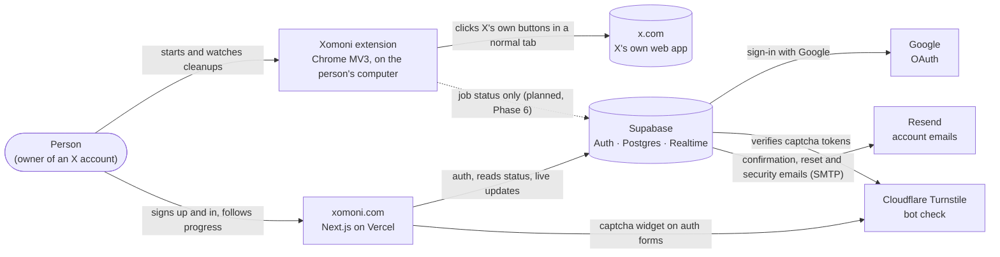
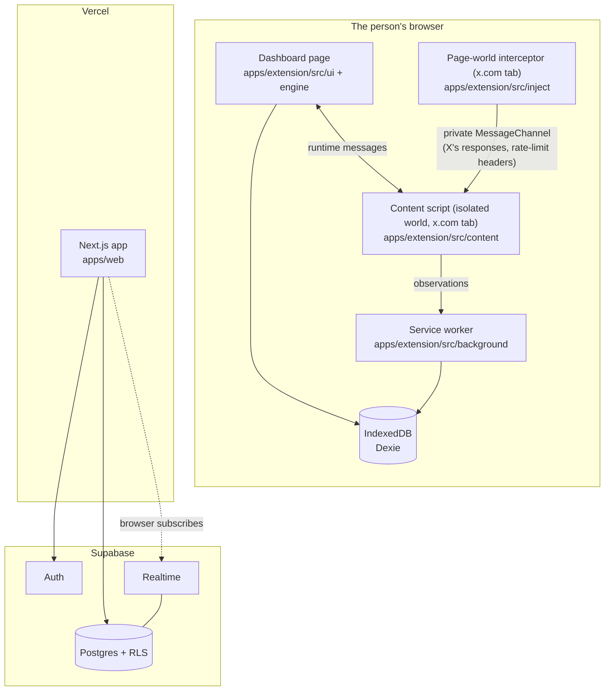
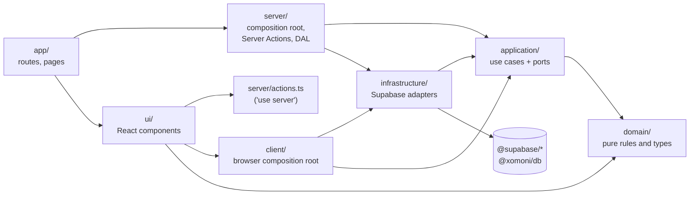
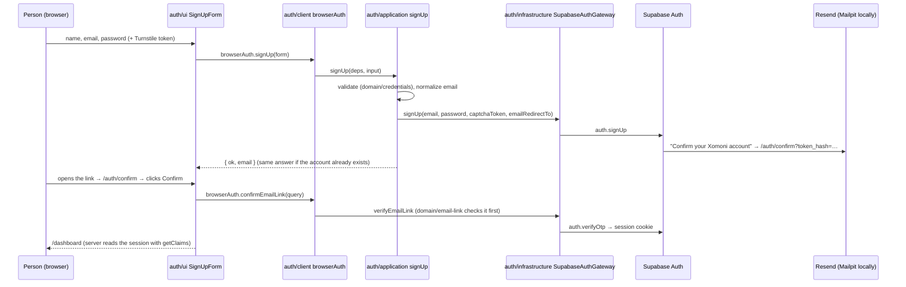
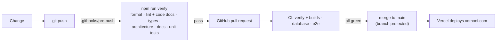

# Xomoni architecture

This document describes how Xomoni is built, the rules that keep it that way, and how those rules are checked. It is the entry point for anyone changing the code, human or AI.

- Why things are the way they are: [decision records](adr/README.md).
- What Xomoni must never do toward X: [safety playbook](PLAYBOOK.md).
- How to contribute: [CONTRIBUTING.md](../CONTRIBUTING.md).

## Principles

1. **The person stays in control.** Only the extension, on the person's own computer, acts on X. The website shows status; it can't start, steer or approve deletions ([ADR-0006](adr/0006-website-is-view-only.md)).
2. **Work within X's protections, never around them.** Xomoni drives X's own UI at a human pace and stops when X pushes back. No header forging, captcha solving, cookie handling or detection evasion ([ADR-0002](adr/0002-drive-x-ui-not-the-api.md), [ADR-0003](adr/0003-no-credentials-no-evasion.md)).
3. **X data stays in the browser.** Post text, likes and the inventory never leave the extension. The cloud stores job status only ([ADR-0004](adr/0004-x-data-stays-local.md)).
4. **Boundaries are enforced, not just described.** Layer and dependency rules are code ([`.dependency-cruiser.cjs`](../.dependency-cruiser.cjs)); a forbidden import fails the build.
5. **Undocumented code doesn't merge.** Every exported symbol has a doc comment, every unit has a README, and every decision has a record ([ADR-0009](adr/0009-documentation-is-a-merge-gate.md)).

## 1. System context

### Trust zones

| Zone | Trust | What lives there | Rule |
| --- | --- | --- | --- |
| x.com page | Untrusted | X's JavaScript, X's DOM | Xomoni only reads X's responses and clicks visible controls. The page-world script never sends requests. |
| Extension | Trusted executor | Engine, inventory, activity log, settings (IndexedDB) | The only component that acts on X. Owns all X data. |
| Website | View-only | Account, live job status | Can't start, change or approve actions on X. |
| Cloud (Supabase) | Status store | Accounts, devices, job counters and states | Never stores post text, likes, X credentials or cookies. Row Level Security on every table. |

## 2. Containers

## 3. Repository layout

The repository is an npm workspaces monorepo ([ADR-0007](adr/0007-npm-workspaces-monorepo.md)). Each unit below has a README that states its responsibility, dependencies and rules.

| Unit | Responsibility |
| --- | --- |
| [`apps/extension`](../apps/extension/README.md) | The Chrome extension. The only part that acts on X. |
| [`apps/extension/src/background`](../apps/extension/src/background/README.md) | Service worker: stores observations, opens the dashboard, handles notification clicks. |
| [`apps/extension/src/content`](../apps/extension/src/content/README.md) | Content script in the x.com tab: X selectors, user-equivalent actions, response matching. |
| [`apps/extension/src/inject`](../apps/extension/src/inject/README.md) | Page-world script: reads X's own GraphQL responses and rate-limit headers. Never sends. |
| [`apps/extension/src/engine`](../apps/extension/src/engine/README.md) | Job runner, pacing limiter, safety policy, cleanup and scan strategies. |
| [`apps/extension/src/shared`](../apps/extension/src/shared/README.md) | Types, IndexedDB schema, parsers, filters, settings: the extension's kernel. |
| [`apps/extension/src/ui`](../apps/extension/src/ui/README.md) | The dashboard (React). |
| [`apps/extension/src/dev`](../apps/extension/src/dev/README.md) | UI preview with demo data; never shipped. |
| [`apps/web`](../apps/web/README.md) | xomoni.com: landing and legal pages, sign-in, the live dashboard. |
| [`apps/web/src/modules/auth`](../apps/web/src/modules/auth/README.md) | Identity: sign-up with email confirmation, sign-in (password or Google), password reset, email and password changes, sessions, account deletion. |
| [`apps/web/src/modules/dashboard`](../apps/web/src/modules/dashboard/README.md) | Devices and live job status. |
| [`apps/web/src/shared`](../apps/web/src/shared/README.md) | Site config, Supabase clients, layout components shared by every module. |
| [`packages/db`](../packages/db/README.md) | The typed contract of the database, generated from the migrations. |
| [`packages/consent`](../packages/consent/README.md) | The informed-consent text shown before an X account's first job: one source for the extension, `/risks` and the README. |
| [`supabase`](../supabase/README.md) | Migrations, auth settings and email templates, as code ([ADR-0010](adr/0010-configuration-as-code.md)). |

`tooling/` holds repository checks (the documentation gate, the `verify` runner, git hook setup) and `docs/` holds this document, the ADRs, the playbook and research.

## 4. Website (`apps/web`)

The website follows a **modular, hexagonal** design ([ADR-0008](adr/0008-hexagonal-modules-for-the-website.md)). Routes in `src/app` are thin; behavior lives in feature modules under `src/modules`, each split into layers with one-way dependencies.

| Layer | Contains | May import | Must not import |
| --- | --- | --- | --- |
| `domain/` | Types, value rules, error codes, messages. Pure functions. | Its own `domain/` (and `zod`) | Anything else: no React, Next.js, Supabase or I/O |
| `application/` | Use cases and the **ports** (interfaces) they need | Its own `domain/` and `application/` | Adapters, frameworks, SDKs |
| `infrastructure/` | **Adapters** implementing ports with Supabase; row ↔ domain mappers | `domain/`, `application/`, `shared/supabase`, `@supabase/*`, `@xomoni/db` | `ui/`, `server/`, `client/`, `app/` |
| `server/` | Server composition root: wires use cases to adapters per request; Server Actions; route handler bodies; the Data Access Layer (`currentViewer`) | Everything in its module, other modules' `server/`, `shared/` | `client/` |
| `client/` | Browser composition root (for example the Realtime feed) | `domain/`, `application/`, `infrastructure/`, `shared/supabase/browser` | `server/` |
| `ui/` | React components and hooks | `domain/`, `client/`, `server/actions.ts`, `shared/ui`, `shared/config`, other modules' `ui/` | `application/`, `infrastructure/`, Supabase |

Other rules for the website:

- **Routes are thin.** A page or route handler composes a module's `server/` and `ui/`; it never reaches into a module's internals.
- **Modules talk through their public surface** (`server/` and `ui/`), never through another module's domain or adapters.
- **The Supabase SDK stays behind adapters.** Only `shared/supabase` and `infrastructure/` folders import `@supabase/*` or `@xomoni/db`.
- **Server code says so.** Files in `server/` import `server-only`, so importing them from a Client Component fails the build. Server Actions (`actions.ts`) start with `'use server'`.
- **Every action re-checks the session.** The proxy's redirects are a convenience; pages use `requireViewer()` and Server Actions verify the user again.
- **Interactive auth runs in the browser.** Sign-up, sign-in, reset and the other credential forms call Supabase Auth from the person's browser through `modules/auth/client`, so Supabase's per-IP limits and the captcha apply to the person rather than to our server ([ADR-0011](adr/0011-email-and-password-sign-in.md)). The server reads and verifies the resulting session cookie.

A flow, end to end (signing up with email). The use case is the same code in the browser and in tests; only the gateway changes.

The other flows (sign-in, password reset, email change, Google) follow the same path; they are described in the [auth module README](../apps/web/src/modules/auth/README.md) and tested end to end in `apps/web/e2e`.

## 5. Extension (`apps/extension`)

The extension runs in four JavaScript contexts, which is why it is split into areas:

| Context | Area | Can use |
| --- | --- | --- |
| Dashboard page (extension origin) | `ui/` + `engine/` | `chrome.*`, IndexedDB, React |
| Service worker | `background/` | `chrome.*`, IndexedDB |
| x.com tab, isolated world | `content/` | DOM of x.com, `chrome.runtime` messaging |
| x.com tab, page world | `inject/` | X's `fetch`/XHR responses (read-only), a `MessagePort` to the content script |

`shared/` is the kernel every area may use. The other areas don't import each other, with one exception: `ui/` drives `engine/`, because the dashboard page runs the engine (`background/` is allowed to as well, but doesn't today). These are the `ext-*` rules below. The target design moves the pure parts of `shared/` and `engine/` into `packages/core` behind ports (X tab, storage, notifier, clock), as tracked in [issue #11](https://github.com/pirdehi/xomoni/issues/11); the current rules already keep the areas from tangling.

## 6. Data

- **Schema:** [`supabase/migrations`](../supabase/migrations). Two tables, `devices` and `jobs`, both owned by `auth.users` with `on delete cascade`, plus `delete_account()`.
- **Row Level Security** on every table: a user reads and writes only their own rows; a job must belong to one of the user's devices. `anon` has no access.
- **Types:** [`packages/db`](../packages/db/README.md) holds the generated `Database` type. CI regenerates it from the migrations and fails on drift.
- **What is never stored:** post text, likes, the inventory, X credentials, X cookies.

## 7. Enforced rules

`npm run arch` runs [dependency-cruiser](https://github.com/sverweij/dependency-cruiser) with these rules. Each rule has a `comment` in the config, and `npm run docs:check` fails if a rule is missing here.

| Rule | Prevents |
| --- | --- |
| `no-circular` | Import cycles. |
| `no-unresolvable` | Imports of files or packages that don't exist. |
| `apps-are-independent` | One app importing another; shared code goes in `packages/`. |
| `packages-do-not-import-apps` | Packages depending on apps. |
| `web-domain-is-pure` | Framework, SDK or I/O code in a module's `domain/`. |
| `web-application-depends-on-domain` | Use cases importing adapters or frameworks instead of ports. |
| `web-infrastructure-is-an-adapter` | Adapters reaching into UI, composition roots or routes. |
| `web-ui-has-no-data-access` | Components calling Supabase, adapters or use cases directly. |
| `web-ui-uses-server-actions-only` | Components importing server code other than Server Actions. |
| `web-client-is-browser-only` | The browser composition root pulling in server code. |
| `web-modules-talk-through-public-surface` | A module using another module's internals. |
| `web-routes-are-thin` | Pages and route handlers bypassing a module's `server/` and `ui/`. |
| `web-shared-is-shared` | `shared/` depending on a module or route. |
| `web-supabase-behind-adapters` | The Supabase SDK or database types outside `shared/supabase` and `infrastructure/`. |
| `web-server-code-is-server-only` | A `server/` file without the `server-only` guard. |
| `ext-shared-is-the-kernel` | `shared/` depending on any other extension area. |
| `ext-engine-is-headless` | The engine importing UI, page scripts or the service worker. |
| `ext-content-is-isolated` | The content script importing anything but `shared/`. |
| `ext-inject-is-isolated` | The page-world script importing anything but `shared/`. |
| `ext-background-is-thin` | The service worker importing UI or page scripts. |
| `ext-ui-stays-out-of-the-page` | The dashboard importing content, inject or background code. |
| `ext-dev-is-not-shipped` | Product code importing the demo-data preview. |

## Documentation rules

Documentation is part of the definition of done and is checked mechanically ([ADR-0009](adr/0009-documentation-is-a-merge-gate.md)):

| What | Rule | Checked by |
| --- | --- | --- |
| Code | Every exported function, class, interface, type, enum and constant has a TSDoc comment with a real description. Next.js special exports (`metadata`, `config`…) are exempt. | ESLint `jsdoc/require-jsdoc`, `jsdoc/require-description` (`npm run lint`) |
| Units | Every app, package, website module, extension area and `supabase/` has a `README.md` with a title and content. | `npm run docs:check` |
| Architecture | This document names every unit and every dependency rule. | `npm run docs:check` |
| Decisions | Every ADR is numbered without gaps, has Status, Date, Context, Decision and Consequences, and is listed in the [index](adr/README.md). | `npm run docs:check` |
| Links | Relative links in Markdown resolve to files in the repository. | `npm run docs:check` |
| Configuration | Every environment variable the website reads is documented in `apps/web/.env.example`. | `npm run docs:check` |
| Database | Every migration starts with a comment that says what it changes and why. | `npm run docs:check` |

Write doc comments for the next maintainer: say what the thing is for and anything non-obvious (units, side effects, X behavior, safety constraints). Don't restate the name or the types.

## 8. Quality gates

Nothing reaches `main` without passing the same checks twice: on the developer's machine and in CI.

- **Pre-push hook:** `npm install` points git at [`.githooks`](../.githooks/pre-push), whose `pre-push` runs [`tooling/verify.mjs`](../tooling/verify.mjs). `git push --no-verify` skips it, but CI runs the same checks and `main` only accepts green pull requests.
- **CI** ([`.github/workflows/ci.yml`](../.github/workflows/ci.yml)): `verify` and both production builds; `database` (fresh migrations, schema lint, Row Level Security tests, generated-types drift); `e2e` (the auth flows in a real browser against a local Supabase, with emails read from Mailpit).
- **Branch protection on `main`:** pull request required, CI must pass, linear history, no force pushes.

## 9. Changing the architecture

1. Write an ADR (copy [`docs/adr/template.md`](adr/template.md)) and add it to the index.
2. Update the rules in `.dependency-cruiser.cjs` and the tables in this document in the same pull request.
3. A new website module: create `src/modules/<name>/` with the layers it needs and a `README.md`, then add it to the layout table above.
4. Run `npm run verify`.
