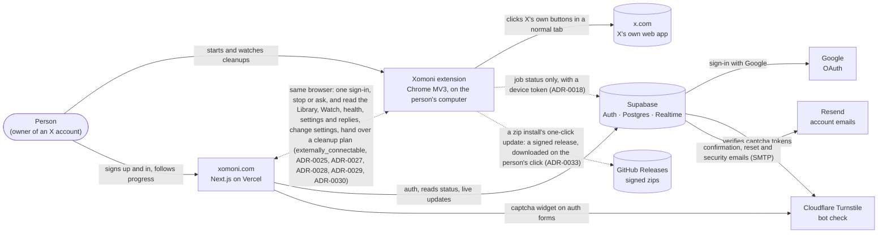
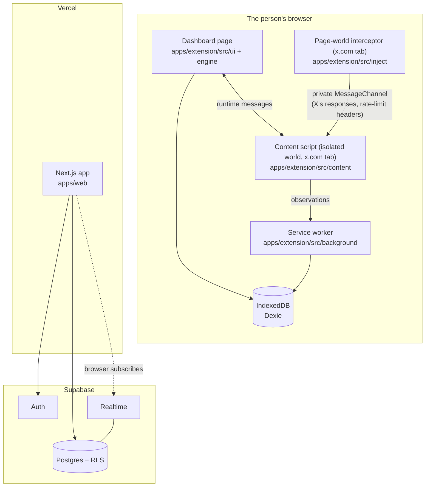
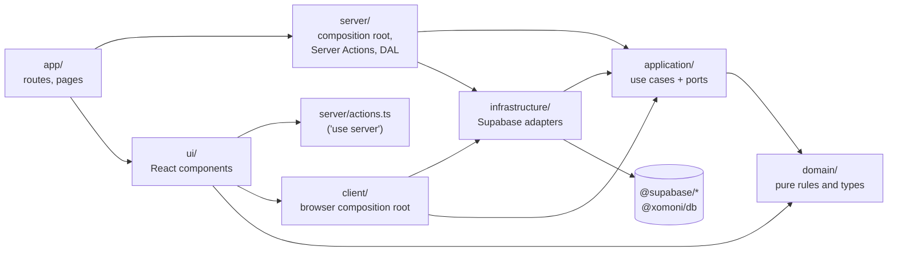
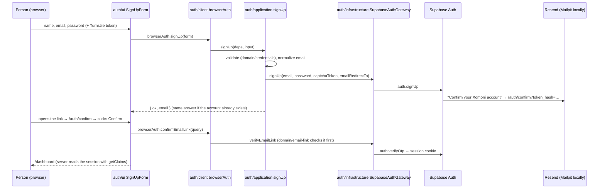
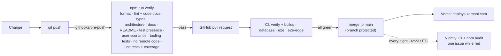

# Xomoni architecture

This document describes how Xomoni is built, the rules that keep it that way, and how those rules are checked. It is the entry point for anyone changing the code, human or AI.

- Why things are the way they are: [decision records](adr/README.md).
- What Xomoni must never do toward X: [safety playbook](PLAYBOOK.md).
- How to contribute: [CONTRIBUTING.md](../CONTRIBUTING.md).
- What is done and what is left: [roadmap](ROADMAP.md).

## Architecture at a glance

| Question | Answer |
| --- | --- |
| What architecture is this? | A **modular monolith** in an npm workspaces monorepo. The website uses **hexagonal architecture (ports and adapters)** in vertical feature modules, with the Clean Architecture dependency rule. The extension is **layered by JavaScript context around a shared kernel**, with its engine behind ports (a hexagonal core, [#11](https://github.com/pirdehi/xomoni/issues/11)). |
| Is it SOLID? | SOLID is a set of principles for the code inside each part, not an architecture. Each principle maps to concrete code in [ADR-0015 §2](adr/0015-architecture-styles-principles-and-patterns.md#2-how-the-solid-principles-show-up). |
| Which design patterns? | Ports and adapters, composition root, use case, observer, state machine, table-driven strategy, command, sliding-window rate limiter, circuit breaker, retry with backoff and others, each with the file it lives in: [ADR-0015 §3](adr/0015-architecture-styles-principles-and-patterns.md#3-design-patterns-in-use). |
| How is it enforced? | The dependency rules in [§7](#7-enforced-rules) (`npm run arch`), strict TypeScript and lint ([ADR-0016](adr/0016-strict-typescript-and-type-aware-lint.md)), the documentation gate, and backend and frontend tests with coverage thresholds ([testing](TESTING.md)), all in `npm run verify` and CI ([§8](#8-quality-gates)). |

## Principles

1. **The person stays in control.** Only the extension, on the person's own computer, acts on X. The website shows status; it can't start, steer or approve deletions ([ADR-0006](adr/0006-website-is-view-only.md)).
2. **Work within X's protections, never around them.** Xomoni drives X's own UI at a human pace and stops when X pushes back. No header forging, captcha solving, cookie handling or detection evasion ([ADR-0002](adr/0002-drive-x-ui-not-the-api.md), [ADR-0003](adr/0003-no-credentials-no-evasion.md)).
3. **X data stays in the browser.** Post text, likes and the inventory never leave the extension. The cloud stores job status only ([ADR-0004](adr/0004-x-data-stays-local.md)).
4. **Boundaries are enforced, not just described.** Layer and dependency rules are code ([`.dependency-cruiser.cjs`](../.dependency-cruiser.cjs)); a forbidden import fails the build.
5. **Undocumented code doesn't merge.** Every exported symbol has a doc comment, every unit has a README, and every decision has a record ([ADR-0009](adr/0009-documentation-is-a-merge-gate.md)).

## 1. System context

### Trust zones

| Zone | Trust | What lives there | Rule |
| --- | --- | --- | --- |
| x.com page | Untrusted | X's JavaScript, X's DOM | Xomoni only reads X's responses and clicks visible controls. The page-world script never sends requests. |
| Extension | Trusted executor | Engine, inventory, activity log, settings (IndexedDB) | The only component that acts on X. Owns all X data. |
| Website | View-only | Account, live job status | Can't start or approve actions on X. In the same browser it may sign the extension in or out (ADR-0025), pause or cancel a job, open Xomoni's pages, and ask to resume a job, which only the person approves in Xomoni (ADR-0027). There it may also read the Library, Watch, account health, settings and replies (the person's own, and others' to the person, ADR-0030) from Xomoni, at most 100 items at a time, kept in the page's memory only (ADR-0028), and change a few settings, which Xomoni checks against its own safety rules and logs (ADR-0029). A cleanup planned there only fills in Xomoni's Cleanup page, where the person confirms it (#235). |
| Cloud (Supabase) | Status store | Accounts, devices, job counters and states | Never stores post text, likes, X credentials or cookies. Row Level Security on every table. |

## 2. Containers

## 3. Repository layout

The repository is an npm workspaces monorepo ([ADR-0007](adr/0007-npm-workspaces-monorepo.md)). Each unit below has a README that states its responsibility, dependencies and rules.

| Unit | Responsibility |
| --- | --- |
| [`apps/extension`](../apps/extension/README.md) | The Chrome extension. The only part that acts on X. |
| [`apps/extension/src/background`](../apps/extension/src/background/README.md) | Service worker: stores observations, opens the dashboard, handles notification clicks. |
| [`apps/extension/src/content`](../apps/extension/src/content/README.md) | Content script in the x.com tab: X selectors, user-equivalent actions, response matching. |
| [`apps/extension/src/inject`](../apps/extension/src/inject/README.md) | Page-world script: reads X's own GraphQL responses and rate-limit headers. Never sends. |
| [`apps/extension/src/engine`](../apps/extension/src/engine/README.md) | Job runner, pacing limiter, safety policy, cleanup, scan, watch and archive strategies. |
| [`apps/extension/src/shared`](../apps/extension/src/shared/README.md) | Types, IndexedDB schema, parsers, filters, settings: the extension's kernel. |
| [`apps/extension/src/cloud`](../apps/extension/src/cloud/README.md) | Connects the browser to a xomoni.com account with a one-time code and reports job status only (ADR-0018); hears the account's plan in the answer, kept in IndexedDB with 7 days of grace offline (ADR-0042). |
| [`apps/extension/src/update`](../apps/extension/src/update/README.md) | One-click updates of a zip install: a signed release from GitHub, checked, then written into Xomoni's own folder ([ADR-0033](adr/0033-one-click-updates-for-the-zip-install.md)). |
| [`apps/extension/src/ui`](../apps/extension/src/ui/README.md) | The dashboard (React). |
| [`apps/extension/src/dev`](../apps/extension/src/dev/README.md) | UI preview with demo data; never shipped. |
| [`apps/web`](../apps/web/README.md) | xomoni.com: landing and legal pages, sign-in, the live dashboard. |
| [`apps/web/src/modules/auth`](../apps/web/src/modules/auth/README.md) | Identity: sign-up with email confirmation, sign-in (password or Google), two-step verification with an authenticator app, password reset, email and password changes, sessions, account deletion. |
| [`apps/web/src/modules/dashboard`](../apps/web/src/modules/dashboard/README.md) | Devices and live job status. |
| [`apps/web/src/modules/extension`](../apps/web/src/modules/extension/README.md) | The Xomoni extension in this browser: finding it, and one sign-in for the site and the extension (ADR-0025). |
| [`apps/web/src/modules/landing`](../apps/web/src/modules/landing/README.md) | The landing page at `/`, which tells Xomoni as a digital footprint manager (#313), and the install guide at `/install`, with its install questions: no data, so a pure `domain/` (the five pillars and the places, X today and the rest planned with no feature or date, #313; the install guide's rules for each browser and computer, #299, which illustration each step shows and how it is drawn for the browser, #299, the questions' anchors, #306, and which store's button each browser gets, #304) and a `ui/` layer, whose illustrations are schematic SVG drawn on the theme's tokens with CSS motion, never recordings. On a computer, each install button is the store's own once a store lists Xomoni for the browser, else a link to /install (#304); on a phone, where Xomoni can't be installed, it becomes *Send to my computer* (#243), `modules/extension`'s, which Xomoni's dialog uses too. |
| [`apps/web/src/shared`](../apps/web/src/shared/README.md) | Site config, Supabase clients, layout components shared by every module. |
| [`packages/db`](../packages/db/README.md) | The typed contract of the database, generated from the migrations. |
| [`packages/bridge`](../packages/bridge/README.md) | The messages xomoni.com and the extension exchange in one browser, with strict parsers, and Xomoni's fixed ids in the stores (#302): one contract for both apps (ADR-0025). |
| [`packages/consent`](../packages/consent/README.md) | The informed-consent text shown before an X account's first job: one source for the extension, `/risks` and the README. |
| [`packages/entitlements`](../packages/entitlements/README.md) | Xomoni's plans, the list of paid features and `hasPlan()`, the one check of a paid feature, with the offline grace and the `XOMONI_PAYWALL=off` build ([ADR-0042](adr/0042-payments-and-entitlements-with-polar.md)): one rule for the extension and xomoni.com. Pure, with 100% coverage. |
| [`packages/fluent-theme`](../packages/fluent-theme/README.md) | Xomoni's Fluent UI themes (ADR-0019): the brand ramp and the light and dark themes, one source for the extension and xomoni.com. |
| [`supabase`](../supabase/README.md) | Migrations, auth settings and email templates, as code ([ADR-0010](adr/0010-configuration-as-code.md)). |

`tooling/` holds repository checks (the documentation gate, the `verify` runner, the user scenarios check, the check for remotely hosted code in the extension's build, the README generator that writes both READMEs' feature list and status from `docs/features.json`, git hook setup) and the release and store scripts ([releasing](RELEASING.md)), and `docs/` holds this document, the ADRs, the playbook, research, each user-facing task's [user scenarios](scenarios/README.md), the [store listing](STORE-LISTING.md), how-tos in `guides/` and dated reports in `reports/<yyyy-mm>/`, all on [one map](README.md).

## 4. Website (`apps/web`)

The website follows a **modular, hexagonal** design ([ADR-0008](adr/0008-hexagonal-modules-for-the-website.md)). Routes in `src/app` are thin; behavior lives in feature modules under `src/modules`, each split into layers with one-way dependencies.

| Layer | Contains | May import | Must not import |
| --- | --- | --- | --- |
| `domain/` | Types, value rules, error codes, messages. Pure functions. | Its own `domain/` (and `zod`) | Anything else: no React, Next.js, Supabase or I/O |
| `application/` | Use cases and the **ports** (interfaces) they need | Its own `domain/` and `application/` | Adapters, frameworks, SDKs |
| `infrastructure/` | **Adapters** implementing ports with Supabase; row ↔ domain mappers | `domain/`, `application/`, `shared/supabase`, `@supabase/*`, `@xomoni/db` | `ui/`, `server/`, `client/`, `app/` |
| `server/` | Server composition root: wires use cases to adapters per request; Server Actions; route handler bodies; the Data Access Layer (`currentViewer`) | Everything in its module, other modules' `server/`, `shared/` | `client/` |
| `client/` | Browser composition root (for example the Realtime feed) | `domain/`, `application/`, `infrastructure/`, `shared/supabase/browser` | `server/` |
| `ui/` | React components and hooks | `domain/`, `client/`, `server/actions.ts`, `shared/ui`, `shared/config`, other modules' `ui/` | `application/`, `infrastructure/`, Supabase |

Other rules for the website:

- **Routes are thin.** A page or route handler composes a module's `server/` and `ui/`; it never reaches into a module's internals.
- **Modules talk through their public surface** (`server/` and `ui/`), never through another module's domain or adapters.
- **The Supabase SDK stays behind adapters.** Only `shared/supabase` and `infrastructure/` folders import `@supabase/*` or `@xomoni/db`.
- **Server code says so.** Files in `server/` import `server-only`, so importing them from a Client Component fails the build. Server Actions (`actions.ts`) start with `'use server'`.
- **Every action re-checks the session.** The proxy's redirects are a convenience; pages use `requireViewer()` and Server Actions verify the user again.
- **Two-step verification is checked on the server** ([ADR-0036](adr/0036-two-step-verification-with-an-authenticator-app.md)). For an account with an authenticator app, a session is signed in only once it gave a code: the access token's `aal` claim is `aal2`. `requireViewer()`, `requireAccount()`, the proxy and the delete action send a session below it to `/login/two-factor`; the database's policies refuse it too.
- **Security headers on every response.** A static Content-Security-Policy (scripts only from the site and Turnstile, connections only to the site and its Supabase project, no framing, Trusted Types with one `default` policy installed by `src/instrumentation-client.ts`, violations reported to `/api/csp-report`), HSTS, `nosniff`, a strict referrer policy, `Cross-Origin-Resource-Policy: same-origin` and a `Permissions-Policy` that turns off unused features. State-changing route handlers check the `Origin`. The site never renders raw HTML, and every end-to-end test fails on a policy violation ([ADR-0014](adr/0014-security-headers-and-a-static-csp.md)).
- **Interactive auth runs in the browser.** Sign-up, sign-in, reset and the other credential forms call Supabase Auth from the person's browser through `modules/auth/client`, so Supabase's per-IP limits and the captcha apply to the person rather than to our server ([ADR-0011](adr/0011-email-and-password-sign-in.md)). The server reads and verifies the resulting session cookie.

A flow, end to end (signing up with email). The use case is the same code in the browser and in tests; only the gateway changes.

The other flows (sign-in, password reset, email change, Google) follow the same path; they are described in the [auth module README](../apps/web/src/modules/auth/README.md) and tested end to end in `apps/web/e2e`.

## 5. Extension (`apps/extension`)

The extension runs in four JavaScript contexts, which is why it is split into areas:

| Context | Area | Can use |
| --- | --- | --- |
| Dashboard page (extension origin) | `ui/` + `engine/` + `cloud/` + `update/` | `chrome.*`, IndexedDB, React, `fetch` to xomoni.com's cloud (status only), and to this repository's GitHub releases for a one-click update (ADR-0033) |
| Service worker | `background/` + `cloud/website.ts` | `chrome.*`, IndexedDB, messages from xomoni.com's top frame (`@xomoni/bridge`: a hello, a one-time code to pair or sign in, a sign-out; ADR-0024, ADR-0025), `fetch` to xomoni.com's cloud to trade a code or end a token |
| x.com tab, isolated world | `content/` | DOM of x.com, `chrome.runtime` messaging |
| x.com tab, page world | `inject/` | X's `fetch`/XHR responses (read-only), a `MessagePort` to the content script |

`shared/` is the kernel every area may use; `shared/vault/` holds the vault (ADR-0043): the one importer of X's files, the analytics CSV, the ledger, the timeline, the reminder and the open export (ADR-0044), with the Vault page in `ui/` and its summary for xomoni.com in `cloud/website-reads.ts`. The other areas don't import each other, with three exceptions: `ui/` drives `engine/`, because the dashboard page runs the engine (`background/` is allowed to as well, but doesn't today), `ui/` starts `cloud/`, which reports job status to xomoni.com while the dashboard is open, and `ui/` offers `update/`, the one-click update of a zip install (ADR-0033). The engine never imports `cloud/`, so work on X never waits on that network. These are the `ext-*` rules below. The engine's core depends on ports, not on Chrome (#11): `engine/ports.ts` defines `XTab` (the worker tab), `Notifier` and `Presence` (whether the person is away, and keeping the display on), `engine/platform.ts` is the composition root that wires the Chrome adapters (`worker-tab.ts`, `shared/notify.ts`, `presence.ts`) and creates the dashboard's `runner`, and `JobContext` and `Runner` receive the ports. Rule `ext-engine-core-uses-ports` and an ESLint rule against `chrome` in the core keep it that way; tests run the engine on fake ports.

The extension has a signed-out state of its own ([ADR-0023](adr/0023-sign-out-of-xomoni-in-the-extension.md)), `signedOut` in `kv`.
- While it is set, the dashboard has no active account and the service worker records nothing from X pages but X's rate limits.
- `ui/sign-out.ts` signs out in order:
  - pause the job and wait for the runner's lock;
  - disconnect from xomoni.com;
  - remove the account's data if chosen;
  - close the X window;
  - open X's own sign-out page if chosen.
- Signing in again takes the person's *Continue as @handle*, or *Sign in to xomoni.com*.

A zip install can update itself in one click ([ADR-0033](adr/0033-one-click-updates-for-the-zip-install.md), #305):
- the person picks the folder Xomoni was loaded from once, and Xomoni checks that it holds this Xomoni at this version;
- on *Update now*, only while no job runs, `update/` downloads the release from this repository's GitHub releases and checks its Ed25519 signature (the release workflow holds the key; the extension trusts `update/release-keys.json`);
- it checks every path, the manifest's version, and that it asks for no more access and no newer browser;
- then it writes the files into that folder under the runner's lock, all or nothing, never over the backup of an update that didn't finish, and calls `chrome.runtime.reload()`;
- the id, and with it every byte of data, stays.

A store build (`npm run build:store`) puts a stand-in in place of the dashboard's update component, so nothing in it imports `update/`, and drops the GitHub access from its manifest: a store updates Xomoni itself.

One sign-in covers xomoni.com and the extension in the same browser ([ADR-0025](adr/0025-one-sign-in-for-the-website-and-the-extension.md)):
- every page of the site asks the extension how it stands (`modules/extension`, `cloud/website.ts`), at the id a page of Xomoni named (`#ext=`), else at a store's fixed id (`STORE_EXTENSION_IDS` in `@xomoni/bridge`, #302): the best that answers wins;
- the newest action wins: a sign-in on the website signs the extension in with a one-time code, and a sign-out on either side signs out the other;
- a browser without a connection is never signed out by the website, so an account stays optional.

The fixed id (#302): the manifest's `key` is the Chrome Web Store item's public key, so a zip install and the store's copy share one id. It is set together with the Chrome id in `STORE_EXTENSION_IDS`, and `tests/manifest-key.test.ts` checks that they agree ([ADR-0024](adr/0024-connect-a-browser-with-one-click.md), [RELEASING](RELEASING.md#the-fixed-id-the-chrome-web-stores-key-302)).

Xomoni is installed from the browsers' stores once they list it, and from the zip otherwise ([ADR-0034](adr/0034-distribution-through-the-browsers-stores.md), #304):
- the listings' addresses are code in each app (`apps/web/src/shared/config/store-listings.ts`, `apps/extension/src/shared/store-listings.ts`), empty until published, each checked as an https page on its store's own host, and kept equal by a test;
- `/install` shows the store's button for the visitor's browser (the Chrome Web Store for Chrome, Brave and other Chromium browsers; Edge Add-ons for Edge), with the zip's guide under *Advanced: install from a zip*;
- a zip install (`chrome.management.getSelf` says `development`, with no permission) gets a card on Home with the steps to the store's Xomoni: *Export everything*, remove this copy, install from the store, import. Xomoni never removes itself, and the data moves only in the file (ADR-0032).

## 6. Data

- **Schema:** [`supabase/migrations`](../supabase/migrations). The tables `devices` and `jobs`, and the daily numbers (below), all owned by `auth.users` with `on delete cascade`, plus `delete_account()`, which needs a sign-in within the last 10 minutes (read from the JWT's `amr` claim), so a stolen session can't delete the account. Each account connects at most 10 devices, and each device keeps its newest 1,000 jobs (older ones are removed). `jobs.risk_level` carries the X account's risk-ladder level (0–4) as a number only, never X's reason or notice text.
- **Pairing** ([ADR-0018](adr/0018-pair-the-extension-with-a-one-time-code.md), [ADR-0024](adr/0024-connect-a-browser-with-one-click.md)): `create_pairing_code()` (signed-in person) makes a one-time code. On `/connect`, xomoni.com hands it to the extension that asked for it with a nonce, through `externally_connectable` (only `https://xomoni.com/*`). It can also be typed. Either way, the extension, with no session, trades it with `pair_device()` for a device token and then calls only `device_report()` (heartbeat and up to 50 job summaries; it answers with the newest release from `extension_releases`, #151) and `unpair_device()`. Codes and tokens are stored as SHA-256 hashes in `device_pairings` and `device_tokens`, which have Row Level Security on and no policies.
- **Row Level Security** on every table: a user reads and writes only their own rows; a job must belong to one of the user's devices. `anon` has no access. Nothing in `public` is exposed by default: every grant is made by name, `authenticated` has only select, insert, update and delete on `devices` and `jobs`, and a pgTAP test checks the whole schema (#149). A job's reason is never stored (a check keeps it empty), and a device token stops working after 90 days without a report.
- **Realtime:** each dashboard listens on a private channel, `dashboard:<user id>`, which a policy on `realtime.messages` lets only its owner join. A trigger on `devices` and `jobs` broadcasts each change there (`dashboard_broadcast`, #149), and nowhere else. The tables are not in the `supabase_realtime` publication, so no subscriber hears Postgres changes of them, deletions included.
- **Daily numbers** ([ADR-0026](adr/0026-daily-numbers-in-the-cloud.md), #250): `daily_stats` holds one row of counts per X account per day, with only the columns the ADR lists, and `daily_stats_choices` one flag per account, off by default. The extension writes rows only through `device_report_stats(token, rows)`, which refuses them while the flag is off, refuses any other field (so no text or id can travel), any value outside 0 to 10⁹ and any day outside the last 400; it learns the flag from its heartbeat (`device_report` answers `stats`). The flag is set by `set_daily_stats(enabled)` on the website or `device_set_daily_stats(token, enabled)` in the extension; turning it off deletes every row in the same call. The owner reads their rows; nobody writes the tables directly.
- **Weekly email** ([ADR-0031](adr/0031-weekly-email-of-the-daily-numbers.md), #257): `weekly_emails` holds each person's choice (off by default) and a random stop token the website never reads. `set_weekly_email(enabled)` turns it on only while the daily numbers are on, and turning those off turns it off. `stop_weekly_email(token)` stops it from the email's link with no sign-in (`/weekly-email/stop`, and `POST /api/weekly-email/stop` for a mail app's one-click *Unsubscribe*, RFC 8058). On Mondays at 07:00 UTC, `pg_cron` runs `send_weekly_emails()`, which only the database's owner may call. It builds each email from the week's counts (`weekly_email_content`) and hands it to Resend's API with `pg_net`, using the `resend_api_key` secret in Supabase Vault. Without that secret it sends nothing; each person gets at most one email in six days.
- **Health alert** ([ADR-0047](adr/0047-an-email-when-x-warns-an-account.md), #407): `health_alerts` holds each person's choice (off by default) and a random stop token the website never reads; `health_alert_status()` tells the website the choice and whether the Resend key is set up, nothing else. For people who asked only, a trigger on `jobs` keeps each X account's level, the highest its jobs reported in the last day (`health_alert_levels`), and queues an alert (`health_alert_queue`: the handle and the level) when it rises to Retreat (2) or above, once per rise. Every five minutes `pg_cron` runs `send_health_alerts()`, which only the database's owner may call: it deletes alerts a week after they were sent or dropped and the levels of an account with no job left, drops what no longer needs telling (turned off, rested back below Retreat, a day old), then claims each person's waiting alerts (`for update … skip locked`) and sends one email through Resend with `pg_net` and the same Vault key, at most one in six hours and ten accounts, keeping the request's id. Without the key it sends nothing. Turning the alert off, or `stop_health_alert(token)` from the email's link (`/health-alert/stop`, and `POST /api/health-alert/stop` for one-click *Unsubscribe*), deletes the levels and drops what waits. Nobody reads the levels or the queue through the Data API.
- **Payments** ([ADR-0042](adr/0042-payments-and-entitlements-with-polar.md), #420): `entitlements` holds one row per account: the plan (`free`, `plus`, `pro`), its status, its source (a subscription or a one-time pass), `valid_until`, `cancel_at_period_end`, `founding`, Polar's customer and subscription ids, and the time of the event it came from. A paid plan always has an end. `billing_events` keeps one row per webhook delivery (its id, type, arrival and result: `applied`, `stale` or `ignored`), never its body, and `billing_settings` one switch, `live`, off until the maintainer opens sales. No column holds an email, a name, a card or X content. Only `apply_billing_event(…)` writes, and only `service_role` may run it: a webhook id seen before is `ignored`, an event older than the row is `stale`, an event from the future is refused. `entitlement_of` gives the plan that counts now: Free without a row, once revoked, or once `valid_until` has passed. The owner reads their row (at `aal2` with an authenticator app) and `my_entitlement()`; nobody else reads or writes any of the three. `device_report` also answers `entitlement` (that plan, its status and `valid_until`) and `billing_live`, for the device's own account only. Deleting the account deletes the row.
- **Types:** [`packages/db`](../packages/db/README.md) holds the generated `Database` type. CI regenerates it from the migrations and fails on drift.
- **Two-step verification** ([ADR-0036](adr/0036-two-step-verification-with-an-authenticator-app.md), #173): Supabase Auth keeps each authenticator app (`auth.mfa_factors`: its name, its shared key, when it was added). `public.mfa_satisfied()` is true for a session that gave a code (`aal2`) or an account without a verified app. Restrictive policies add it to `devices`, `jobs`, `daily_stats`, `daily_stats_choices`, `weekly_emails`, `health_alerts`, `entitlements` and the dashboard's Realtime channel. `delete_account()`, `create_pairing_code()`, `set_daily_stats()`, `set_weekly_email()`, `set_health_alert()`, `health_alert_status()` and `my_entitlement()` refuse without it (hint `second_factor_required`). The extension's device-token functions are unchanged.
- **What is never stored:** post text, likes, the inventory, X credentials, X cookies.
- **In the browser, daily numbers** (#249, [ADR-0026](adr/0026-daily-numbers-in-the-cloud.md)): the extension's `daily` table keeps one row of counts per X account per local day, from pages X already showed (the profile's counts, and the rise in the counts of the person's own posts). No request is made to collect them. They reach the cloud only by the person's choice (#250).
- **In the browser, replies to you** (#256, [ADR-0030](adr/0030-replies-to-you-kept-on-the-computer.md)): the extension's `incoming` table keeps replies other people wrote to the person's posts, from the same responses: id, author handle, text (at most 1,000 characters), time and the post it answers. At most 90 days and 5,000 per X account, removed with the account's data, never in a backup (only in the move file below), never sent to a server, never acted on.
- **In the browser, the vault** (#424, [ADR-0043](adr/0043-the-vault-x-files-kept-on-the-computer.md)): X's official files the person chooses, read in and kept in the extension's IndexedDB (Dexie version 8, `shared/vault/`). `vaultImports` is the import ledger: one row per import, with the file's name, size and fingerprint (the sizes and CRCs of a ZIP's directory, or a text file's SHA-256), the period it covers, the rows read, merged and skipped and the problems met; a known fingerprint writes a `duplicate` row and nothing else. `analyticsPosts` and `analyticsDays` keep X's analytics of each post and day: a merge never lowers a post's count, and for a day the newer import wins. `accountEvents` is the account's timeline, in Xomoni's words or the person's notes (at most 500 characters), read together with the risk ladder's events. `labelMonths` (Dexie version 9, #428) keeps X's *Under the hood* report, one row per account and month, a newer file replacing an older one's month; a label new or larger than the month before goes on the timeline (`x_label`, ADR-0045). Every file comes in through one importer (`shared/vault/importer.ts`): a parser per kind of file, every size checked before anything is read, the owner checked before anything is written, then merged batch by batch; X's archive in the Library is its first parser. Every row is checked before it is written, and one bad row writes nothing. A local reminder, at most once a day per account within active hours, says when the archive (30 days) or the analytics export (60) is due for a fresh copy: the dashboard gives it while open, the service worker when X's page is seen while it isn't, with the notifications Xomoni already has and no new permission. The vault has no expiry: it goes with *Delete local data* and with an account's data, and is never sent to a server or acted on.
- **Moving to another Xomoni** (#300, [ADR-0032](adr/0032-move-data-between-xomoni-versions.md)): a fixed id or the store's version is another extension to Chrome, with an empty database. *Export everything* writes every table but `consents` into one file on the computer (`shared/move-file.ts`, `shared/move.ts`):
  - format `xomoni-export`, a version (2 since the vault, #424; a file of version 1 still imports, with the vault empty), the app's version and the time, and a SHA-256 checksum of all of it;
  - the vault's tables, registered in `VAULT_MOVE_TABLES` with their check, cap and merge, so a later vault table keeps the version;
  - only listed `kv` values: never the xomoni.com token or the sign-in state.

  *Import from a file* checks the whole file first: its size, format and version, the checksum, and every record's shape. It then merges in one transaction while holding the runner's lock: the newer copy of each record wins (a post's analytics keep the highest of each number), nothing is deleted, an unfinished job arrives cancelled, and a typed override of the risk ladder isn't taken. Nothing is sent anywhere.

## 7. Enforced rules

`npm run arch` runs [dependency-cruiser](https://github.com/sverweij/dependency-cruiser) with these rules. Each rule has a `comment` in the config, and `npm run docs:check` fails if a rule is missing here.

| Rule | Prevents |
| --- | --- |
| `no-circular` | Import cycles. |
| `no-unresolvable` | Imports of files or packages that don't exist. |
| `apps-are-independent` | One app importing another; shared code goes in `packages/`. |
| `packages-do-not-import-apps` | Packages depending on apps. |
| `web-domain-is-pure` | Framework, SDK or I/O code in a module's `domain/`. |
| `web-application-depends-on-domain` | Use cases importing adapters or frameworks instead of ports. |
| `web-infrastructure-is-an-adapter` | Adapters reaching into UI, composition roots or routes. |
| `web-ui-has-no-data-access` | Components calling Supabase, adapters or use cases directly. |
| `web-ui-uses-server-actions-only` | Components importing server code other than Server Actions. |
| `web-client-is-browser-only` | The browser composition root pulling in server code. |
| `web-modules-talk-through-public-surface` | A module using another module's internals. |
| `web-routes-are-thin` | Pages and route handlers bypassing a module's `server/` and `ui/`. |
| `web-shared-is-shared` | `shared/` depending on a module or route. |
| `web-supabase-behind-adapters` | The Supabase SDK or database types outside `shared/supabase` and `infrastructure/`. |
| `web-server-code-is-server-only` | A `server/` file without the `server-only` guard. |
| `ext-shared-is-the-kernel` | `shared/` depending on any other extension area. |
| `ext-engine-is-headless` | The engine importing UI, page scripts or the service worker. |
| `ext-engine-core-uses-ports` | The engine's core importing the Chrome adapters (`worker-tab.ts`, `presence.ts`, `shared/notify.ts`) instead of its ports; ESLint also forbids `chrome` in the core. |
| `ext-content-is-isolated` | The content script importing anything but `shared/`. |
| `ext-inject-is-isolated` | The page-world script importing anything but `shared/`. |
| `ext-background-is-thin` | The service worker importing UI or page scripts. |
| `ext-cloud-is-isolated` | The status reporter importing anything but `shared/`; the engine can't import it either (`ext-engine-is-headless`). |
| `ext-update-is-isolated` | The one-click update importing anything but `shared/`; only the dashboard imports it, since the engine, the service worker, the page scripts and `cloud/` may not (ADR-0033). |
| `ext-ui-stays-out-of-the-page` | The dashboard importing content, inject or background code. |
| `ext-dev-is-not-shipped` | Product code importing the demo-data preview. |

## Documentation rules

Documentation is part of the definition of done and is checked mechanically ([ADR-0009](adr/0009-documentation-is-a-merge-gate.md)):

| What | Rule | Checked by |
| --- | --- | --- |
| Code | Every exported function, class, interface, type, enum and constant has a TSDoc comment with a real description. Next.js special exports (`metadata`, `config`…) are exempt. | ESLint `jsdoc/require-jsdoc`, `jsdoc/require-description` (`npm run lint`) |
| Units | Every app, package, website module, extension area and `supabase/` has a `README.md` with a title and content. | `npm run docs:check` |
| Architecture | This document names every unit and every dependency rule. | `npm run docs:check` |
| Decisions | Every ADR is numbered without gaps, has Status, Date, Context, Decision and Consequences, and is listed in the [index](adr/README.md). | `npm run docs:check` |
| Links | Relative links in Markdown resolve to files in the repository. | `npm run docs:check` |
| Configuration | Every environment variable the website reads is documented in `apps/web/.env.example`. | `npm run docs:check` |
| Database | Every migration starts with a comment that says what it changes and why. | `npm run docs:check` |
| Docs by kind | Only the living documents listed in `tooling/docs-layout-lib.mjs` sit at the root of `docs/`; dated reports, reviews and plans go in `docs/reports/<yyyy-mm>/`; [the map](README.md) links every living document and every folder ([ADR-0041](adr/0041-docs-sorted-by-kind-with-one-map.md)). | `npm run docs:check` |

Write doc comments for the next maintainer: say what the thing is for and anything non-obvious (units, side effects, X behavior, safety constraints). Don't restate the name or the types.

## 8. Quality gates

Nothing reaches `main` without passing the same checks twice: on the developer's machine and in CI. Nothing is released without two more gates: the release candidate and the release itself. [Quality gates](QUALITY-GATES.md) lists every rule and what enforces it ([ADR-0037](adr/0037-one-written-gate-for-every-merge-and-release.md)).

- **Pre-push hook:** `npm install` points git at [`.githooks`](../.githooks/pre-push), whose `pre-push` runs [`tooling/verify.mjs`](../tooling/verify.mjs). `git push --no-verify` skips it, but CI runs the same checks and `main` only accepts green pull requests.
- **CI** ([`.github/workflows/ci.yml`](../.github/workflows/ci.yml)): `verify` and both production builds; `database` (fresh migrations, schema lint, Row Level Security tests, generated-types drift); `e2e` (the website's flows in a real browser against a local Supabase, with emails read from Mailpit, and the built extension in a real browser on synthetic x.com fixtures with no network, [ADR-0040](adr/0040-test-the-extension-against-recorded-x-fixtures.md); axe checks both for serious accessibility violations); `e2e-edge`, the same in Microsoft Edge (#342), required since 2026-11-21. Each of `e2e` and `e2e-edge` is a gate that passes only when all its parts passed, each part on a runner of its own: the website's tests in shards, each with a Supabase of its own, and the extension's in shards (#412).
- **Branch protection on `main`:** pull request required, CI must pass, linear history, no force pushes, no bypass. The gate's own files have a code owner ([`CODEOWNERS`](../.github/CODEOWNERS)).
- **Releases** ([`release.yml`](../.github/workflows/release.yml)): a version tag runs the full CI again on the tagged commit (it calls `ci.yml`) and checks the version's release issue ([`tooling/check-release-issue.mjs`](../tooling/check-release-issue.mjs)). Then it audits the dependencies, builds the extension's zip, and the store build without the one-click updater, and publishes both on GitHub Releases once the maintainer approves. Last, it comments the release on its issue and closes it (#340), then calls the check after the release (#343). A manual run of [`store.yml`](../.github/workflows/store.yml) sends that release's store build to the Chrome Web Store and Edge Add-ons, with the store keys only in the `stores` environment ([releasing](RELEASING.md#chrome-web-store-and-edge-add-ons)).
- **Pull request policy** ([`pr-policy.yml`](../.github/workflows/pr-policy.yml)): `pr-policy` ([`tooling/check-pr.mjs`](../tooling/check-pr.mjs)) checks that the description links its task, that a user-facing change brings a changelog line and its scenarios, and that each exemption label has a written reason; `dependency-review` fails on a new dependency with a high or critical vulnerability. Both are required checks on `main` (#346). [Contributing](../CONTRIBUTING.md#pull-request-checks) lists what each one wants.
- **Every night and after each release** (#343): [`nightly.yml`](../.github/workflows/nightly.yml) runs the full CI and `npm audit` on `main` and keeps one *Nightly run failing* issue open while they fail ([`tooling/nightly-report.mjs`](../tooling/nightly-report.mjs)). [`release-check.yml`](../.github/workflows/release-check.yml), which the release calls once it has published, downloads the release as people get it, checks its checksums, the provenance of each zip and `releases/latest`, and comments the result on the release issue ([`tooling/check-published-release.mjs`](../tooling/check-published-release.mjs)). Only their report jobs can write, to issues only ([quality gates](QUALITY-GATES.md#every-night-and-after-each-release)).

The workflows, in [`.github/workflows`](../.github/workflows):

| Workflow | Runs | Jobs |
| --- | --- | --- |
| [`ci.yml`](../.github/workflows/ci.yml) | Every pull request and push to `main`; called by `release.yml` and `nightly.yml` | `verify` (with both builds and the release dry run), `database`, `e2e`, and `e2e-edge` (Edge, #342) |
| [`pr-policy.yml`](../.github/workflows/pr-policy.yml) | Every pull request, again when its description or labels change | `pr-policy`, `dependency-review` |
| [`release.yml`](../.github/workflows/release.yml) | A `vX.Y.Z` tag | `ci`, `readiness`, `build`, `publish` (the `release` environment), `after-release` |
| [`release-check.yml`](../.github/workflows/release-check.yml) | Called by `release.yml`; by hand, with a tag; a release a person publishes | `check` (read-only), `report` (issues only) |
| [`nightly.yml`](../.github/workflows/nightly.yml) | Every day at 02:23 UTC; by hand | `ci`, `audit`, `report` (issues only) |
| [`store.yml`](../.github/workflows/store.yml) | By hand, from `main` | `release`, `chrome` and `edge` (the `stores` environment) |

## 9. Changing the architecture

1. Write an ADR (copy [`docs/adr/template.md`](adr/template.md)) and add it to the index.
2. Update the rules in `.dependency-cruiser.cjs` and the tables in this document in the same pull request.
3. A new website module: create `src/modules/<name>/` with the layers it needs and a `README.md`, then add it to the layout table above.
4. Run `npm run verify`.
