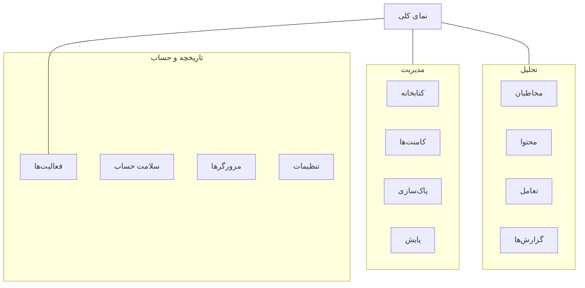

[English](DASHBOARD-PLAN-2026-11-19.md)

<div dir="rtl">

# داشبورد کامل در xomoni.com

> برنامه‌ای که ۱۹ نوامبر ۲۰۲۶ با نگه‌دارنده توافق شد (#248):
> - xomoni.com جای دیدن و مدیریت حساب X می‌شود: هرچه افزونه دارد و خیلی بیشتر.
> - افزونه جمع‌آوری و اجرا می‌کند؛ سایت نشان می‌دهد، گزارش می‌دهد و برنامه می‌ریزد.
>
> این برنامه روی [بررسی تجربه‌ی کاربری سایت](UX-REVIEW-WEBSITE-2026-11-17.fa.md) ساخته شده و کار «پوسته‌ی برنامه»ی آن (#245) را جایگزین می‌کند.

## تصمیم‌ها

| # | پرسش | تصمیم |
| --- | --- | --- |
| ۱ | عددها کجا نگه داشته شوند؟ | **عددهای روزانه در سرور، به انتخاب کاربر** ([ADR-0026](adr/0026-daily-numbers-in-the-cloud.md)). فقط شمارش روزانه، هرگز متن، شناسه یا افراد دیگر. تا کاربر روشنش نکند خاموش است و خاموش کردنش همه را پاک می‌کند. |
| ۲ | جمع‌آوری چقدر فعال باشد؟ | **بدون ریسک: هیچ درخواست اضافه‌ای به X.** فقط آنچه X خودش به مرورگر کاربر می‌فرستد: صفحه‌هایی که کاربر یا یک کار باز می‌کند، اسکن‌هایی که کاربر شروع می‌کند، و آرشیو. |
| ۳ | تاریخچه از کی؟ | «منتشرشده» از آرشیو، تا روز اول حساب. «دریافتی» و تغییر فالوور از روزی که عددها روشن می‌شوند. |
| ۴ | چه کسی آنفالو کرده؟ | فقط با مقایسه‌ی دو آرشیو. Xomoni هرگز فهرست فالوورها را اسکرول نمی‌کند. فهرست‌ها در مرورگر می‌مانند. |
| ۵ | کامنت دیگران؟ | نشان داده می‌شوند، با «باز کردن روی X» برای پنهان کردن. X اجازه‌ی حذفشان را به کسی نمی‌دهد و Xomoni پنهان‌سازی را خودکار نمی‌کند. |
| ۶ | چند حساب X؟ | بله، با انتخابگر حساب در هر صفحه. افزونه حساب‌ها را از هم جدا نگه می‌دارد. |
| ۷ | کارهای افزونه در سایت؟ | **همه‌ی کارها در سایت هستند، فقط در همان مرورگر، و تأییدشان در Xomoni است** ([ADR-0027](adr/0027-extension-actions-from-the-website.md)). وقتی Xomoni نیست، یک پنجره‌ی پیام دلیلش را می‌گوید. |

## اصل‌ها

1. **هیچ‌وقت دیوار خالی نشان نده.**
   - هر بخش از اولین بازدید نشان می‌دهد چه چیزی خواهد داشت.
   - راه‌اندازی یک نوار باریک بالای صفحه است، نه یک صفحه‌ی کامل.
   - بخش خالی همان یک کاری را نام می‌برد که پرش می‌کند، مثل «آرشیو X را وارد کن» یا «عددهای روزانه را روشن کن».
2. **هر عدد منبع و تازگی‌اش را می‌گوید:** «آرشیو ۱۰ نوامبر»، «دیده‌شده در Chrome روی macOS، ۲ ساعت پیش» یا «حذف‌شده توسط Xomoni». تخمین‌ها با برچسب تخمین و با میزان پوشش می‌آیند.
3. **یک انتخابگر حساب و یک انتخابگر دوره** برای همه‌ی صفحه‌ها، که در آدرس صفحه می‌مانند (`?account=…&period=30d`).
4. **همان نام‌های افزونه.** بخشی که در Xomoni «Library» است، در سایت هم «Library» است.
5. **موبایل برای خواندن، کامپیوتر برای اجرا.** موبایل همه‌ی عددها را نشان می‌دهد. کارهایی که روی X اجرا می‌شوند در موبایل می‌گویند «روی کامپیوترت باز کن».

## ساختار



```
دسکتاپ                                                       موبایل
┌──────────────┬───────────────────────────────────────┐    ┌───────────────────────┐
│ Xomoni       │ [@omid ▾] [Last 30 days ▾] ⟳ 2 h ago ⤓ │    │ [@omid ▾] [30 d ▾]    │
│              ├───────────────────────────────────────┤    │ All is well · 62 %    │
│ ⌂ Overview   │ All is well · “Old replies” 62 %       │    │ ┌─────┬─────┬─────┐   │
│ INSIGHTS     │ ┌──────┬──────┬──────┬──────┬────┬───┐ │    │ │+42  │ 38  │1.2k │   │
│  Audience    │ │Follow│Posts │Likes │Repl. │Rate│Rem│ │    │ │foll.│posts│likes│   │
│  Content     │ │ +42▲ │ 38   │1,240 │ 216  │3.1%│337│ │    │ └─────┴─────┴─────┘   │
│  Engagement  │ └──────┴──────┴──────┴──────┴────┴───┘ │    │ [followers chart]     │
│  Reports     │ [Followers over time] [Posting calendar]│    │ [top posts]           │
│ MANAGE       │ [Top posts]           [Recent cleanup]  │    │                       │
│  Library     │                                        │    ├───────────────────────┤
│  Comments    │                                        │    │ ⌂   ◔   💬   ⋯        │
│  Cleanup     │                                        │    └───────────────────────┘
│  Watch       │                                        │
│ HISTORY      │                                        │
│  Activity    │                                        │
│  Health      │                                        │
│  Browsers    │                                        │
│  Settings    │                                        │
└──────────────┴───────────────────────────────────────┘
```

## بخش‌ها

| بخش | چه نشان می‌دهد | چه کاری می‌شود کرد | Issue |
| --- | --- | --- | --- |
| **نمای کلی** | وضعیت (همه‌چیز رو‌به‌راه، X تو را لازم دارد، کار در جریان)؛ شش عدد در مقایسه با دوره‌ی قبل (فالوور، پست، لایک دریافتی، کامنت دریافتی، نرخ تعامل، حذف‌شده)؛ روند فالوور؛ تقویم انتشار؛ پست‌های برتر؛ آخرین پاک‌سازی‌ها؛ قدم بعدی | توقف کار در جریان؛ باز کردن چیزی که تو را لازم دارد | [#252](https://github.com/pirdehi/xomoni/issues/252) |
| **مخاطبان** | فالوور و فالووینگ در طول زمان؛ خالص گرفته یا از دست داده در هر روز؛ رکوردها؛ نسبت فالوور به فالووینگ؛ کسانی که بین دو آرشیو فالو یا آنفالو کرده‌اند | وارد کردن آرشیو تازه‌تر | [#253](https://github.com/pirdehi/xomoni/issues/253) |
| **محتوا** | انتشار در هر روز و هفته به تفکیک نوع؛ بهترین روز و ساعت (نقشه‌ی حرارتی)؛ پست‌های برتر؛ پست‌های بی‌تعامل؛ سن پست‌هایی که هنوز آنلاین‌اند | فرستادن پست‌های بی‌تعامل یا قدیمی به پاک‌سازی | [#254](https://github.com/pirdehi/xomoni/issues/254) |
| **تعامل** | لایک، کامنت، ریپست، نقل‌قول و بازدید دریافتی در هر روز (تخمینی، با پوشش)؛ سهم پست‌هایی که لایک گرفته‌اند؛ کامنت‌های تو که لایک گرفته‌اند؛ نرخ تعامل | باز کردن یک پست روی X | [#255](https://github.com/pirdehi/xomoni/issues/255) |
| **گزارش‌ها** | گزارش هفتگی، ماهانه، گزارش پاک‌سازی (رسید آنچه حذف شد)، «سال من»؛ گزارش‌ساز (شاخص × دوره × حساب) | خروجی CSV یا PDF؛ ایمیل خلاصه‌ی هفتگی | [#257](https://github.com/pirdehi/xomoni/issues/257) |
| **کتابخانه** | همه‌ی پست‌ها، ریپلای‌ها، ریپست‌ها و لایک‌هایی که Xomoni می‌شناسد، قابل جست‌وجو (مثل افزونه) | انتخاب برای پاک‌سازی؛ دانلود یک نسخه | [#233](https://github.com/pirdehi/xomoni/issues/233) |
| **کامنت‌ها** | «کامنت‌های تو» (بر اساس تاریخ، لایک، طرف گفت‌وگو، کلمه)؛ «کامنت‌های دیگران زیر پست‌هایت» (در هر روز، و چه کسی بیشتر کامنت می‌گذارد) | انتخاب کامنت‌های خودت برای پاک‌سازی؛ باز کردن کامنت دیگران روی X برای پنهان کردن | [#256](https://github.com/pirdehi/xomoni/issues/256) |
| **پاک‌سازی** | سه سؤال افزونه، پیش‌نمایش، قوانین نگه‌داری | برنامه‌ریزی در سایت؛ «Start in Xomoni» | [#235](https://github.com/pirdehi/xomoni/issues/235) |
| **پایش** | عبارت‌ها و منشن‌ها، و تعداد منشن در هر روز | افزودن عبارت؛ شروع و توقف پایش | [#233](https://github.com/pirdehi/xomoni/issues/233) |
| **فعالیت‌ها** | همه‌ی کارها، و اینکه چه چیزی و کی حذف شد؛ گزارش کامل | توقف، ادامه، لغو؛ خروجی | [#233](https://github.com/pirdehi/xomoni/issues/233) |
| **سلامت حساب** | سطح ریسک، محدودیت‌های X، سرعت امروز، هشدارها | توقف همه‌ی کارها | [#233](https://github.com/pirdehi/xomoni/issues/233) |
| **مرورگرها** | مرورگرهای وصل، که همین مرورگر در میانشان علامت خورده | قطع اتصال | داشبورد فعلی |
| **تنظیمات** | تنظیمات افزونه و گزینه‌ی «عددهای من در xomoni.com نشان داده شود» | تغییر، که در Xomoni اعمال می‌شود | [#234](https://github.com/pirdehi/xomoni/issues/234)، [#250](https://github.com/pirdehi/xomoni/issues/250) |

## داده‌ها از کجا می‌آیند

| داده | منبع | دقیق یا تخمینی | از کی |
| --- | --- | --- | --- |
| پست، ریپلای، ریپست و نقل‌قول منتشرشده در هر روز | آرشیو و اسکن | دقیق | از روز اول حساب (با آرشیو) |
| فالوور و فالووینگ | پاسخ‌های پروفایل که X خودش می‌فرستد | در روزهایی که X نشانشان داده، دقیق | از روز روشن شدن عددها |
| خالص فالوور گرفته یا از دست داده در هر روز | تفاوت دو روز | وقتی هر دو روز عدد داشته باشند، دقیق | همان |
| چه کسی فالو یا آنفالو کرد | مقایسه‌ی دو آرشیو | بین دو تاریخ دقیق | از دو آرشیو اول |
| لایک، کامنت، ریپست، نقل‌قول و بازدید دریافتی در هر روز | افزایشی که در شمارش پست‌های خودت دیده شده | تخمینی، با نمایش پوشش (`observed_posts`) | از روز روشن شدن عددها |
| پست‌ها و کامنت‌هایی که لایک گرفته‌اند | شمارش پست‌های خودت | دقیق، تا آخرین باری که دیده شده | از همین حالا |
| کامنت دیگران زیر پست‌هایت | کامنت‌هایی که Xomoni در صفحه‌های X دیده | ناقص، با برچسب | از همین حالا |
| منشن در هر روز | پایش (`@handle`)، فقط وقتی کاربر اجرایش کند | برای آنچه پایش دیده دقیق | از وقتی پایش اجرا شود |
| حذف‌شده توسط Xomoni | گزارش فعالیت | دقیق | همیشه |
| ریسک و هشدارها | پله‌های ریسک | دقیق | ۳۰ روز اخیر |

**چه چیزی به سرور می‌رود:** فقط عددهای روزانه‌ی ADR-0026، اگر کاربر روشنشان کرده باشد، به‌علاوه‌ی وضعیت کارها طبق ADR-0004. متن پست‌ها و فهرست پست‌ها، افراد و کامنت‌ها را سایت در همان مرورگر از Xomoni می‌خواند (#233) و هرگز روی سرور ذخیره نمی‌شوند.

## در هر موقعیت

| صفحه کجا باز شده | عددها و نمودارها | فهرست‌ها (پست، کامنت، افراد) | کارها |
| --- | --- | --- | --- |
| کامپیوتر، با Xomoni وارد شده به همین حساب | زنده از Xomoni، و از سرور | زنده از Xomoni | به Xomoni فرستاده می‌شود؛ کار روی X آنجا تأیید می‌شود (ADR-0027) |
| کامپیوتر، Xomoni نصب نشده | از سرور، اگر روشن باشد | «Xomoni را باز کن تا ببینی» | هر کار پنجره‌ی پیام را باز می‌کند: **هنوز Xomoni را نصب نکرده‌ای**، با مراحل نصب و دکمه‌ی «نصبش کردم» |
| کامپیوتر، Xomoni خارج شده یا روی حساب دیگر | از سرور | — | پنجره‌ی پیام: «در همین مرورگر وارد Xomoni شو» |
| موبایل یا تبلت | از سرور | — | پنجره‌ی پیام: «Xomoni روی کامپیوتر اجرا می‌شود»، با «Send to my computer» |

## ترتیب کار (فاز ۱۷)

1. **پوسته** ([#245](https://github.com/pirdehi/xomoni/issues/245)):
   - همه‌ی بخش‌ها و انتخابگرها؛
   - نوار راه‌اندازی به جای دیوار خالی؛
   - انتقال داده‌های فعلی به نمای کلی، فعالیت‌ها و مرورگرها.
2. **کارها و پنجره‌ی پیام** ([#251](https://github.com/pirdehi/xomoni/issues/251)، ADR-0027).
3. **عددهای روزانه:**
   - در افزونه ([#249](https://github.com/pirdehi/xomoni/issues/249))؛
   - در سرور، با گزینه‌ی روشن و خاموش و صفحه‌ی حریم خصوصی ([#250](https://github.com/pirdehi/xomoni/issues/250)، ADR-0026).
4. **تحلیل‌ها:** نمای کلی ([#252](https://github.com/pirdehi/xomoni/issues/252))، مخاطبان ([#253](https://github.com/pirdehi/xomoni/issues/253))، محتوا ([#254](https://github.com/pirdehi/xomoni/issues/254))، تعامل ([#255](https://github.com/pirdehi/xomoni/issues/255)).
5. **بخش‌های افزونه از همان مرورگر:** کتابخانه، پایش، فعالیت‌ها و سلامت ([#233](https://github.com/pirdehi/xomoni/issues/233))، تنظیمات ([#234](https://github.com/pirdehi/xomoni/issues/234))، پاک‌سازی ([#235](https://github.com/pirdehi/xomoni/issues/235)).
6. **کامنت‌ها** ([#256](https://github.com/pirdehi/xomoni/issues/256)) و **گزارش‌ها** ([#257](https://github.com/pirdehi/xomoni/issues/257)).

هر مرحله:
- جداگانه منتشر می‌شود؛
- در هر دو طرف تست دارد؛
- `npm run verify` را پاس می‌کند؛
- پیش از ادغام، روی دسکتاپ و موبایل روی صفحه دیده می‌شود.

</div>
