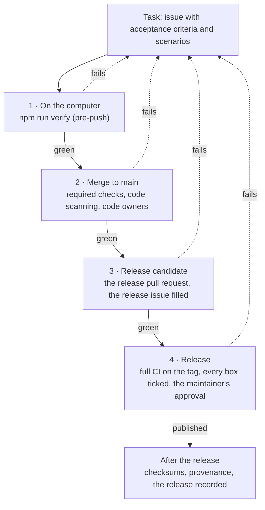

# Quality gates

Every change to Xomoni passes the same four gates, whether a person or an AI agent wrote it. Each rule below is a command or a GitHub setting, so forgetting it doesn't skip it. The decisions: [ADR-0037](adr/0037-one-written-gate-for-every-merge-and-release.md) (the gates), [ADR-0038](adr/0038-user-scenarios-for-every-user-facing-task.md) (user scenarios), [ADR-0039](adr/0039-the-readme-comes-from-the-feature-registry.md) (the README).

## Definition of done

A task is done when all of this is true in the pull request that finishes it:

1. The pull request links its task: `Closes #N`, `Fixes #N` or `Part of #N`.
2. The code is in the right layer, and `npm run verify` passes ([architecture](ARCHITECTURE.md)).
3. Backend tests and frontend tests cover the behavior, including the failure and security cases ([testing](TESTING.md)).
4. **For a user-facing change:**
   - A scenarios file has at least 20 scenarios, each with its browser test ([ADR-0038](adr/0038-user-scenarios-for-every-user-facing-task.md)).
   - `CHANGELOG.md` has a line under `[Unreleased]`.
   - The feature is in `docs/features.json`, with the READMEs regenerated by `npm run readme` ([ADR-0039](adr/0039-the-readme-comes-from-the-feature-registry.md)).
5. The docs are current: a doc comment on every export, the unit's README, and `ARCHITECTURE.md` and an ADR when structure or a decision changes.
6. The task is ticked in [the roadmap](ROADMAP.md).

## The four gates

| Gate | When | What must pass | Enforced by |
| --- | --- | --- | --- |
| 1 · On the computer | Every `git push` | `npm run verify` | [`.githooks/pre-push`](../.githooks/pre-push) |
| 2 · Merge to `main` | Every pull request | `verify`, `database`, `e2e`, `pr-policy`, `dependency-review`, code scanning, a code owner's review of the gate's files | The "Protect main" ruleset |
| 3 · Release candidate | The release pull request | The whole suite; the release issue opened and every box ticked | [The release issue template](../.github/ISSUE_TEMPLATE/release.md) |
| 4 · Release | A `vX.Y.Z` tag | Full CI on the tagged commit, `npm audit` at high, the release issue complete, the maintainer's approval | [`release.yml`](../.github/workflows/release.yml) and the `release` environment |

## Rules and what enforces them

"Planned" rules are decided and apply now. Reviews hold them until their check lands, in the issue named.

| # | Rule | Enforced by | Status |
| --- | --- | --- | --- |
| R1 | Formatting, lint with no warnings, a doc comment on every export | `npm run verify` | Enforced |
| R2 | Strict TypeScript, no `any`, no inline lint exceptions ([ADR-0016](adr/0016-strict-typescript-and-type-aware-lint.md)) | `npm run verify` | Enforced |
| R3 | Code in the right layer ([ADR-0015](adr/0015-architecture-styles-principles-and-patterns.md)) | `npm run arch` | Enforced |
| R4 | A README for every unit, an up-to-date architecture, valid ADRs, working links, documented environment variables ([ADR-0009](adr/0009-documentation-is-a-merge-gate.md)) | `npm run docs:check` | Enforced |
| R5 | Every source file has a test; coverage thresholds only go up ([ADR-0017](adr/0017-test-standard.md)) | `npm run tests:check`, Vitest thresholds | Enforced |
| R6 | A backend test and a frontend test for every feature, with failure and security cases | Review, the pull request template | Review |
| R7 | Row Level Security tests; generated types match the migrations | CI `database` | Enforced |
| R8 | Real flows in a real browser | CI `e2e` | Enforced for the website in Chromium. The extension, Edge and axe: #342 |
| R9 | At least 20 user scenarios per user-facing task, each tied to its browser test | `npm run scenarios:check`, `pr-policy` | `pr-policy` enforced (#350); `scenarios:check`: #338 |
| R10 | A task link; a changelog line for a user-facing change; every exemption with a written reason | `pr-policy` | Enforced (#350) |
| R11 | The READMEs' features and status match `docs/features.json`, and the registry matches the changelog | `npm run readme:check`, `node tooling/release.mjs check` | Enforced (#349) |
| R12 | No new dependency with a high or critical vulnerability | `dependency-review`; `npm audit` in the release | `dependency-review` enforced (#350); `npm audit`: #340 |
| R13 | No open high or critical code scanning alert | The ruleset's code scanning rule | Planned: #341, #346 |
| R14 | No remotely hosted code in the extension | `npm run remote-code:check` | Enforced |
| R15 | Releases only from `main`: reproducible, signed, with provenance; tags never move | `release.yml`, the tag rulesets | Enforced |
| R16 | No release before the checklist is complete and the maintainer approves | The `release` environment; the release issue check | The environment since 2026-11-21. The issue check: #340 |
| R17 | The gate's own files are reviewed by the maintainer | [`CODEOWNERS`](../.github/CODEOWNERS), the ruleset | Planned: #346, once agents have their own account |
| R18 | The whole suite every night on `main`, and a check of each published release | A nightly workflow | Planned: #343 |

## Exemptions

A user-facing pull request may skip a rule only with a label and a reason written in its description:

- `no-changelog`: with a line `No changelog: <why>`, for a change no user would notice, such as a refactor or a typo.
- `no-scenarios`: with a line `No scenarios: <why>`, for a change to no behavior a person can see.

Dependabot's pull requests need no task link. Reviews and the release checklist look at every exemption.

## The release checklist

Each version gets an issue opened from [the Release template](../.github/ISSUE_TEMPLATE/release.md), before the release pull request. Tick a box only once you have checked it, and link the proof: the CI run, the smoke test's notes. The release workflow will refuse to publish while a box is unticked (#340). After publishing, it comments the release on the issue and closes it. [Releasing](RELEASING.md) has the steps.

## Changing a rule

1. Write an ADR that says what changes and why.
2. Change the rule, its check and this page in the same pull request.
3. The maintainer reviews it ([`CODEOWNERS`](../.github/CODEOWNERS)).

Rules get stricter, never looser, unless the ADR explains why. Never relax a rule, a threshold or a required check to make a check pass ([`AGENTS.md`](../AGENTS.md)).
