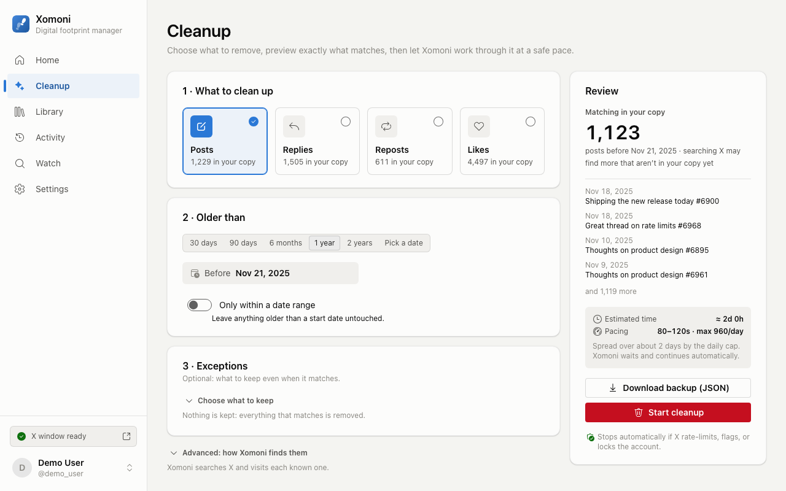

# Store listing: Chrome Web Store and Microsoft Edge Add-ons

Everything the two stores ask for, ready to paste: the permission justifications, the privacy answers, the listing text, the images and the notes for reviewers. It is phase 3 of the one-click install project ([#301](https://github.com/pirdehi/xomoni/issues/301)). The plan is to publish on the Chrome Web Store as **Unlisted** first, and on Microsoft Edge Add-ons as **Hidden**.

> **Status: drafts.** Nothing has been submitted, and no store account exists yet (the maintainer makes them in phase 0: [guide, in Persian](STORE-ACCOUNTS-GUIDE.fa.md)). The name (§3) and the category were decided on 2026-11-21, and the manifest carries the name and the short description (#312). The detailed description (§4) and the privacy answers (§7) still need the maintainer's approval.

Contents:
1. [What each store needs](#1-what-each-store-needs)
2. [Single purpose](#2-single-purpose)
3. [Name](#3-name)
4. [Listing text](#4-listing-text)
5. [Permissions and why each is needed](#5-permissions-and-why-each-is-needed)
6. [No remote code](#6-no-remote-code)
7. [Privacy practices](#7-privacy-practices)
8. [Images](#8-images)
9. [Notes for reviewers](#9-notes-for-reviewers)
10. [Open questions for the maintainer](#10-open-questions-for-the-maintainer)

## 1. What each store needs

The package is the store build: `xomoni-extension-store-X.Y.Z.zip`, which the release workflow builds with `npm run build:store -w @xomoni/extension` and attaches to each GitHub release, and which the store workflow sends after checking its checksum and build provenance ([releasing](RELEASING.md#chrome-web-store-and-edge-add-ons)). It is the same code as the `xomoni-extension-X.Y.Z.zip` beside it, without the one-click updater, since a store updates Xomoni itself ([ADR-0033](adr/0033-one-click-updates-for-the-zip-install.md)). Both stores take the name and the short description from the manifest. To change either one, upload a new zip.

| Field | Chrome Web Store | Microsoft Edge Add-ons | Xomoni |
| --- | --- | --- | --- |
| Visibility | Distribution → Visibility: Public, Unlisted or Private | Availability → Visibility: Public or Hidden | **Unlisted** / **Hidden**: anyone with the link can install, and search doesn't show it |
| Markets | All regions by default | All markets by default | All |
| Name | Manifest `name`, at most 75 characters | Manifest `name` (Extension name) | §3 |
| Short description | Manifest `description`, at most 132 characters (the summary) | Manifest `description` (Short description) | §4 |
| Detailed description | Store listing → Description | Required, 250 to 10,000 characters | §4 |
| Category | Required, one category | Required | **Tools**, decided on 2026-11-21: Xomoni is a tool that manages a person's digital footprint, not a social network. Chrome: *Productivity › Tools*. Edge has no *Tools*: *Productivity* |
| Language | Required | One listing per language in the package | English. A Persian listing as well would need `_locales` in the package, which it doesn't have yet |
| Store icon | 128 × 128 PNG in the zip and on the listing: 96 × 96 artwork, 16 px transparent on each side | Extension logo: 1:1, 300 × 300 recommended, at least 128 × 128 | [`store/icon-128.png`](store/icon-128.png), [`store/edge-logo-300.png`](store/edge-logo-300.png) |
| Screenshots | 1 to 5, 1280 × 800 or 640 × 400, square corners, no padding | Optional, up to 6, 1280 × 800 or 640 × 480 | Five at 1280 × 800 (§8) |
| Small promo tile | 440 × 280. Optional on the images page, which lists items without one after those with one; older pages call it required | Optional, 440 × 280 | [`store/promo-small-440x280.png`](store/promo-small-440x280.png) |
| Marquee / large promo tile | Optional, 1400 × 560 | Optional, 1400 × 560 | None for now |
| Video | Optional, YouTube | Optional, YouTube | None |
| Homepage | Homepage URL | Website | https://xomoni.com |
| Support | Support URL | Support contact detail | https://github.com/pirdehi/xomoni/issues |
| Official URL | Optional: a site verified in Google Search Console | — | xomoni.com, once the maintainer verifies it |
| Privacy policy | Privacy practices → Privacy policy URL | Privacy → Privacy Policy URL | https://xomoni.com/privacy |
| Mature content | Toggle | Checkbox | No |
| Single purpose | Privacy practices | Privacy → Single Purpose | §2 |
| Permission justifications | One field per permission, plus host permissions | Permission justification | §5 |
| Remote code | "No, I am not using remote code" | "No, I am not using remote code" | §6 |
| Data usage and certifications | Privacy practices | Privacy → Data usage | §7 |
| Search terms | — | Optional: at most 7 terms, each at most 30 characters, 21 words in all | `digital footprint`, `delete old posts`, `delete tweets`, `remove likes`, `undo reposts`, `delete replies`, `account cleanup` |
| Notes for reviewers | No general field is documented: the text feeds the justifications, and an appeal | Notes for certification, optional | §9 |

Sources: Chrome's [listing](https://developer.chrome.com/docs/webstore/cws-dashboard-listing), [images](https://developer.chrome.com/docs/webstore/images) and [privacy](https://developer.chrome.com/docs/webstore/cws-dashboard-privacy) pages, and Microsoft's [Publish a Microsoft Edge extension](https://learn.microsoft.com/microsoft-edge/extensions/publish/publish-extension), read on 2026-11-21. Check them again before submitting.

## 2. Single purpose

The same text for both stores:

<!-- single-purpose:start -->
Xomoni manages a person's own digital footprint, which today means helping them clean up their own X account. It finds their old posts, replies, reposts and likes, lets them choose what to remove and confirm it, and then removes it in their own signed-in X tab, through X's own website, slowly and within X's limits. Everything else in Xomoni serves that one purpose:
- a copy of the account on the computer to choose from;
- X's own archive, to reach old posts X no longer shows;
- the activity log and account health, to follow the work safely;
- an optional xomoni.com account, to follow progress from another device.

What Xomoni learns about the account stays on the person's computer.
<!-- single-purpose:end -->

## 3. Name

*Decided on 2026-11-21* ([#312](https://github.com/pirdehi/xomoni/issues/312)). The name was "Xomoni — X Account Manager", which next to an icon that looks like a letter X may read as X's own product; stores refuse listings that suggest an affiliation. The maintainer named the product and its title:

<!-- name:start -->
Xomoni — Digital footprint manager
<!-- name:end -->

It is the manifest's `name` (a test checks they agree, and Chrome's limit of 75 characters). It names no platform: Xomoni works on X today, and on the person's email and other places later. The short name stays `Xomoni`. Every description says **"Not affiliated with X Corp."**

## 4. Listing text

The short description follows the name (#312). The detailed description needs the maintainer's approval.

### Short description (the manifest's `description`)

At most 132 characters; the manifest carries it, and a test checks they agree:

<!-- summary:start -->
Manage your digital footprint, starting with X: review and remove your old posts, replies, reposts and likes, on your computer.
<!-- summary:end -->

### Detailed description

Plain text, for both stores:

<!-- detailed-description:start -->
```text
Xomoni is a digital footprint manager. Today it works on your own X (formerly Twitter) account: it finds your old posts, replies, reposts and likes, shows you exactly what matches, and removes what you choose, slowly and within X's limits, in your own signed-in X tab. What it learns stays on your computer.

Not affiliated with X Corp. Xomoni is an independent, free and open-source project (MIT license).

WHAT YOU CAN DO
• Remove posts, replies, reposts or likes older than a date, or between two dates.
• Keep what matters: posts with at least a number of likes, posts with certain words, links you paste, and replies in your own threads.
• See every match before anything happens, download a backup, then type DELETE to start.
• Reach past the roughly 3,200 posts your profile shows: Xomoni searches X and reads your X archive, which it helps you request on X's own page.
• Pause, close the browser and carry on later where you stopped.
• If you like, follow progress from any device on xomoni.com.

HOW IT STAYS CAREFUL
• Xomoni clicks X's own buttons in a normal X tab, as you would. X's website sends every request; Xomoni never builds its own.
• It uses at most one fifth of every limit X announces, goes slower on an account's first days, takes breaks, and stops at X's first warning.
• You confirm every cleanup. Before an account's first one, Xomoni explains the risks and asks you to type I UNDERSTAND.
• It never asks for, stores or reads your X password or session cookies, never solves captchas, and never hides that it is automation.

YOUR DATA
• Your posts, likes, replies, archive and activity log stay in your browser, on your computer. Xomoni sends none of them to any server.
• A xomoni.com account is optional. If you connect one, only job status goes there (titles, states and counts), and your daily numbers only if you turn them on.
• No ads, no analytics, no tracking.

BEFORE YOU START
Deletions on X are permanent. X's rules prohibit non-API automation, such as scripting its website, and X can limit, lock or suspend accounts that break its rules. Xomoni keeps far below X's limits and stops at X's first warning, but it can't promise what X will do. The decision is yours: https://xomoni.com/risks

Privacy policy: https://xomoni.com/privacy
Source code: https://github.com/pirdehi/xomoni
Help and bug reports: https://github.com/pirdehi/xomoni/issues
```
<!-- detailed-description:end -->

## 5. Permissions and why each is needed

Each item in [`manifest.json`](../apps/extension/public/manifest.json), where the code uses it, and the one line to paste into the store's justification field. Paths are under `apps/extension/src/`. Nothing was removed in this audit: every permission is in use. `apps/extension/tests/manifest.test.ts` fails if one stops being used, or is used outside the files named here, and `tooling/store-listing.test.mjs` fails if this table misses an item of the manifest.

| Manifest item | Where the code uses it | Justification for the store |
| --- | --- | --- |
| `storage` | `engine/worker-tab.ts` and `background/sw.ts`: `chrome.storage.session` holds the tab id of the X window Xomoni opened. `cloud/connection.ts`: reads `chrome.storage.local` once, to move a xomoni.com connection an older version kept there into IndexedDB. | Remembers, for this browser session only, which tab is the X window Xomoni opened, so it acts in that tab and never in the person's other tabs. |
| `unlimitedStorage` | `shared/db.ts`: the IndexedDB database (Dexie) with the inventory (including what was read from X's archive), the activity log, jobs and settings. No API call. | Keeps the person's copy of their posts and likes, including those read from their X archive, and the activity log on their computer. These grow large for accounts with years of posts, and Chrome must not evict them during a cleanup that runs for days. |
| `notifications` | `shared/notify.ts` creates them; `background/sw.ts` handles clicks. | Tells the person when a cleanup ends or when X needs them (to sign in, pass a check or confirm it's them); a click opens the dashboard or the X window. |
| `idle` | `engine/presence.ts`: `chrome.idle.queryState`, used by `engine/context.ts`. | Checks only whether the person is away, so a covered X window is brought forward while they are away, never while they are using the computer. |
| `power` | `engine/presence.ts`: `chrome.power.requestKeepAwake('display')` while a job runs with *Keep going while I'm away* on, released when it stops. | Keeps the display awake while a cleanup runs, because Chrome pauses an X page that isn't on screen; it is released as soon as the job pauses or ends. |
| `downloads` | `background/archive-downloads.ts`, registered in `background/sw.ts` (`downloads.onDeterminingFilename`); `ui/downloads-folder.ts` (`download`, `search`, `erase`). | While Xomoni expects the person's X archive, it saves that ZIP, downloaded from X's own page, in Downloads/Xomoni, the folder the person lets Xomoni read. It moves, reads or keeps no other download. |
| `content_scripts`: `content.js` on `https://x.com/*`, at `document_start` | `content/`: `actor.ts` clicks, `dom.ts` reads the page, `net.ts` passes on what X answered. | Carries out the cleanup the person confirmed, one click at a time on X's own Delete, Undo repost and Unlike buttons in their signed-in X tab, and reads which posts the page shows and which account is signed in. |
| `content_scripts`: `inject.js` on `https://x.com/*`, `"world": "MAIN"`, at `document_start` | `inject/interceptor.ts` | Reads, never changes or sends, the responses X's own web app receives, to confirm each deletion and to read X's rate-limit headers, so Xomoni stays within one fifth of them. It must run in X's page from the start to see those responses. |
| `externally_connectable`: `https://xomoni.com/*` | `background/sw.ts` (`runtime.onMessageExternal`) and `cloud/website.ts` | Lets the person's own xomoni.com pages in the same browser sign Xomoni in, show its status, pause or cancel a job and hand over a cleanup plan, which the person then confirms in Xomoni. Only xomoni.com can send, and no other extension. |
| `content_security_policy` (`extension_pages`) | The dashboard and the service worker | Locks the dashboard down: scripts only from the extension, connections only to Xomoni's own API, images only from the extension and X's avatar servers. |
| `incognito`: `not_allowed` | — | Xomoni never runs in incognito windows. |
| `minimum_chrome_version`: `116` | `background/sw.ts`: `chrome.runtime.getContexts` finds an open dashboard. | Chrome 116 is the first version with that API. |

Only in `xomoni-extension-X.Y.Z.zip` on GitHub Releases, never in the store build: `optional_host_permissions` for GitHub's release downloads, and the same two hosts in the CSP's `connect-src`, which the zip's one-click update uses (#305, [ADR-0033](adr/0033-one-click-updates-for-the-zip-install.md)). `npm run build:store` removes them with the updater's code, and `tooling/store-build.test.mjs` checks the built manifest. So the store's manifest is this table, with no other host access.

The **host permission** field (Chrome asks about the `https://x.com/*` matches of the content scripts): *Xomoni works only on x.com, in the person's own signed-in tab: it removes the posts, replies, reposts and likes they chose, by clicking X's own buttons, and reads X's responses to confirm each one and to stay within X's rate limits. It has no other host access.*

Install warnings this gives: *Read and change your data on x.com*, *Display notifications* and *Manage your downloads*.

Used without a permission, and worth knowing for review:
- `chrome.tabs` and `chrome.windows` open Xomoni's dashboard and its small X window, and focus or close that window. On install they open xomoni.com/welcome. Xomoni reads no tab's address.
- `chrome.management.getSelf` tells whether Xomoni was loaded unpacked (a zip install). Only then does Home offer the steps to the store's Xomoni, and a button that opens Xomoni's own card on the extensions page; the person removes the old copy there, never Xomoni ([ADR-0034](adr/0034-distribution-through-the-browsers-stores.md)). It needs no permission.
- **Run hidden** ([ADR-0020](adr/0020-run-hidden-by-sharing-the-x-tab.md)) uses the page API `getDisplayMedia`. Chrome's own picker asks the person to share the X tab, so Chrome keeps drawing it while its window is minimized. Its frames are never read, shown, stored or sent.

## 6. No remote code

Answer in both stores: **No, I am not using remote code.**

- Every script ships in the zip. The dashboard and the service worker are bundled by Vite, and the content scripts by esbuild ([`apps/extension/README.md`](../apps/extension/README.md)).
- The store build has no updater. The zip on GitHub Releases can update itself: it downloads a signed release and writes it into its own folder, which Chrome loads on the next reload. None of that code is in the store build (`npm run build:store`, checked by `tooling/store-build.test.mjs`), which each release attaches as `xomoni-extension-store-X.Y.Z.zip` for the stores.
- The extension's CSP allows scripts and workers only from the extension itself (`script-src 'self'`, `worker-src 'self'`, no `'unsafe-eval'`).
- `npm run remote-code:check`, a step of `npm run verify`, builds the extension and reads every script and page in `apps/extension/dist`, libraries included. The release workflow runs the same check on both builds it zips, the store build included. The check fails on any of these ([`tooling/remote-code-lib.mjs`](../tooling/remote-code-lib.mjs), tested by `tooling/remote-code.test.mjs`):
  - code built from a string: `eval`, `new Function`, `Function` or `setTimeout` with a string;
  - code from elsewhere: `importScripts`, an `import` or a `Worker` from a URL, a `<script>` from another site;
  - an inline `<script>` or event handler, `executeScript` with code, WebAssembly compiled at run time;
  - a manifest script that is a URL or isn't in the bundle;
  - a CSP that lets scripts in from anywhere but the extension.

## 7. Privacy practices

*Needs the maintainer's approval.* These answers have to match [xomoni.com/privacy](https://xomoni.com/privacy), and they do as written. Both stores ask about data handled at all, even data that never leaves the computer.

### Data types (Chrome Web Store; Edge asks the same)

| Category | Tick | What Xomoni handles |
| --- | --- | --- |
| Personally identifiable information | **Yes** | The handle and name of the person's X account, kept on the computer; the handle goes to xomoni.com with job summaries if they connect an account. While connecting, the extension shows that account's email address, masked. |
| Health information | No | — |
| Financial and payment information | No | — |
| Authentication information | **Yes** (see §10) | Only Xomoni's own credential: the device token xomoni.com issues when the person connects a browser. Never X passwords, X session cookies or X tokens. |
| Personal communications | No | Xomoni never opens direct messages or email. |
| Location | No | — |
| Web history | No | No list of pages visited. To respect X's limits it counts its own page loads in the X window for 24 hours: a time and a kind, no address. |
| User activity | **Yes** | Network monitoring on x.com only: the page script reads the responses X's web app receives, to confirm actions and read rate-limit headers. No keystrokes, mouse movement or clicks are recorded. |
| Website content | **Yes** | The text and dates of the person's own posts, replies, reposts and likes, and replies others wrote to them, from x.com and from their X archive, kept on the computer. |

What leaves the computer, and only after the person connects an optional xomoni.com account: job summaries (title, type, state, counts, times, X handle, a risk level from 0 to 4), the browser's name (such as "Chrome on macOS") and the extension version. The daily counts go only if the person turns them on. The person's xomoni.com pages in the same browser can show Xomoni's data, kept in that page's memory and never sent to a server ([ADR-0028](adr/0028-xomoni-data-on-the-website-in-the-same-browser.md)).

### Certifications (tick all three)

- I do not sell or transfer user data to third parties, outside of the approved use cases.
- I do not use or transfer user data for purposes that are unrelated to my item's single purpose.
- I do not use or transfer user data to determine creditworthiness or for lending purposes.

This is how Google's form words them; Edge's are alike. Read them again when filling in the form: each one must stay true.

### Privacy policy URL

https://xomoni.com/privacy in both stores.

### For later: a sentence on the privacy page

Installs from a store aren't possible yet, so the privacy page doesn't change now. Once the listings are live, add this sentence to the end of *What stays on your computer* in `apps/web/src/app/privacy/page.tsx`, with a new date:

```diff
         Xomoni or anyone else. Xomoni never asks for, reads or stores your X password, and it does not read your X
-        session cookies.
+        session cookies. Whether you install Xomoni from GitHub, the Chrome Web Store or Microsoft Edge Add-ons, it is
+        the same extension and this policy applies to it; the store itself works under Google’s or Microsoft’s own
+        privacy policy.
       </p>
```

## 8. Images

Made by `npm run store:images -w @xomoni/extension` ([`apps/extension/scripts/store-images.mjs`](../apps/extension/scripts/store-images.mjs)), into [`docs/store`](store):
- the icons come from the same drawing as the extension's own icons (`scripts/icon.mjs`);
- the screenshots come from the dashboard's UI preview with its made-up demo account, `@demo_user`, never real data;
- the script starts Vite on 127.0.0.1 port 4791 (`--port` to change it) and uses Playwright's Chromium, headless;
- run `npx playwright install chromium` once first;
- nothing reaches X or xomoni.com.

`tooling/store-listing.test.mjs` checks each file's size, and that the screenshots and the tile have no transparency: the dashboard has long asked for JPEG or 24-bit PNG without alpha there.

| File | Size | For |
| --- | --- | --- |
| [`icon-128.png`](store/icon-128.png) | 128 × 128, transparent padding | Chrome store icon (the zip's `icons/icon128.png` is the full-size version) |
| [`edge-logo-300.png`](store/edge-logo-300.png) | 300 × 300 | Edge extension logo |
| [`screenshot-1-overview.png`](store/screenshot-1-overview.png) | 1280 × 800 | Home: what is still on the account, by year, and a paused cleanup |
| [`screenshot-2-cleanup.png`](store/screenshot-2-cleanup.png) | 1280 × 800 | Cleanup: what to remove, the date, the exceptions, and the review with pacing |
| [`screenshot-3-library.png`](store/screenshot-3-library.png) | 1280 × 800 | Library: the copy on the computer and X's archive |
| [`screenshot-4-activity.png`](store/screenshot-4-activity.png) | 1280 × 800 | Activity: a job, its progress and account health |
| [`screenshot-5-settings-dark.png`](store/screenshot-5-settings-dark.png) | 1280 × 800 | Settings in dark mode: the one-fifth pacing and the schedule |
| [`promo-small-440x280.png`](store/promo-small-440x280.png) | 440 × 280 | Small promo tile, both stores |



## 9. Notes for reviewers

For Edge's *Notes for certification*, Chrome's justification fields, and an appeal to either store.

<!-- reviewer-notes:start -->
```text
What Xomoni is
Xomoni is a free, open-source extension (MIT, https://github.com/pirdehi/xomoni) that helps a person delete their own old posts, replies, reposts and likes on X. It acts only on the X account signed in in the person's own browser, and only after the person confirms each cleanup. Not affiliated with X Corp.

Why it runs on x.com
X's website deletes one post at a time, and X's API is paid and slow for this. Xomoni does in X's own web page what the person would do by hand. It opens X in a small window of their browser, and its content script clicks X's own Delete, Undo repost and Unlike buttons, one at a time, with pauses. X's website sends every request itself; Xomoni never builds, changes, delays or replays a request. The script in the page's MAIN world only reads the responses X's web app already receives: to confirm each deletion, and to read X's rate-limit headers so Xomoni stays far inside them.

Safety rules, enforced in code and tests
1. Pace: at most one fifth of every limit X announces, slower on an account's first days, with breaks and active hours. It stops at X's first warning (a rate limit, an "automated" error, a lock) and waits, or asks the person.
2. No credentials: Xomoni never asks for, stores or reads X passwords or X session cookies, and writes no cookies. It reads one cookie, twid, which holds the signed-in account's numeric id, to make sure it acts on the account the person chose. When X asks the person to sign in or confirm it's them, Xomoni pauses and the person does it on X's own page.
3. No evasion: no captcha solving, proxies, fingerprint changes, forged headers, chrome.debugger or synthesized trusted input events. Its page script is not hidden from X.
4. Confirmation for every job: each cleanup shows exactly what matches and starts only after the person types DELETE. Before an X account's first job, the person reads the risks, including X's automation rules, and types I UNDERSTAND. The website xomoni.com cannot start or approve a deletion.
5. Data stays local: what Xomoni learns from X stays in the browser's IndexedDB on the computer. The extension's CSP lets its pages connect only to Xomoni's own API. With an optional xomoni.com account, that API receives job status only (titles, states and counts), and daily counts only if the person turns them on.

Permissions
storage: the tab id of the X window it opened. unlimitedStorage: the local copy of the account, which grows large. notifications: tells the person when X needs them or a job ends. idle and power: keep the display on during a job and bring the X window forward when the person is away, because Chrome pauses pages that aren't on screen. downloads: saves the person's X archive ZIP in Downloads/Xomoni so Xomoni can read it; no other download is touched. externally_connectable: only xomoni.com, so the person's own xomoni.com pages can show status and sign Xomoni in.

How to test
1. Install. Xomoni's dashboard opens, and xomoni.com/welcome in front of it; that tab can be closed, and no Xomoni account is needed.
2. Sign in to any X account in the X window Xomoni opens. We can't provide an X test account: Xomoni never handles X credentials.
3. Library: read the account's recent posts. Cleanup: pick Likes or Posts and a date, review the matches, type DELETE.
4. Pause at any time. "Run hidden" asks, through Chrome's own picker, to share the X tab so it keeps running minimized; the frames are never read.

Remote code: none. Every script ships in the package. There is no eval or new Function, and an automated check of every build enforces this.
Privacy policy: https://xomoni.com/privacy
Contact: privacy@xomoni.com
```
<!-- reviewer-notes:end -->

## 10. Open questions for the maintainer

1. ~~**Name** (§3)~~: decided on 2026-11-21, *Xomoni — Digital footprint manager* (#312).
2. **The icon looks like X's logo.** It is a white X on a dark rounded square, which is close to X's own mark, and the likeliest cause of a trademark refusal. Redraw it before submitting. The dashboard's subtitle is now "Digital footprint manager" (#312); the 𝕏 badge on the connection map still shows in screenshot 5.
3. **Short and detailed description** (§4): approve, or change. Should the description quote X's automation rule, as the consent text does? It is honest, and it matches what the person agrees to in Xomoni, but it may draw a reviewer's attention.
4. **"Authentication information"** (§7): tick it for the device token, as drafted, or leave it unticked because the token is Xomoni's own credential, not something the person gives? Ticking it is the safer reading of the policy, but the listing would then show "Authentication information" to everyone.
5. **Watch** ([ADR-0021](adr/0021-watch-x-search-read-only.md)) reads X's search for phrases the person picks. It is read-only, but a reviewer may see it as a second purpose. The single-purpose text doesn't mention it. If a reviewer asks, describe it as part of keeping an eye on the account, or leave it out of the store build.
6. ~~**`homepage_url`**~~: now https://xomoni.com, with the name (#312).
7. ~~**Category**~~: decided on 2026-11-21, *Tools* (§1).
8. **Privacy page:**
   - The store-install sentence waits for the listings (§7).
   - One-click connection, what xomoni.com shows from the extension in the same browser (ADR-0028) and the replies kept (ADR-0030) are in the policy (#320).
9. **Official URL:** verifying xomoni.com in Google Search Console (part of phase 0) shows it on the Chrome listing as the publisher's site.
