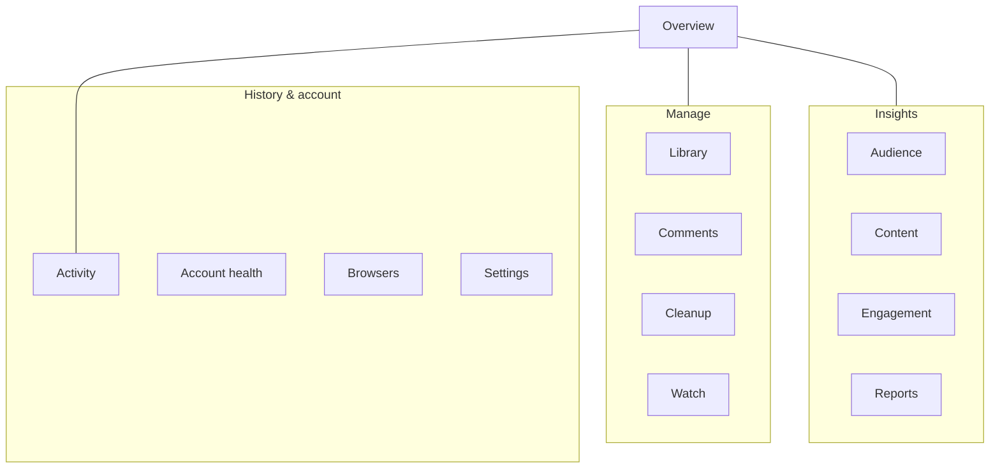

[فارسی](DASHBOARD-PLAN-2026-11-19.fa.md)

# The full dashboard on xomoni.com

> The plan agreed with the maintainer on 19 November 2026 (#248).
> - xomoni.com becomes the place to see and manage the X account: everything the extension has, and much more.
> - The extension collects and carries out; the website shows, reports and plans.
>
> It builds on the [website UX review](UX-REVIEW-WEBSITE-2026-11-17.md) and replaces its app-shell task (#245).

## What was decided

| # | Question | Decision |
| --- | --- | --- |
| 1 | Where do the numbers live? | **Daily numbers in the cloud, by the person's choice** ([ADR-0026](../../adr/0026-daily-numbers-in-the-cloud.md)). Counts per day only; never text, ids or other people. Off until turned on. Turning it off deletes them. |
| 2 | How actively does Xomoni collect? | **Without risk: no extra request to X.** Only what X already sends to the person's browser: pages they or a job open, scans they start, the archive. |
| 3 | How far back? | *Published* from the archive, back to the account's first day. *Received* and follower changes from the first day the numbers are on. |
| 4 | Who unfollowed? | Only by comparing two imported archives. Xomoni never scrolls follower lists. The lists stay in the browser. |
| 5 | Other people's replies? | Shown, with *Open on X* to hide one. X lets nobody delete them, and Xomoni won't automate hiding. |
| 6 | Several X accounts? | Yes: an account picker on every page. The extension already keeps accounts apart. |
| 7 | The extension's actions on the website? | **Every action is there, in the same browser only, and approved in Xomoni** ([ADR-0027](../../adr/0027-extension-actions-from-the-website.md)). Without Xomoni, one dialog says why. |

## Principles

1. **Never an empty wall.**
   - Every section shows from the first visit what it will hold.
   - Setting up is a slim bar at the top, not a full page.
   - An empty section names the one step that fills it, such as *Import your X archive* or *Turn on daily numbers*.
2. **Every number says where it comes from and how fresh it is:** *archive of 10 Nov*, *seen in Chrome on macOS 2 h ago*, or *removed by Xomoni*. Estimates are marked as estimates, with their coverage.
3. **One account picker and one period picker** for every page, kept in the address (`?account=…&period=30d`).
4. **Same names as the extension.** A place called *Library* in Xomoni is *Library* on the website.
5. **Phone first for reading, computer for acting.** The phone shows every number. Actions on X say *Open on your computer*.

## The structure



```
Desktop                                                     Phone
┌──────────────┬───────────────────────────────────────┐    ┌───────────────────────┐
│ Xomoni       │ [@omid ▾] [Last 30 days ▾] ⟳ 2 h ago ⤓ │    │ [@omid ▾] [30 d ▾]    │
│              ├───────────────────────────────────────┤    │ All is well · 62 %    │
│ ⌂ Overview   │ All is well · “Old replies” 62 %       │    │ ┌─────┬─────┬─────┐   │
│ INSIGHTS     │ ┌──────┬──────┬──────┬──────┬────┬───┐ │    │ │+42  │ 38  │1.2k │   │
│  Audience    │ │Follow│Posts │Likes │Repl. │Rate│Rem│ │    │ │foll.│posts│likes│   │
│  Content     │ │ +42▲ │ 38   │1,240 │ 216  │3.1%│337│ │    │ └─────┴─────┴─────┘   │
│  Engagement  │ └──────┴──────┴──────┴──────┴────┴───┘ │    │ [followers chart]     │
│  Reports     │ [Followers over time] [Posting calendar]│    │ [top posts]           │
│ MANAGE       │ [Top posts]           [Recent cleanup]  │    │                       │
│  Library     │                                        │    ├───────────────────────┤
│  Comments    │                                        │    │ ⌂   ◔   💬   ⋯        │
│  Cleanup     │                                        │    └───────────────────────┘
│  Watch       │                                        │
│ HISTORY      │                                        │
│  Activity    │                                        │
│  Health      │                                        │
│  Browsers    │                                        │
│  Settings    │                                        │
└──────────────┴───────────────────────────────────────┘
```

## The sections

| Section | What it shows | What you can do there | Issue |
| --- | --- | --- | --- |
| **Overview** | Status (all well, X needs you, the running job); six figures against the previous period (followers, posts, likes received, replies received, engagement rate, removed); followers over time; a publishing calendar; top posts; recent cleanup; the next step | Pause the running job; open what needs you | [#252](https://github.com/pirdehi/xomoni/issues/252) |
| **Audience** | Followers and following over time; net gained or lost per day; milestones; the ratio; who followed or unfollowed between two archives | Import a newer archive | [#253](https://github.com/pirdehi/xomoni/issues/253) |
| **Content** | Published per day and week by kind; best day and hour (heatmap); top posts; posts with no engagement; how old the posts still online are | Send the no-engagement posts or the old ones to Cleanup | [#254](https://github.com/pirdehi/xomoni/issues/254) |
| **Engagement** | Likes, replies, reposts, quotes and views received per day (estimates, with coverage); the share of posts with likes; your replies that got likes; the engagement rate | Open a post on X | [#255](https://github.com/pirdehi/xomoni/issues/255) |
| **Reports** | Weekly, monthly, cleanup report (proof of what was removed), year in review; a builder (metrics × period × account) | Export CSV or PDF; email a weekly digest | [#257](https://github.com/pirdehi/xomoni/issues/257) |
| **Library** | Every post, reply, repost and like Xomoni knows, searchable (as in the extension) | Select for a cleanup; download a copy | [#233](https://github.com/pirdehi/xomoni/issues/233) |
| **Comments** | *Your replies* (by date, likes, who, keyword); *Replies to you* (per day, who replies most) | Select your replies for a cleanup; open one of theirs on X to hide it | [#256](https://github.com/pirdehi/xomoni/issues/256) |
| **Cleanup** | The extension's three questions, a preview, keep rules | Plan it here; *Start in Xomoni* | [#235](https://github.com/pirdehi/xomoni/issues/235) |
| **Watch** | Phrases and mentions, mentions per day | Add a phrase; start or stop watching | [#233](https://github.com/pirdehi/xomoni/issues/233) |
| **Activity** | Every job and what it removed, when; the log | Pause, resume, cancel; export | [#233](https://github.com/pirdehi/xomoni/issues/233) |
| **Account health** | Risk level, X's limits, today's pace, warnings | Pause everything | [#233](https://github.com/pirdehi/xomoni/issues/233) |
| **Browsers** | Connected browsers, this one marked | Disconnect | today's dashboard |
| **Settings** | The extension's settings, *Show my numbers on xomoni.com* | Change them; they apply in Xomoni | [#234](https://github.com/pirdehi/xomoni/issues/234), [#250](https://github.com/pirdehi/xomoni/issues/250) |

## Where the data comes from

| Data | Source | Exact or estimate | From when |
| --- | --- | --- | --- |
| Posts, replies, reposts, quotes published per day | Archive + scans | Exact | The account's first day (with the archive) |
| Followers and following | Profile responses X already sends | Exact on days X showed them | First day the numbers are on |
| Net followers gained or lost per day | Difference between days | Exact when both days have a value | Same |
| Who followed or unfollowed | Two imported archives compared | Exact between the two dates | The first two archives |
| Likes, replies, reposts, quotes, views received per day | Increases seen in the counts of own posts | Estimate; coverage shown (`observed_posts`) | First day the numbers are on |
| Posts and replies that got likes | Counts of own posts | Exact as last seen | Now |
| Replies to you | Replies Xomoni has seen in pages X showed | Partial; labeled | Now |
| Mentions per day | Watch (`@handle`), only while the person runs it | Exact for what Watch saw | When Watch runs |
| Removed by Xomoni | The activity log | Exact | Always |
| Risk and warnings | The risk ladder | Exact | Last 30 days |

**What reaches the cloud:** only the daily numbers of ADR-0026, if the person turned them on, plus the job status of ADR-0004. Post text, lists of posts, people and replies are read by the website from Xomoni in the same browser (#233) and never stored on a server.

## In each situation

| Where the page is opened | Numbers and charts | Lists (posts, replies, people) | Actions |
| --- | --- | --- | --- |
| Computer, with Xomoni signed in to this account | Live from Xomoni, and the cloud | Live from Xomoni | Sent to Xomoni; work on X is confirmed there (ADR-0027) |
| Computer, Xomoni not installed | From the cloud, if turned on | *Open Xomoni to see them* | Each action opens the dialog: **You haven't installed Xomoni yet**, with the install steps and *I've installed it* |
| Computer, Xomoni signed out or another account | From the cloud | — | The dialog: *Sign in to Xomoni in this browser* |
| Phone or tablet | From the cloud | — | The dialog: *Xomoni runs on a computer*, with *Send to my computer* |

## Order of work (Phase 17)

1. **The shell** ([#245](https://github.com/pirdehi/xomoni/issues/245)):
   - every section and the pickers;
   - the setup bar instead of the empty wall;
   - today's data moved into Overview, Activity and Browsers.
2. **Actions and the dialog** ([#251](https://github.com/pirdehi/xomoni/issues/251), ADR-0027).
3. **Daily numbers:**
   - in the extension ([#249](https://github.com/pirdehi/xomoni/issues/249));
   - in the cloud, with the toggle and the privacy page ([#250](https://github.com/pirdehi/xomoni/issues/250), ADR-0026).
4. **Insights:** Overview ([#252](https://github.com/pirdehi/xomoni/issues/252)), Audience ([#253](https://github.com/pirdehi/xomoni/issues/253)), Content ([#254](https://github.com/pirdehi/xomoni/issues/254)), Engagement ([#255](https://github.com/pirdehi/xomoni/issues/255)).
5. **The extension's places from the same browser:** Library, Watch, Activity and Health ([#233](https://github.com/pirdehi/xomoni/issues/233)), Settings ([#234](https://github.com/pirdehi/xomoni/issues/234)), Cleanup ([#235](https://github.com/pirdehi/xomoni/issues/235)).
6. **Comments** ([#256](https://github.com/pirdehi/xomoni/issues/256)) and **Reports** ([#257](https://github.com/pirdehi/xomoni/issues/257)).

Each step:
- ships on its own;
- has tests on both sides;
- passes `npm run verify`;
- is shown on screen, on desktop and phone, before it merges.
