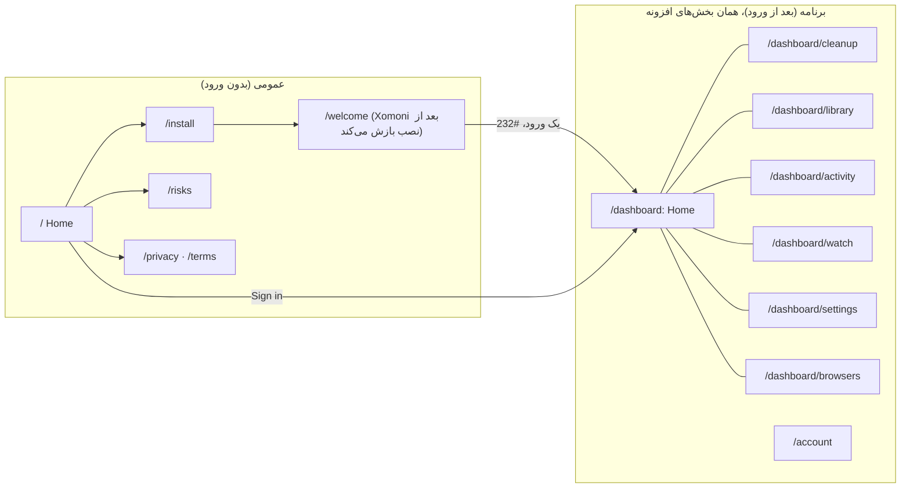

[English](UX-REVIEW-WEBSITE-2026-11-17.md)

<div dir="rtl">

# بررسی تجربه‌ی کاربری xomoni.com: ساختار و مسیرها

> این سند ساختار وب‌سایت را از چشم کسانی بررسی می‌کند که به آن سر می‌زنند، و می‌گوید فاز ۱۶ چه چیزهایی را عوض می‌کند. تاریخ بررسی ۱۷ نوامبر ۲۰۲۶ است، روی `main` بعد از [#236](https://github.com/pirdehi/xomoni/pull/236) (ورود یکپارچه).
> - صفحه‌های عمومی روی خود xomoni.com، در دسکتاپ و موبایل و در حالت روشن و تیره دیده شدند.
> - صفحه‌های بعد از ورود از روی کدشان بررسی شدند.
>
> ایرادهای جزئی هر صفحه در [#239](https://github.com/pirdehi/xomoni/issues/239) آمده‌اند و [#241](https://github.com/pirdehi/xomoni/pull/241) (فاز ۱۵) آن‌ها را رفع می‌کند: عددهای اشتباه، تصویر قدیمی، واژه‌هایی که با افزونه فرق دارند و منوی حساب تکراری. این‌ها اینجا تکرار نمی‌شوند. موضوع این بررسی ساختار است: سایت از چه ساخته شده، آدم‌ها در آن چطور جابه‌جا می‌شوند، و چطور با افزونه یک محصول واحد می‌شود ([فاز ۱۴](../../ROADMAP.md#phase-14--one-xomoni-the-website-and-the-extension-together)).

## چه کسانی به xomoni.com می‌آیند و چرا

| بازدیدکننده | معمولاً با | برای چه می‌آید | با چه چیزی می‌رود |
| --- | --- | --- | --- |
| **کسی که دارد تصمیم می‌گیرد** به Xomoni اعتماد کند، از یک لینک یا پست | موبایل | بفهمد چه می‌کند و امن است یا نه | دلیلی برای امتحانش روی کامپیوتر، یا نه |
| **کاربر تازه** که دارد راه‌اندازی می‌کند | کامپیوتر | نصب، ساخت حساب، اتصال | Xomoni آماده، با ورود در هر دو طرف |
| **کاربری که سری می‌زند** تا پاک‌سازی در جریان را ببیند | موبایل یا کامپیوتر دیگر | ببیند همه‌چیز رو‌به‌راه است و X او را لازم دارد یا نه | خیال راحت، یا همان یک کاری که باید بکند |
| **کاربر پشت کامپیوترش** (بعد از فاز ۱۴) | مرورگری که Xomoni دارد | هرچه افزونه نشان می‌دهد، به‌علاوه‌ی تنظیمات و برنامه‌ریزی | همان محصولِ داخل افزونه |

سایت امروز اولی را روی کامپیوتر خوب راه می‌اندازد. سه تای دیگر را فقط تا حدی.

## چه چیزهایی مانع است

### ۱. سایت و افزونه دو محصول جدا به نظر می‌رسند

- **دو ساختار متفاوت.**
  - افزونه شش بخش در منوی کناری دارد: *Home*، *Cleanup*، *Library*، *Activity*، *Watch* و *Settings*.
  - سایت بعد از ورود یک صفحه‌ی بلند *Dashboard* و یک صفحه‌ی *Account* دارد. هیچ صفحه‌ای در سایت با بخشی از افزونه جور نیست.
- **داشبورد یک ستون از همه‌چیز است.** این‌ها همه در یک صفحه‌اند:
  - نوار حساب؛
  - *Needs you*؛
  - ریسک حساب‌های X؛
  - کارها؛
  - مرورگرهای وصل؛
  - پنل اتصال.
  ناوبری بین بخش‌ها وجود ندارد. وقتی فاز ۱۴ کتابخانه و Watch و تنظیمات را اضافه کند، صفحه فقط بلندتر می‌شود.
- **صفحه‌هایی که فاز ۱۴ می‌آورد هنوز جایی ندارند.** #233 تا #235 اول یک پوسته‌ی برنامه لازم دارند:
  - ناوبری؛
  - آدرس صفحه‌ها؛
  - این‌که هر صفحه وقتی افزونه در همین مرورگر نیست چه نشان دهد.

### ۲. صفحه‌ی اصلی داستان هفته‌ی پیش را می‌گوید

- **بخش *Extension + website*** می‌گوید سایت *View only* است و اتصال با کد یک‌بارمصرف انجام می‌شود. حالا:
  - فاز ۱۴ سایت را جای دیدن و برنامه‌ریزی همه‌چیز می‌کند؛
  - #232 ورود را یک‌مرحله‌ای کرده؛
  - پیام تازه‌ی این بخش باید این باشد: *همه‌جا برنامه بریز، در مرورگرت اجرا کن*.
- **دو روایت از ریسک.**
  - بالای صفحه از سرعتی می‌گوید که *X قبول دارد*. بخش *Safety* می‌گوید *با محافظت‌های X کار می‌کند*.
  - راهنمای نصب می‌گوید خودکارسازی کارها *خلاف قوانین X است*. صفحه‌ی Risks می‌گوید حساب ممکن است محدود یا معلق شود.
  - بازدیدکننده‌ی دقیق هر دو را می‌خواند و به هیچ‌کدام اعتماد نمی‌کند. یک جمله‌ی صادقانه نزدیک بالای صفحه، با لینک یک‌کلیکی به صفحه‌ی Risks، اعتمادی را که بقیه‌ی صفحه می‌سازد حفظ می‌کند.
- **بلند است، و مسئله را پیش از محصول توضیح می‌دهد.**
  - هشت بخش دارد: حدود ۶٬۲۰۰ پیکسل در کامپیوتر و ۸٬۴۰۰ پیکسل در موبایل.
  - *Why it's hard* پیش از *How it works* آمده، و محصول در موبایل تازه در صفحه‌ی چهارم پیدا می‌شود.
  - سه عدد سرعت همان چیزی را تکرار می‌کنند که *Safety* گفته.

### ۳. در موبایل، سایت به بن‌بست می‌رسد

- **منو ندارد.** زیر ۷۶۸ پیکسل، سربرگ فقط لوگو و *Sign in* را نشان می‌دهد. *How it works*، *Safety*، *Privacy* و *Install* فقط با اسکرول پیدا می‌شوند.
- **دکمه‌ی اول در موبایل به کاری نمی‌آید.**
  - دکمه‌ی اصلی *Get the extension* است، اما Xomoni فقط روی کامپیوتر نصب می‌شود.
  - هیچ راهی برای رساندن لینک به کامپیوتر نیست: نه هم‌رسانی، نه کپی، نه فرستادن برای خود.
- **تصویر محصول خوانا نیست.** در عرض موبایل، تصویر داشبورد حدود ۳۵۰ پیکسل است و نوشته‌هایش ۳ پیکسل.

### ۴. شروع کار رشته‌ی مشخصی ندارد

کاربر تازه از صفحه‌ی اصلی از چهار جا می‌گذرد:
1. **/install:** چهار مرحله و فایل zip.
2. **افزونه:** داشبورد خودش را باز می‌کند.
3. **/signup:** تأیید ایمیل، بعد داشبورد.
4. **داشبورد:** پنل *Connect your browser*.

دو چیز این مسیر را سخت‌تر از لازم می‌کند:
- **هیچ‌کدام از این صفحه‌ها نمی‌داند کاربر تا کجا آمده.**
  - صفحه‌ی نصب نمی‌فهمد Xomoni نصب شده.
  - ثبت‌نام به جای شروعش برنمی‌گردد چون `next` را نگه نمی‌دارد. برای همین `/connect` به یک اعلان در داشبورد تکیه می‌کند.
- **سایت شناسه‌ی افزونه را فقط وقتی می‌فهمد که افزونه یکی از صفحه‌هایش را باز کند** (`#ext=`). افزونه درست بعد از نصب داشبورد خودش را باز می‌کند، نه xomoni.com. پس:
  - سایت نمی‌تواند به نصب تازه خوش‌آمد بگوید؛
  - ورود یکپارچه (#232) نمی‌تواند در مفیدترین لحظه شروع شود.

### ۵. کمبودهای کوچک ساختاری

- **در سربرگ دکمه‌ی *Install* نیست.** کاربر کامپیوتر باید تا بالای صفحه برگردد تا آن را پیدا کند.
- **پاورقی چهار لینک دارد:** *Risks*، *Privacy*، *Terms* و *GitHub*. این‌ها نیستند:
  - *Install*؛
  - نسخه‌ها (*What's new*)؛
  - پشتیبانی (GitHub issues)؛
  - *Security* (`security.txt` و SECURITY.md).
- **منوی حساب و نوار حساب داشبورد همدیگر را تکرار می‌کنند** (#239). در پوسته‌ی برنامه، حساب باید فقط یک جا باشد.
- **سایت فقط انگلیسی است.** کاربران اول و شبکه‌ی نگه‌دارنده بیشتر فارسی‌زبان‌اند. فارسی یعنی چیدمان راست‌به‌چپ و روندی برای ترجمه. تصمیمش با نگه‌دارنده است.

## چه چیزهایی بماند

- **وعده‌ی بالای صفحه:** بدون رمز عبور، بدون کلید API، اجرا در مرورگر خودت.
- **فهرست‌های *Always / Never*** و تقسیم حریم خصوصی به *روی کامپیوترت می‌ماند* و *بعد از ورود همگام می‌شود*.
- **راهنمای نصب:** با ریسک‌ها شروع می‌شود و checksum و منشأ ساخت را نشان می‌دهد.
- **کارت ورود:** آرام و با یک کار. Google کنار ایمیل است، با توضیح روشن که این حساب X نیست.
- **کیفیت ساخت:** Fluent در همه‌جا، حالت تیره‌ی واقعی، بدون جابه‌جایی چیدمان، و CSP سخت‌گیرانه با Trusted Types.

## ساختار پیشنهادی



- **سایت عمومی.**
  - سربرگ: *How it works · Safety · Privacy · Install* و سپس *Sign in*. زیر ۷۶۸ پیکسل، یک دکمه‌ی منو همین لینک‌ها را باز می‌کند.
  - پاورقی: *Install · What's new · Risks · Privacy · Terms · Security · Support · GitHub*.
- **پوسته‌ی برنامه.**
  - همان بخش‌های افزونه، با همان نام‌ها و همان ترتیب: *Home, Cleanup, Library, Activity, Watch, Settings*. *Browsers* زیر آن‌ها می‌آید.
  - در دسکتاپ منوی کناری چپ، مثل افزونه.
  - در موبایل نوار پایین با *Home، Activity، Library* و *More*.
  - منوی حساب، حساب و خروج را نگه می‌دارد و جای دیگری آن‌ها را تکرار نمی‌کند.
- **هر صفحه، بسته به جایی که باز می‌شود، چه نشان می‌دهد.** محتوای X فقط در همان مرورگر و از خود افزونه به سایت می‌رسد (ADR-0004، #233).

  | صفحه | در مرورگری که Xomoni دارد | در دستگاه دیگر |
  | --- | --- | --- |
  | Home | وضعیت زنده و قدم بعدی، از افزونه | وضعیت از ابر: کارها، *Needs you*، ریسک |
  | Activity | کارها و گزارش | کارها (از ابر) |
  | Cleanup | همین‌جا برنامه بریز؛ *Start in Xomoni* (#235) | همین‌جا برنامه بریز؛ منتظر Xomoni روی کامپیوترت می‌ماند |
  | Library، Watch | از افزونه | *روی کامپیوتری که Xomoni دارد باز کن*، با نام آن مرورگر و آخرین زمان دیده شدنش |
  | Settings | در Xomoni اعمال می‌شود (#234) | دفعه‌ی بعد که آن مرورگر گزارش داد اعمال می‌شود (#234 تصمیم می‌گیرد) |
  | Browsers | مرورگرهای وصل، این مرورگر علامت‌خورده | همین |

- **شروع کار یک مسیر راهنمایی‌شده است.**
  - افزونه درست بعد از نصب، کنار داشبورد خودش، `xomoni.com/welcome#ext=<id>` را باز می‌کند. سایت از همان لحظه می‌داند Xomoni اینجاست.
  - صفحه‌ی خوش‌آمد ورود یا ساخت حساب رایگان را پیشنهاد می‌دهد. یک ورود (#232) افزونه را هم وارد می‌کند.
  - *Continue without an account* تب را می‌بندد؛ حساب همچنان اختیاری است.
  - یک چک‌لیست (نصب شد ✓، وارد شدی ✓، پنجره‌ی X باز است) در `/install`، `/welcome` و داشبورد خالی دیده می‌شود. هر مرحله از روی چیزی که سایت می‌بیند خودش تیک می‌خورد.
  - ثبت‌نام `next` را نگه می‌دارد، تا `/connect` و `/welcome` بعد از لینک ایمیل به خودشان برگردند.

```
دسکتاپ، بعد از ورود                           موبایل، بعد از ورود
┌───────────┬───────────────────────────┐     ┌──────────────────────┐
│ Xomoni    │ Home              [⚙ me ▾]│     │ Xomoni       [me ▾]  │
│           │ ┌───────────────────────┐ │     │ ┌──────────────────┐ │
│ ⌂ Home    │ │ All is well · next:    │ │     │ │ All is well      │ │
│ ✦ Cleanup │ │ “Old replies” 62 %     │ │     │ │ Old replies 62 % │ │
│ ▤ Library │ └───────────────────────┘ │     │ └──────────────────┘ │
│ ⟲ Activity│ Needs you · Risk · Jobs   │     │ Needs you · Jobs     │
│ ⌕ Watch   │                           │     │                      │
│ ⚙ Settings│                           │     ├──────────────────────┤
│ ▭ Browsers│                           │     │ ⌂  ⟲  ▤  ⋯          │
└───────────┴───────────────────────────┘     └──────────────────────┘
```

## فاز ۱۶ · xomoni.com، یک محصول

هر کار issue خودش را دارد، تست در هر دو طرف دارد، و روی #241 ساخته می‌شود.

1. **سربرگ و پاورقی** ([#242](https://github.com/pirdehi/xomoni/issues/242)): منوی موبایل، *Install* در سربرگ، و پاورقی کامل.
2. **صفحه‌ی اصلی برای Xomoni یکپارچه** ([#243](https://github.com/pirdehi/xomoni/issues/243)):
   - پیام تازه‌ی *Extension + website*؛
   - یک جمله‌ی صادقانه درباره‌ی ریسک نزدیک بالای صفحه، با لینک به Risks؛
   - *How it works* اول، و بخش‌های کوتاه‌تر؛
   - تصویری که در موبایل خوانا باشد؛
   - در موبایل *Send to my computer* (هم‌رسانی یا کپی لینک) به جای دکمه‌ی نصب.
3. **شروع کار** ([#244](https://github.com/pirdehi/xomoni/issues/244)):
   - صفحه‌ی `/welcome` که افزونه بعد از نصب بازش می‌کند (با اصلاحیه‌ای بر ADR-0024 یا ADR-0025 برای صفحه‌ای که باز می‌کند)؛
   - یک چک‌لیست که خودش تیک می‌خورد؛
   - ثبت‌نامی که `next` را نگه می‌دارد.
4. **پوسته‌ی برنامه** ([#245](https://github.com/pirdehi/xomoni/issues/245)): بخش‌های افزونه در سایت، با منوی کناری در دسکتاپ و نوار پایین در موبایل، و جدول بالا برای هر دستگاه. #233 تا #235 آن را پر می‌کنند.
5. **زبان** ([#246](https://github.com/pirdehi/xomoni/issues/246)، تصمیم نگه‌دارنده): فارسی راست‌به‌چپ، یا فقط انگلیسی.

</div>
