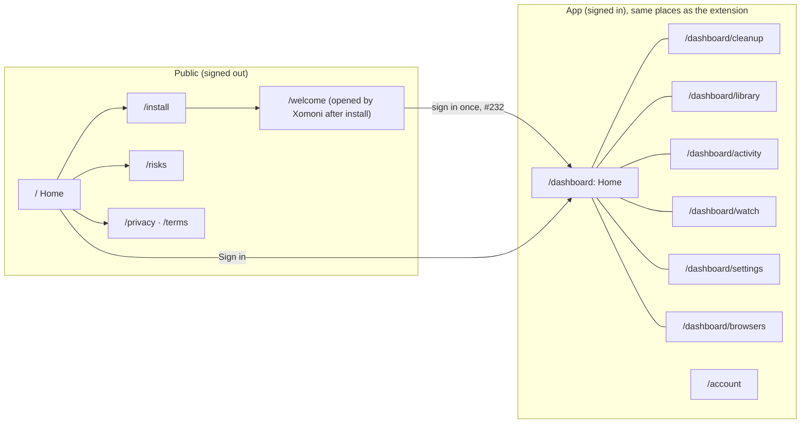

[فارسی](UX-REVIEW-WEBSITE-2026-11-17.fa.md)

# xomoni.com UX review: structure and journeys

> The website's structure as the people who come to it meet it, and what Phase 16 changes. Reviewed on 17 November 2026, on `main` after [#236](https://github.com/pirdehi/xomoni/pull/236) (one sign-in). The public pages were checked on xomoni.com on desktop and phone, in light and dark. The signed-in pages were checked from their code.
>
> The page-by-page defects (wrong numbers, the old screenshot, words that differ from the extension, the duplicated account menu) are in [#239](https://github.com/pirdehi/xomoni/issues/239), fixed by [#241](https://github.com/pirdehi/xomoni/pull/241) (Phase 15), and are not repeated here. This review is about the structure: what the site is made of, how people move through it, and how it becomes one product with the extension ([Phase 14](../../ROADMAP.md#phase-14--one-xomoni-the-website-and-the-extension-together)).

## Who comes to xomoni.com, and why

| Visitor | Usually on | Comes to | Leaves with |
| --- | --- | --- | --- |
| **Someone deciding** whether to trust Xomoni, from a link or a post | Phone | Understand what it does, and whether it is safe | A reason to try it on their computer, or not |
| **A new user** setting it up | Computer | Install, create an account, connect | A working Xomoni, signed in on both sides |
| **A user checking in** on a running cleanup | Phone, another computer | See whether all is well, and whether X needs them | Peace of mind, or the one thing to do |
| **A user at their computer** (after Phase 14) | The browser with Xomoni | Everything the extension shows, plus settings and planning | The same product as in the extension |

Today the site serves the first visitor on a computer well. It serves the other three only partly.

## What gets in the way

### 1. The website and the extension look like two products

- **Two different structures.**
  - The extension has six places in a sidebar: *Home*, *Cleanup*, *Library*, *Activity*, *Watch* and *Settings*.
  - Signed in, the website has one long *Dashboard* page and an *Account* page. Nothing on the website matches a place in the extension.
- **The dashboard is one column of everything.** One page holds:
  - the account bar;
  - *Needs you*;
  - the X accounts' risk;
  - jobs;
  - connected browsers;
  - the pairing panel.
  There is no navigation between parts, and the page will only grow once Phase 14 adds Library, Watch and Settings.
- **The pages Phase 14 adds have no home yet.** #233 to #235 need an app shell first: navigation, addresses, and what each page shows when the extension isn't in this browser.

### 2. The landing page tells last week's story

- ***Extension + website*** says the website is *View only* and that connecting takes a one-time code. Phase 14 makes the website the place to see and plan everything; #232 made sign-in one step. The section needs a new message: *plan anywhere, run in your browser*.
- **Two stories about risk.**
  - The hero promises a pace *X accepts*, and *Safety* says *Works with X's protections*.
  - The install guide says automating actions *is against X's rules*, and the Risks page says an account can be limited or suspended.
  - A careful visitor who reads both stops trusting either. One honest line near the top, with the Risks page one click away, keeps the trust the rest of the page builds.
- **It is long, and it explains the problem before the product.**
  - Eight sections: about 6,200 px on a computer, about 8,400 px on a phone.
  - *Why it's hard* comes before *How it works*, so the product appears in the fourth screen on a phone.
  - The three pacing figures repeat what *Safety* says.

### 3. On a phone, the site runs into dead ends

- **No menu.** Below 768 px, the header shows only the logo and *Sign in*. *How it works*, *Safety*, *Privacy* and *Install* can only be reached by scrolling.
- **The first button can't be used on a phone.**
  - *Get the extension* is the primary action, but Xomoni installs only on a computer.
  - Nothing helps the person bring the link to their computer, such as sharing it, copying it or sending it to themselves.
- **The product picture can't be read.** At phone width the dashboard screenshot is about 350 px wide, and its words are 3 px tall.

### 4. Getting started has no thread

From the home page, a new user goes through four places:
1. **/install:** four steps, the zip.
2. **The extension**, which opens its own dashboard.
3. **/signup:** email confirmation, then the dashboard.
4. **The dashboard:** its *Connect your browser* panel.

Two things make this harder than it needs to be:
- **None of these pages knows how far the person has come.**
  - The install page doesn't notice that Xomoni is installed.
  - Sign-up doesn't come back to where it started: it ignores `next`, so `/connect` falls back on a notice on the dashboard.
- **The website learns the extension's id only when the extension opens one of its pages** (`#ext=`). Right after installing, the extension opens its own dashboard, not xomoni.com. So the site can't greet a new install, and one sign-in (#232) can't start at the moment it is most useful.

### 5. Small structural gaps

- **No *Install* in the header.** On a computer, the visitor scrolls back to the hero to find it.
- **The footer has four links:** *Risks*, *Privacy*, *Terms* and *GitHub*. Missing are *Install*, the releases (*What's new*), support (GitHub issues) and *Security* (`security.txt`, SECURITY.md).
- **The account menu and the dashboard's account bar repeat each other** (#239). In the app shell, the account belongs in one place only.
- **The site is in English only.** The first users and the maintainer's network are largely Persian speakers. Persian would mean a right-to-left layout and a translation workflow. This is the maintainer's decision.

## What stays

- **The hero's promise:** no password, no API keys, runs in your browser.
- **The *Always / Never* lists and the privacy split:** *Stays on your computer* / *Synced when you sign in*.
- **The install guide:** it starts with the risks and shows checksums and provenance.
- **The sign-in card:** calm, one task, Google next to email, and a clear note that this is not the X account.
- **The craft:** Fluent everywhere, a real dark mode, no layout shift, and a strict CSP with Trusted Types.

## The proposed structure



- **Public site.**
  - Header: *How it works · Safety · Privacy · Install*, then *Sign in*. Below 768 px, a menu button opens the same links.
  - Footer: *Install · What's new · Risks · Privacy · Terms · Security · Support · GitHub*.
- **App shell.**
  - The extension's places, by the same names and in the same order: *Home, Cleanup, Library, Activity, Watch, Settings*. *Browsers* sits under them.
  - Desktop: a left sidebar, as in the extension.
  - Phone: a bottom bar with *Home, Activity, Library* and *More*.
  - The account menu holds the account and sign-out, and nothing else repeats them.
- **What each page shows, by where it is opened.** X content reaches the website only in the same browser, from the extension (ADR-0004, #233).

  | Page | In the browser with Xomoni | On another device |
  | --- | --- | --- |
  | Home | Live status and the next step, from the extension | Status from the cloud: jobs, *Needs you*, risk |
  | Activity | Jobs and the log | Jobs (from the cloud) |
  | Cleanup | Plan it here; *Start in Xomoni* (#235) | Plan it here; it waits for Xomoni on your computer |
  | Library, Watch | From the extension | *Open on the computer with Xomoni*, naming that browser and when it was last seen |
  | Settings | Applied in Xomoni (#234) | Applied the next time that browser reports (#234 decides) |
  | Browsers | Connected browsers, this one marked | Same |

- **Getting started is one guided path.**
  - Right after installing, the extension opens `xomoni.com/welcome#ext=<id>`, besides its own dashboard. The website then knows Xomoni is here.
  - The welcome page offers sign-in or a free account. One sign-in (#232) signs the extension in too.
  - *Continue without an account* closes the tab: the account stays optional.
  - The same checklist (installed ✓, signed in ✓, X window open) shows on `/install`, `/welcome` and an empty dashboard. Each step is ticked from what the site can see.
  - Sign-up keeps `next`, so `/connect` and `/welcome` come back to themselves after the email link.

```
Desktop, signed in                            Phone, signed in
┌───────────┬───────────────────────────┐     ┌──────────────────────┐
│ Xomoni    │ Home              [⚙ me ▾]│     │ Xomoni       [me ▾]  │
│           │ ┌───────────────────────┐ │     │ ┌──────────────────┐ │
│ ⌂ Home    │ │ All is well · next:    │ │     │ │ All is well      │ │
│ ✦ Cleanup │ │ “Old replies” 62 %     │ │     │ │ Old replies 62 % │ │
│ ▤ Library │ └───────────────────────┘ │     │ └──────────────────┘ │
│ ⟲ Activity│ Needs you · Risk · Jobs   │     │ Needs you · Jobs     │
│ ⌕ Watch   │                           │     │                      │
│ ⚙ Settings│                           │     ├──────────────────────┤
│ ▭ Browsers│                           │     │ ⌂  ⟲  ▤  ⋯          │
└───────────┴───────────────────────────┘     └──────────────────────┘
```

## Phase 16 · xomoni.com, one product

Each task has its issue and tests on both sides, and builds on #241.

1. **Header and footer** ([#242](https://github.com/pirdehi/xomoni/issues/242)). A phone menu, *Install* in the header, and the full footer.
2. **The landing page for one Xomoni** ([#243](https://github.com/pirdehi/xomoni/issues/243)):
   - the new *Extension + website* message;
   - one honest risk line near the top, linking to the Risks page;
   - *How it works* first and the sections shortened;
   - a picture that reads on a phone;
   - on a phone, *Send to my computer* (share or copy the link) instead of an install button.
3. **Getting started** ([#244](https://github.com/pirdehi/xomoni/issues/244)):
   - `/welcome`, opened by the extension after it is installed, with an amendment to ADR-0024 or ADR-0025 for the page it opens;
   - one checklist that ticks itself;
   - sign-up keeps `next`.
4. **The app shell** ([#245](https://github.com/pirdehi/xomoni/issues/245)): the extension's places on the website, desktop sidebar and phone bottom bar, and the per-device table above. #233 to #235 fill it.
5. **Language** ([#246](https://github.com/pirdehi/xomoni/issues/246), the maintainer's decision): Persian, right-to-left, or English only.
